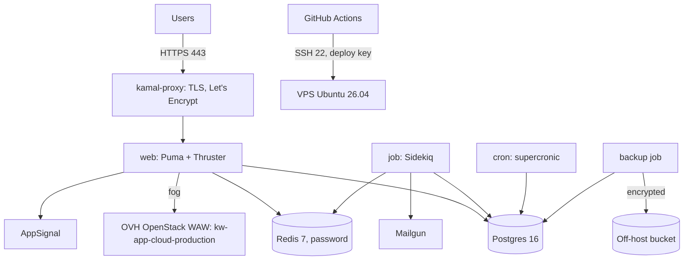

# New Production Implementation Plan

Status: **PLAN ONLY, nothing below has been applied to the new VPS.** Written 2026-11-17 on branch `develop`.

Goal: move kw-app from the old native server (`51.68.141.247`) to the new OVH VPS (`51.255.38.227`) running Kamal + Docker, with a hardened host, working background jobs and cron, tested backups and a rehearsed, reversible cutover.

Related: `.rules` section 14 (hosts), `.agents/skills/prod-db-restore` (1:1 DB restore + verify), `.agents/skills/scp-transfer` (fetching the prod dump), `.agents/skills/bws-secrets` (secrets, rotation backlog), `.agents/skills/kamal-deployment`.

Legend: **[V]** verified on a real host or in the repo on 2026-11-17, **[R]** recommendation, **[?]** open question that needs a decision or investigation, **[ASK]** needs explicit user approval first (`.rules` section 8).

---

## 1. Current state

### 1.1 Old production `51.68.141.247` [V] (read-only)

| Item | Value |
|------|-------|
| OS / size | Ubuntu 20.04.6 (EOL standard support), 1 vCPU, 2 GB RAM, 20 GB disk at 84% |
| Shared host | Also runs PHP-FPM, MariaDB, ~9 other nginx sites, PostgreSQL 10 **and** 12 |
| App runtime | Ruby 2.6.6 (rbenv), nginx + Passenger, Capistrano-style `releases/` |
| Public host | `panel.kw.krakow.pl` (nginx `server_name`, Let's Encrypt via Certbot) |
| Background jobs | systemd `sidekiq.service`, queues `default` + `mailers`, native Redis with password |
| Cron | 10 jobs from `config/schedule.rb` (whenever), run from the user crontab |
| Backups | 03:15 `kw-db-backup` runner, 7-day local retention, **off-host copy is in ERROR** |
| Local files | `shared/public/uploads` 1.7 GB = **only CarrierWave's stale `tmp/` cache, not needed** (section 3.1). Real files are in OpenStack |

### 1.2 New production `51.255.38.227` [V]

| Item | Value |
|------|-------|
| Provider | OVH VPS, created 2026-11-17, hostname `vps-fb065f1c` |
| OS | **Ubuntu 26.04 LTS (codename `resolute`)**, kernel 7.0, brand new release |
| Size | 2 vCPU, 3.8 GB RAM, 38 GB disk, no swap, IPv4 + IPv6 |
| Access | `ubuntu` with our key only (`SHA256:cVosxEG...`, verified, exactly 1 key in `authorized_keys`), passwordless sudo |
| Docker | **Not installed** |
| Firewall | UFW installed but **inactive**; listening only on `:22` |
| SSH | Password login **still enabled** (`50-cloud-init.conf` sets `PasswordAuthentication yes` and wins over `60-cloudimg-settings.conf`) |
| fail2ban | Not installed; unattended-upgrades active; chrony/NTP synced; AppArmor loaded (178 profiles) |
| Docker packages | Official repo `download.docker.com/.../resolute` returns 200; Ubuntu archive also has `docker.io` 29.1.3 |

### 1.3 Staging `pi5main.local` [V]
Kamal `web` role + `kw-app-staging-postgres` + `kw-app-staging-redis`. **No Sidekiq and no cron are deployed there.** Also hosts unrelated apps. Note: containers `kw-app-postgres` / `kw-app-redis` (no `staging`) also exist on the Pi. Check what they are before using the `new-prod` restore profile anywhere near the Pi.

---

## 2. Gaps found in the repo (must be closed before cutover)

| # | Finding | Evidence | Impact | Fix (phase) |
|---|---------|----------|--------|-------------|
| G1 | **No Sidekiq role** in Kamal. Old prod runs `sidekiq.service`; 32 files enqueue jobs (`deliver_later`, `perform_async`) | `config/deploy*.yml` have only `servers.web`; `Procfile` is unused by Kamal | Mail, reminders, payments follow-ups would pile up in Redis and never run | P4 |
| G2 | **No cron** for the 10 whenever jobs | `config/schedule.rb`; nothing in Kamal | Prepaid e-mails, reminders, sign-up cleanup, yearly fee never run | P4 |
| G3 | **Hostname mismatch**: live host is `panel.kw.krakow.pl`, Kamal/Rails use `nowypanel.kw.krakow.pl` | nginx on old prod vs `deploy.production.yml`, `production.rb` (`default_url_options`, route host) | Links in e-mails, Dotpay/Strava/Mailgun callbacks and inbound `reply+...@panel.kw.krakow.pl` depend on the host | Decision D1 |
| G4 | `proxy.ssl: true` makes kamal-proxy **stop forwarding `X-Forwarded-*`**, and `force_ssl` is **commented out** | Kamal proxy docs; `production.rb` line 55 | App does not know it is on HTTPS (cookies, redirects, URL helpers); enabling `force_ssl` without `forward_headers: true` causes a redirect loop | P4 |
| G5 | `app_port: 3000` bypasses **Thruster** (it listens on 80 and proxies to 3000) | `Dockerfile.production` CMD `thrust ...`, `deploy.yml` `app_port: 3000` | Thruster compression/asset caching unused. Harmless but misleading | P4 |
| G6 | `config/init.sql` runs `CREATE DATABASE kw_app_production` while `POSTGRES_DB` already creates it | `deploy.production.yml` accessory | Postgres init script runs with `ON_ERROR_STOP`, so first boot of the accessory **will likely fail**. Verify on a scratch container, then drop the file | P4 |
| G7 | Custom Docker network `kw-app-network` is referenced by app and accessories but **Kamal does not create it** | `options.network` in all deploy files | `kamal setup` fails on a clean host | P2 (create it) |
| G8 | Redis URLs: Sidekiq initializer needs `REDIS_URL_SIDEKIQ` (or `credentials.redis.url`); Action Cable needs `REDIS_URL` | `config/initializers/sidekiq.rb`, `config/cable.yml` | Falls back to `localhost` inside the container, jobs and cable silently break | P4 (set in `env.clear`, verify without printing credentials) |
| G9 | Upload **cache** is written under `public/uploads/tmp` (default), publicly servable, 1.7 GB of stale files on old prod, and 8 `.php` probe files; uploaders have no extension allow-list | section 3.1, `app/uploaders/*` | Public exposure of cached uploads, disk growth, accepted dangerous extensions | P4 (cache dir under `tmp/`, allow-lists) |
| G10 | `log_level :debug` in production, no Docker log rotation | `production.rb` line 59 | Disk fills, noisy logs with PII | P4 / P2 |
| G11 | Production workflow: secret written with `echo "${{ secrets... }}"` (script injection pattern), `cat` of `known_hosts` and `ssh/config`, `ssh-keyscan` at deploy time (trust on first use), 5 of 7 bws values not `::add-mask::`ed, `gem install kamal` unpinned (lockfile has 2.10.1), actions not pinned, no environment protection | `.github/workflows/deploy-production.yml` | Secret leakage / MITM / supply-chain risk | P3 |
| G12 | **Ruby part FIXED on `develop` 2026-11-17: 3.2.2 -> 3.2.11** (see P0.1 for what changed). Rails **7.0.10** (EOL 2025-04-01) is still open (Phase U). Was: Ruby **3.2.2** (EOL 2026-03-31, latest 3.2.11), base image `ruby:3.2.2-slim` unpatched | `.ruby-version`, `Gemfile.lock`, `Dockerfile.production`; endoflife.date | Unpatched CVEs on an internet-facing app | P0 (patch bump) + separate upgrade track. **Phase U deferred until after the cutover (owner, 2026-11-18)**: new prod starts on Ruby 3.2.11 (already EOL since 2026-03-31, last patch) and Rails 7.0.10 (EOL 2025-04-01); see the risk rows in section 6 |
| G13 | No CI security gates besides tests (`brakeman` is in the Gemfile, no `bundler-audit`, no `rack-attack`) | `Gemfile`, `.github/workflows/test.yml` | No automated dependency/CVE checks, no app-level rate limiting on login | P3 / P4 |
| G14 | Sidekiq Web is mounted at `/sidekiq` behind `authenticate :user, admin?` | `config/routes.rb` | OK, keep. Do not expose any other admin surface | none |
| G15 | Registry creds are one account for push and pull; the server stores the pull token in `~/.docker/config.json` | Kamal registry login | Compromised host leaks push rights | P3 (scoped Docker Hub token) |
| G16 | **FIXED on `develop` 2026-11-17 (specs `sign_up_operations_spec`, `dry_monads_includes_spec`). `Charity::CreateDonation` was wrongly listed: it `require`s the deprecated `lib/` Result and works, so 7 classes were fixed.** `develop` regression: 5 cron/Sidekiq-path operations call `Success(...)`/`Failure(...)` with no `Dry::Monads` include** (`FillEmptyPlaces`, `DestroySignUp`, `OpenConversation`, `AddToConversation`, `SendEmailWithPayment`; also `Training::Questionare::SnwProfileService`, `Events::Competitions::SignUps::Destroy`, `Charity::CreateDonation`). Commit `8e4151f7` renamed `Left/Right` to `Failure/Success` and dropped `include Dry::Monads::Either::Mixin`. `master` still has the include | verified in the app container: `respond_to?(:Success, true)` is `false` for all five; none of them has a spec | Every course waitlist fill, conversation open and sign-up destroy (cron **and** admin UI) raises `NoMethodError`. `DestroySignUp` raises **after** `sign_up.destroy` and the mail enqueue | Appendix A.4, fix on `develop` with specs before staging soak |
| G17 | **FIXED on `develop` 2026-11-17 for the 3 `expired_sign_ups` repositories (two chained `where.not`, specs added); the 25 affected activities statistics queries are FIXED in the working tree 2026-11-19 (A.4 #3 DONE, see the log line of that date).** Rails 6.1 changed `where.not(a: nil, b: nil)`** from `a IS NOT NULL AND b IS NOT NULL` to `NOT (a IS NULL AND b IS NULL)`. `expired_sign_ups` uses it in 3 repositories (training, business, events) | `SignUpRecord.where.not(sent_at: nil, expired_at: nil).to_sql` on Rails 7.0.10; old prod runs Rails 5.2.3 | On old prod `destroy_expired_sign_ups` never touches rows with `sent_at IS NULL`. On Rails 7 it selects **424 unpaid training sign-ups (219 distinct e-mails, created 2019-2025, all for past courses)**, deletes their payments, destroys them and sends each person a "sign-up deleted" mail. Also 4 business sign-ups. The same shape (`mountain_routes: { id: nil, length: nil }`, 25 places in the activities repositories) changed the meaning of the leaderboards (data impact in the 2026-11-19 log line) | Appendix A.4: rewrite as two chained `where.not` calls + specs **before** any cron runs on new prod; activities queries done in A.4 #3 (2026-11-19) |
| G18 | **Code FIXED in the working tree 2026-11-18 (A.4 slice 1: `Healthchecks::Monitored`, ping key + slug, `/fail` on error, timeouts; checks in healthchecks.io still to create).** 14 hardcoded `hc-ping.com` / `hchk.io` URLs in `lib/tasks/periodic.rake` (+2 in `Management::Voting::Reminder`); pings are sent on **enqueue**, not on job success; `Net::HTTP.get` has no explicit timeout | `lib/tasks/periodic.rake` | Running any task on staging/dev pings the **production** monitor; anyone with the URL can fake a heartbeat; monitor says "OK" even when the Sidekiq job later fails | Appendix A.5 |
| G19 | **FIXED on `develop` 2026-11-17** (`value: ...to_s`; the same bug was also in `reactivation.html.slim`; request spec). **`develop` regression: the public application form `/zgloszenie` returns 500** (`undefined method 'strftime' for "":String`, `app/views/profiles/_form.html.slim:44`, `date_field` on a blank-string `birth_date`; Rails 7.0 stopped tolerating `""`) | Reproduced on staging (smoke check B-PRO-2) | New members cannot apply through the legacy form, which is the URL the club links to (`get 'zgloszenie' => 'profiles#new'`). The v2 form `/v2/profiles/new` works | Fix on `develop` with a request spec (default `birth_date` to `nil` / use `value:`), before the rehearsal |
| G20 | **FIXED on `develop` 2026-11-17** (`gutter: 0`; mailer spec). **Prawn 2.2.2 -> 2.5.0: `define_grid(columns:, rows:)` without a gutter raises** `TypeError: can't convert nil into Float` (2.2.2 did `nil.to_f`, 2.5.0 uses `Float(nil)`) | `ProfileMailer#apply` (`profile_mailer.rb:44`) and `app/views/profiles/show.pdf.prawn:2`; reproduced on staging (B-PRO-6) | Admin button "send application e-mail with payment link" (`Admin::ProfilesController#send_email`) fails; profile PDF download fails | Add `gutter: 0` (identical to 2.2.2 behaviour), spec that renders the PDF |
| G21 | **FIXED on `develop` 2026-11-17**: the `visiting_card` route was removed. On old prod the main `profiles` routes win (verified with `curl`: `/profiles/reactivation` 200, `/profiles/new` 200, `/profiles/1` 404), so the visiting-card page was never reachable there either; `VisitingCard::ProfilesController` is now unused (routing spec). **`/profiles/reactivation` is unreachable on `develop`**: `custom_endpoints.rb` draws `scope module: 'visiting_card' { resources :profiles, only: :show }` first, so `/profiles/reactivation` routes to `visiting_card/profiles#show` with `id=reactivation` (RecordNotFound -> redirect to `/`). The legacy `ProfilesController#show` (PDF) is shadowed the same way | `Rails.application.routes.recognize_path('/profiles/reactivation')` on staging (B-PRO-3). `master` has no `visiting_card` | Lapsed members cannot reactivate | Constrain the visiting-card route (`id: /\d+/`) or draw it after the profile collection routes; decide whether the PDF `show` is still wanted |
| G22 | **FIXED on `develop` 2026-11-17** (un-nested the `to_prepare`; initializer spec). **`develop` regression: the Mailboxer extensions never load.** `config/initializers/mailboxer.rb` wraps everything in `Rails.application.config.to_prepare { ... }` (commit `1855626c rails70`) and has a **second, nested** `to_prepare` inside it. A `to_prepare` registered while the prepare callbacks are already running is never executed when classes are not reloaded (staging/production). So `Mailboxer::Conversation#sign_ups`, `#courses`, `#conversation_items`, `set_code` and `Mailboxer::Message#create_notification` are **not defined** | Staging: `reflect_on_association(:sign_ups)` and `(:courses)` are `nil`; the new-message e-mail template raises `undefined method 'sign_ups'`; inbound reply `POST /email_processor` raises `undefined method 'courses'` (B-MAIL-5, B-MSG-3). `master` has the unwrapped file | Every e-mail notification of a new message/reply, every reply-by-e-mail and the course/business conversation features fail | Remove the nested `to_prepare` (keep one), add a spec that asserts the associations exist, re-run B-MAIL-5 |
| G23 | **Dotpay status callback is unauthenticated** (`POST /api/payments/status`): no `signature`/PIN check, no IP allow-list; it trusts `control` + `operation_status` from the request. Reproduced: an anonymous request with a bogus `signature` marked a payment `prepaid` (B-PAY-4). An unknown `control` raises `NoMethodError: undefined method 'paid?' for nil` (500, B-PAY-3). The app also holds no Dotpay PIN secret, and `PaymentRequest` disables TLS verification (`VERIFY_NONE`) | `app/services/payments/dotpay/{notification,status,payment_request}.rb`, staging smoke test | Anyone who learns a payment's `dotpay_id` (sent to Dotpay as `control` in every payment link, so very likely visible to the payer; to be confirmed) can mark it paid (fees, trainings, donations). Same on old prod, so it is not a migration regression, but the migration must not make it worse | **Decision 2026-11-17: fix on the new prod server, not before; do not forget.** Owner: Rafal; trigger: right after the cutover is stable (P9), before any Dotpay traffic is considered safe. Fix: nil-safe lookup now; signature verification (needs the Dotpay PIN from the Dotpay panel, then a new bws secret) + `VERIFY_PEER`. Confirm the signature algorithm in Dotpay's current documentation before implementing |
| G24 | Authorization gaps found by **reading code, not executed** (a call would reach Dotpay or Strava): `PaymentsController#refund` has no authorization or login check (any visitor with a CSRF token can request a refund of any payment id); `Api::StravaActivitiesController#index/#create` are open (`index` reads Strava activities of any `user_id`, `create` enqueues a sync job); `EmailCenter::Api::EmailsController#delivered` is unsigned (anyone can mark e-mails delivered) | `app/controllers/payments_controller.rb`, `app/components/training/activities/api/strava_activities_controller.rb`, `app/components/email_center/api/emails_controller.rb` | Money and personal-data exposure. Identical on old prod | Backlog after cutover (`authorize!`/`authenticate_user!` + Mailgun webhook signature); verify with a harness scenario using a stubbed HTTP layer |
| G25 | **`develop` regression: ActiveJob runs on the in-process `:async` adapter in staging and production.** `master` sets `config.active_job.queue_adapter = :sidekiq` in `config/application.rb`; the Rails 6.1 upgrade commit `9fc768e5` dropped it, so every `deliver_later` / `perform_later` runs inside the Puma process (lost on restart, no retries, no Sidekiq UI) and the separate Sidekiq process never sees them | `config/application.rb` on `master`, `config/environments/{staging,production}.rb` | Mail and jobs silently bypass Sidekiq | **FIXED in the working tree (staging.rb, production.rb); smoke check B-INF `ActiveJob adapter is :sidekiq`** |
| G26 | **CI `Test Suite` failed at "Set up Ruby"**: `ubuntu-latest` became Ubuntu 26.04 and `ruby/setup-ruby` has no Ruby 3.2.2 build for it (only 3.2.11) | `.github/workflows/test.yml`, `deploy-production.yml` | Red CI on every push | **FIXED: Ruby 3.2.11 everywhere, `ubuntu-latest` kept.** A second CI failure appeared once Ruby installed: `appsignal` 4.3.1's C extension does not compile with the GCC 15 of Ubuntu 26.04 (C23 default); the job sets `BUNDLE_BUILD__APPSIGNAL=--with-cflags=-std=gnu17` (reproduced and verified in a container). Drop it when appsignal is upgraded in Phase U. CI is independent of the VPS OS: the app runs in a Docker image (`ruby:3.2.11-slim-bookworm`); the VPS (Ubuntu 26.04) only hosts Docker |
| G27 | Staging Redis accessory existed but nothing used it: the Sidekiq initializer had a staging special case, the web container had no `REDIS_URL_SIDEKIQ`, and there was no `job` role. Staging also holds **real member e-mail addresses** now, so a running Sidekiq on staging must never send mail | `config/deploy.staging.yml`, `config/initializers/sidekiq.rb`, `config/environments/staging.rb` | Jobs never ran on staging; once they run, real members could be mailed | **FIXED in the working tree:** `job` role, `REDIS_URL_SIDEKIQ` + `REDIS_PASSWORD` wired, initializer reads env first; staging delivers mail to `tmp/mails` (`:file`) unless `STAGING_REAL_MAIL=true` |
| G28 | **Redis accessory is not protected by the secret.** The accessory command is `sh -c 'redis-server --requirepass "$$REDIS_PASSWORD" ...'`. Kamal hands this string to the container shell, where `$$` is the shell's **PID**, not an escaped `$`. Redis therefore runs with the password `1REDIS_PASSWORD` (PID 1 + the literal variable name), a guessable value that has nothing to do with the bws secret. Found when the new staging `job` container got `WRONGPASS`. Staging also publishes Redis on `6381` on the Pi | `config/deploy.staging.yml`, **`config/deploy.production.yml` line 59 (same typo)** | On new prod an attacker on the Docker network (or anyone, if the port were published) would have an authenticated Redis; Sidekiq could not connect with the real secret | **Staging FIXED (single `$`, `kamal accessory reboot redis -d staging`, data volume kept, job worker connects).** Production: fix in P4 together with the other deploy-config gaps (ask first), and verify with a `PING` using the secret and a failed `PING` with the old guess. Do not publish Redis ports on new prod |
| G29 | **`master` (live old prod, Capistrano) is still receiving commits that `develop` does not have.** On 2026-11-18 `git cherry origin/develop origin/master` shows **27 commits** not matched by patch id (trad league UI, climb styles, user gender sync, photo lightbox, ESP flag, `page.php`/`szkolaalpinizmu` helper commits, ...). At least one was re-applied on `develop` with a different SHA (photo competition: `f9500dc6` on `master` = `f0ec208e` on `develop`), so patch-id alone over-counts. `main` is a third, stale branch (last commit 2026-01-23; 2 commits not on `develop`: a merge and `Update deploy-production.yml`) | New prod would silently lack features and fixes that old prod has at cutover | Before P7: review the 27 commits by content (`git cherry -v origin/develop origin/master`), port the app ones to `develop` with specs, mark the PHP-site/skill ones as not applicable. From T-7 hotfixes on `master` are cherry-picked to `develop` the same day. Gate: `git cherry` shows no unreviewed commit at P8 **CLOSED 2026-11-18: `master` merged into `develop` (commit `1e48243a`, deployed to staging), visual content review skipped by the owner, `master` frozen. See the execution log** |

---

## 3. Decisions (answered 2026-11-17)

| ID | Decision | Answer | Consequence for the plan |
|----|----------|--------|--------------------------|
| D1 | Final public hostname | **`panel.kw.krakow.pl`**, but it stays on **old prod until the flip**. | New prod is rehearsed on a temporary name (`nowypanel.kw.krakow.pl`). At cutover `panel` DNS moves. Deploy config switches to `panel` only in the cutover change. |
| D2 | Upgrade first or migrate first | **Upgrade first: do as much as possible before the migration so we test once.** | New Phase **U** (Ruby/Rails upgrade) runs in parallel with the infra phases and must finish before the single rehearsal phase P7. Reverses my earlier recommendation, see 5.U for the trade-off. **REVISED 2026-11-18 (owner): migrate first, upgrade after.** The cutover happens on **Ruby 3.2.11 / Rails 7.0.10** (the 5.U fallback becomes the plan); Phase U runs afterwards on the new host, one hop at a time, with the P7 rehearsal stack as the soak environment. Reason: keep the migration small and testable; the infra, backups and restore chain do not depend on the app version. |
| D3 | Local `public/uploads` | **Investigated: stale, not needed** (see 3.1). | No volume, no rsync, nothing to migrate. Fix the cache location and add upload allow-lists instead (P4). |
| D4 | Off-host backup target | Not decided, asked for the simplest. | **OVH Object Storage (S3) + restic**, see 3.2. |
| D5 | SSH exposure | Asked what is better. | **Key-only SSH on 22 + fail2ban now**; optional step to close 22 behind Tailscale later, see 3.3. |
| D6 | Cutover window / old prod | **Agreed**: weekend early morning (avoid 04:15-04:45 cron slot), keep the **panel app** on old prod intact but stopped for 14 days. **Do not wipe or cancel the VPS**: the other sites on it belong to another developer and stay as they are (decided 2026-11-18, Appendix D.6). | As written in P8/P9. |

### 3.1 Uploads investigation (D3) [V, read-only on old prod]
- `shared/public/uploads` contains **only `tmp/`**: 2001 files, 1.7 GB, i.e. CarrierWave's default **cache directory**. No `csv/` or any store directory exists.
- Every mounted uploader inherits `ApplicationUploader` with `storage :fog` (OpenStack), so rendering reads files from `kw-app-cloud-<env>`, never from local disk. The only `storage :file` uploader is `CsvUploader`, used directly by `Admin::ImportingController` (not mounted on a model, nothing persisted).
- Age: 1992 of 2001 files are older than 30 days, 1512 older than a year (oldest 2024-02-05). Content is leftover originals/thumbnails/PDF invoices from uploads whose permanent copy lives in OpenStack.
- **Conclusion: stale cache, not needed for rendering. Do not migrate.** `shared/public/system` is empty, `assets` (34 MB) is rebuilt by the image.
- **Security finding:** 8 files with a `.php` extension sit in that cache (`test.php` x4 from 2024, `hello.php` 2025-03, `template.php` x2 and `doc.php` 2025). Names/sizes only were read, never the content. They look like upload-form probes or web-shell attempts. They are served as static text by nginx (the `panel` vhost has no PHP handler), so likely harmless today, but it proves an upload endpoint accepts arbitrary extensions. Action items for P4:
  1. add an extension/content-type **allow-list** to `ApplicationUploader` (and a per-uploader list where images only are expected);
  2. move CarrierWave `cache_dir` **out of `public/`** (e.g. `Rails.root.join('tmp/uploads')`) so cached uploads are never publicly served;
  3. find which authenticated/unauthenticated form accepted them (nginx access logs on old prod for `/uploads/tmp/*.php`, read-only) and tell the user, since it may be a membership/PII incident to assess.

### 3.2 Backup target (D4): my recommendation and why it is simplest
**OVH Object Storage (S3 API) with `restic`.**
- You already use OVH Public Cloud (OpenStack, region WAW) for uploads, so no new vendor/account/billing. Create one bucket + one S3 user limited to that bucket.
- `restic` = one static binary: client-side encryption, dedup, retention (`forget --keep-daily 7 --keep-weekly 4 --keep-monthly 6`), integrity `check`. The DB is ~90 MB raw so cost is cents per month.
- Credentials and the restic password live in bws (`kw-app-production-restic-password`, `...-backup-s3-*`), not on disk beyond a root-only env file.
- Put the bucket in a **different OVH region/project from the VPS** than the live data where possible, and **store the restic password also outside the VPS** (bws is that copy; a lost restic password means unrecoverable backups, so keep a break-glass copy too, C.7.2).
- Optional second copy: have the Pi at home **pull** the encrypted dumps over SSH with a restricted key. Adds nothing to the cloud bill, but the Pi is a single home device, so treat it as a bonus, not the primary.
- Rejected as more work: Backblaze B2 (new vendor), a second VPS (patching + cost), plain rsync without encryption (PII in the dump).

### 3.3 SSH exposure (D5): which is better
| Option | Security | Effort | Catch |
|--------|----------|--------|-------|
| A. Port 22 open, **key-only**, fail2ban, `AllowUsers`, limited tries | Good: no passwords to guess, ed25519 key, noise only | Low | Constant scan noise in logs; relies on key hygiene |
| B. SSH reachable **only over a private network** (Tailscale/WireGuard), 22 closed on the public IP | Best: nothing to scan or brute force | Medium: the GitHub runner must join the tailnet (ephemeral auth key via `tailscale/github-action`), your laptop too | Dependency; if the VPN or the OAuth app breaks, deploys stop (OVH KVM/console remains the break-glass) |
| C. Allow-list source IPs in UFW | Good | Low for laptop, **not workable** with GitHub-hosted runners (dynamic IPs) | Only if deploys move to your laptop or a self-hosted runner |

**Recommendation: A now** (it is what the rest of the plan assumes and is adequate for a key-only sshd), then **B as a follow-up hardening step** after the first successful production deploy, if you want zero public SSH. Decide B at the end of P3 and we adjust P1.

## 4. Target architecture



Principles: only 22/80/443 reachable from outside; Postgres and Redis only on the Docker network (no published ports); secrets only from bws at deploy time; every state-changing step has a rollback.

---

## 5. Phases

Order: P0 -> (P1, P2, P3, P4, P5, P6 in parallel where independent) -> P7 -> P8 -> P9 -> **U (after the cutover, decided 2026-11-18)**. P4's Kamal/Rails changes are made on the current code (Ruby 3.2.11 / Rails 7.0.10); U is described before P4 only for historical reasons.

Each phase has an exit gate. Do not start the next one until the gate is green. Items marked [ASK] need your approval at that moment.

### P0. Prerequisites in the repo (develop only, no server changes)
1. **DONE in the working tree 2026-11-17 (push pending): Ruby 3.2.2 -> 3.2.11.** Changed: `.ruby-version`, `Gemfile`, `Gemfile.lock` (`ruby 3.2.11p268`, no gem changes), `Dockerfile`, `Dockerfile.production`, the 3 workflows, docs/skills that mention `chruby 3.2.2`. Two traps found: (a) `ruby:3.2.11-slim` is **Debian 13 (trixie)**, `3.2.2-slim` was bookworm, so the base is pinned to `ruby:$RUBY_VERSION-slim-bookworm` (same OS as before; the OS change is a separate decision for Phase U); (b) bookworm's current `libxml2-dev` no longer pulls `zlib1g-dev`, and nokogiri 1.12.5 (lockfile platform `ruby`, always compiled) needs it, so `zlib1g-dev` was added to the apt list of both Dockerfiles. The full suite passes in Docker on 3.2.11 (435 examples). Local Kamal needs `ruby-install ruby 3.2.11` plus `bundle config set --local build.pg --with-pg-config=/opt/homebrew/opt/libpq/bin/pg_config` and `bundle install` (done on the laptop). The self-hosted staging runner compiles Ruby 3.2.11 with ruby-build on its first run (slow once, then cached).
2. [R] Add `bundler-audit` and a `brakeman` step to `.github/workflows/test.yml` (new gem = [ASK]).
3. Fix the code gaps that do not need the server: Sidekiq/cron roles drafted in a branch (P4), `force_ssl`, `config.hosts`, log level, `init.sql` check on a scratch Postgres 16 container.
4. [V] Uploads classified (section 3.1): stale CarrierWave cache, nothing to migrate. The 8 `.php` probe files are stale cache and can be deleted (decision 2026-11-17); the access-log trace is optional (`/var/log/nginx` is not readable by `deploy` on old prod, so it would need sudo). New prod never executes PHP and the uploader extension allow-list (G9) is fixed in P4.
5. [?] Inventory external callbacks bound to the host: Mailgun routes/webhooks (inbound `reply+...@panel.kw.krakow.pl`), Dotpay URLC/return URLs, Strava webhook subscription, any OAuth redirect URIs. List them with where each is configured. **Inbound mail finding (DNS, read-only, 2026-11-17):** `MX panel.kw.krakow.pl = mx.sendgrid.net`, so inbound replies are delivered by **SendGrid Inbound Parse** (POST to `/email_processor`, Griddler `:sendgrid` adapter), not Mailgun. `MX kw.krakow.pl` is Google; SPF includes `mailgun.org` (outbound). At cutover the Inbound Parse hostname URL for `panel.kw.krakow.pl` keeps working after the DNS flip as long as it points at the hostname, not an IP; confirm in the SendGrid panel (owner: club) before the rehearsal.
6. Rehearse the whole restore path on staging first (`prod-db-restore` skill, `staging` profile). Already rehearsed on a scratch DB; do the real one before touching new prod.

Gate: suite green, staging deployed on the patched Ruby, callback inventory written down.

### P1. Host hardening (Ubuntu 26.04) [ASK before each batch]
Order matters: **never close the current SSH session until a second, new session proves access.**

1. **Updates**: `apt update && apt full-upgrade`, reboot if `/var/run/reboot-required`. Add a 2 GB swapfile (box has none).
2. **Users**: keep `ubuntu` as the admin (sudo). Create `deploy` (no sudo, member of `docker` after P2, own key). `docker` group is root-equivalent, so only the deploy key and CI use it. Lock root password; keep `PermitRootLogin no`.
3. **SSH** via a drop-in that sorts first (`/etc/ssh/sshd_config.d/00-hardening.conf`), because the first value wins and `50-cloud-init.conf` currently enables passwords:
   ```
   PasswordAuthentication no
   KbdInteractiveAuthentication no
   PermitRootLogin no
   PubkeyAuthentication yes
   AllowUsers ubuntu deploy
   MaxAuthTries 3
   LoginGraceTime 20
   X11Forwarding no
   AllowAgentForwarding no
   ```
   Validate with `sshd -t`, then `sshd -T | grep -E 'passwordauthentication|permitrootlogin'`, reload (not restart), open a **new** session, only then close the old one.
4. **Firewall (UFW)**, IPv6 included (`IPV6=yes`): default deny incoming, allow `22/tcp` (use `ufw limit`), `80/tcp`, `443/tcp`. **Docker bypasses UFW for published ports**, so: publish nothing but kamal-proxy (80/443), do not publish Postgres/Redis at all, and add the `DOCKER-USER` chain rule set (ufw-docker pattern) as defence in depth. Verify from outside with `nmap -Pn` (laptop and one more network).
5. **fail2ban**: `sshd` jail with `backend = systemd` (Ubuntu 26.04 uses journald; the old Ansible playbook used `/var/log/auth.log`, which may not exist), `maxretry 4`, `bantime 1h` increasing, `ignoreip` = our fixed IPs.
6. **Automatic security updates**: `unattended-upgrades` (security pocket only), `Automatic-Reboot` at a quiet hour (e.g. 05:00 Sun) or use Ubuntu Pro Livepatch (free for personal use, up to 5 machines) and reboot manually. `needrestart` in automatic mode. **Revised 2026-11-18 (low-maintenance principle, C.4):** instead of excluding Docker from restarts, move `apt-daily-upgrade.timer` into a quiet window (drop-in, 03:30 Europe/Warsaw, small random delay; the Ubuntu default fired at about 07:26 Warsaw, i.e. when members are online) and enable Docker `live-restore` in P2 so a daemon restart does not stop containers. The weekly `kw-reboot-if-needed` timer (Sunday 05:00 Warsaw) is the safety net for kernel and library updates.
7. **Kernel/network sysctl** (`/etc/sysctl.d/90-hardening.conf`): `rp_filter`, `accept_redirects=0`, `send_redirects=0`, `tcp_syncookies=1`, `kernel.dmesg_restrict=1`, `kernel.kptr_restrict=2`, `fs.protected_hardlinks/symlinks=1`. Do **not** disable IPv4 forwarding (Docker needs it).
8. **Logging**: persistent journald with size cap (`SystemMaxUse=500M`), `auditd` with a small ruleset (**owner approved 2026-11-18, batch 3 part E**): watch `/etc/ssh/sshd_config` and `sshd_config.d`, `/etc/sudoers` and `sudoers.d`, `/etc/passwd`, `/etc/group`, `/etc/shadow`, `/var/run/docker.sock` and `/etc/docker`, rules in `/etc/audit/rules.d/kw.rules`, **not** made immutable. **Installed 2026-11-18 without the `/var/run/docker.sock` and `/etc/docker` watches (Docker is not installed yet: add `-w /etc/docker/ -p wa -k docker` and `-w /var/run/docker.sock -p wa -k docker` in P2) and without an `execve` rule for `deploy` (Kamal runs hundreds of commands per deploy, it would flood the capped log and cost CPU)** (`-e 2` would force a reboot for every rule change). Caps `max_log_file = 20`, `num_logs = 5`, `max_log_file_action = ROTATE` so it cannot fill the disk; read with `ausearch -k <key> -ts this-week`. Feeds C.10 (auth/SSH logs, 8 weeks). **No e-mail digest and no routine reading:** auditd is a forensic record, read with `ausearch` only during an incident.
9. **OVH side**: enable the VPS **automated backup / snapshot** option, record the KVM/console access path (this is your recovery if SSH breaks), verify reverse DNS/IPv6, enable OVH 2FA on the account.
10. **Acceptance**: run `lynis audit system` (or Ubuntu Security Guide, Ubuntu Pro) and keep the report; target hardening index >= 80 and zero "warning" on SSH/firewall.

Gate: password SSH rejected from outside, only 22/80/443 open on both IPv4 and IPv6, `fail2ban-client status sshd` active, second session test passed, snapshot taken.

**Execution log (new prod `51.255.38.227`)**
- **2026-11-18 batch 1 DONE** (approved by the owner after an OVH snapshot): `apt full-upgrade` (kernel 7.0.0-28 -> 7.0.0-43, 63 -> 6 pending; the 6 left are `distro-info`, `fwupd`, `libfwupd3`, `python3-distro-info`, `python3-software-properties`, `software-properties-common`, held back by phasing, check again in batch 2), `autoremove` (removed `pollinate`), 2 GB `/swapfile` + fstab entry, user `deploy` (uid 1001, no sudo, groups `deploy`,`users`, locked password) with the laptop key `id_main` (`SHA256:cVosxEGq1KeMtKf7ZFjdClkq0UNUf1SAooo1NJTX8WA`) as a **temporary** key until the dedicated CI/Kamal key replaces it (P3), then a reboot. Verified after reboot: kernel 7.0.0-43, `/var/run/reboot-required` gone, swap 2 GB active from fstab, `deploy` logs in by key and `sudo` is refused, no failed units, still only port 22 listening. Rollback was not needed. **Not done yet:** SSH hardening, UFW, fail2ban, Docker, sysctl, unattended-upgrades config, root password lock (batch 2+).
- **2026-11-18 pre-check for batch 2a (read-only):** `50-cloud-init.conf` (root-only, 27 bytes) sorts before `60-cloudimg-settings.conf` and keeps `PasswordAuthentication yes` effective; `sshd` is socket-activated (`ssh.socket` active, so `systemctl reload ssh` is the right call); `Include sshd_config.d/*.conf` is the first line of `sshd_config`, so a `00-` drop-in wins; **5,167 failed login attempts in 24 h** (internet scan noise, no successful foreign login: accepted were `ubuntu` x13 and `deploy` x1, all ours).
- **2026-11-18 batch 2a DONE** (owner approved, second `ubuntu` terminal kept open): wrote `/etc/ssh/sshd_config.d/00-hardening.conf` (`PasswordAuthentication no`, `KbdInteractiveAuthentication no`, `PermitRootLogin no`, `PubkeyAuthentication yes`, `AuthenticationMethods publickey`, `AllowUsers ubuntu deploy`, `MaxAuthTries 3`, `LoginGraceTime 20`, `X11Forwarding no`, `AllowAgentForwarding no`), `sshd -t` OK, `sshd -T` showed the intended values, `systemctl reload ssh` (no restart). Verified from new sessions: `ubuntu` and `deploy` log in by key; password-only attempt, `root` and an unknown user are all `Permission denied (publickey)`. Rollback not needed (would be: remove the drop-in, `systemctl reload ssh`). **Note for later:** a future `logpull` user (C.10.3.7) must be added to `AllowUsers`. **Next:** batch 2b (UFW + fail2ban).
- **2026-11-18 batch 2b part 1 DONE (UFW)** (owner approved; a 10-minute `ufw-failsafe` timer armed first, cancelled after verification): `default deny incoming`, `default allow outgoing`, `allow 22/tcp`, `80/tcp`, `443/tcp` with `IPV6=yes` (six rules: three v4, three v6), enabled at boot. **Deviation from P1.4:** plain `allow 22` instead of `ufw limit 22`, because `limit` (6 connections / 30 s per IP) can block Kamal's parallel SSH connections; brute force is handled by fail2ban (part 2). Verified from new sessions: `ubuntu` and `deploy` log in; 80 and 443 answer `connection refused` (allowed, nothing listens yet); 8080 and 5432 time out (dropped). IPv6 reachability could not be tested from the laptop (no IPv6), so v6 relies on the three `(v6)` rules in `ufw status`; re-test from a v6 network at P7 with `nmap -Pn -6`. Docker bypasses UFW for published ports: handled in P2 (DOCKER-USER rules, publish only kamal-proxy). **Next:** part 2 (fail2ban).
- **2026-11-18 batch 2b part 2 DONE (fail2ban 1.1.0)** (owner approved): installed from Ubuntu 26.04, `/etc/fail2ban/jail.d/10-kw-sshd.local`: `backend = systemd`, `banaction = nftables` (own table `inet f2b-table`, independent of UFW), `bantime 1h` with `bantime.increment` (factor 2, max 1 week), `findtime 10m`, `maxretry 4`, `ignoreip = 127.0.0.1/8 ::1 37.31.36.3` (owner's laptop IP as seen by the server; **review at the quarterly SSH review, it may change**), `[sshd] enabled`. Verified: config test OK; `fail2ban-regex` matched **5,219 real scan lines** from the journal; a real scanner (`45.148.10.152`) was banned within seconds of start; test ban of `192.0.2.1` appeared in `nft list ruleset` and was removed; laptop not banned and `deploy` still logs in. **Quirk:** right after the first start `fail2ban-client get sshd ignoreip` said 'No IP address/network is ignored' although the config dump had the entries; `fail2ban-client reload` fixed it and the three entries are now listed. After any future fail2ban restart, re-check `fail2ban-client get sshd ignoreip`. **Batch 2 complete.** Gate items 'password SSH rejected', 'only 22/80/443 open', 'fail2ban sshd active', 'second session test passed' are met; IPv6 outside test is pending (P7). **Next:** batch 3 (unattended-upgrades + needrestart, sysctl, journald limits, root password lock).
- **2026-11-18 batch 3 part A DONE (auto-updates and reboot timer)** (owner approved): read-only findings first: root password already locked (`passwd -S root` = `L`), `unattended-upgrades` already enabled with the security and ESM origins only, persistent `/var/log/journal` exists, no MTA on the box (so update mail reports wait for P6.5, recipient `darek.finster@kw.krakow.pl`). Wrote `/etc/apt/apt.conf.d/52-kw-unattended.conf` (`Automatic-Reboot "false"`, `Remove-Unused-Kernel-Packages`, `Remove-Unused-Dependencies`, `MinimalSteps` all `true`); `unattended-upgrade --dry-run --debug` returned `upgrade result: True` ('No packages found that can be upgraded unattended'). **Deviation from P1.6:** instead of `Automatic-Reboot-Time` a systemd timer `kw-reboot-if-needed.timer` (`OnCalendar=Sun *-*-* 05:00:00 Europe/Warsaw`, `Persistent=false`) runs `kw-reboot-if-needed.service`, which reboots **only if `/var/run/reboot-required` exists** and logs via `logger -t kw-reboot`; this keeps the reboot in Warsaw time on a UTC host and lets us pause it. `systemd-analyze calendar` confirmed next run Sun 2026-11-22 04:00 UTC; timer enabled; `/var/run/reboot-required` absent today. The timer was **not** fired by hand. **Rule:** pause `kw-reboot-if-needed.timer` (`systemctl stop`) during the P8 cutover window and re-enable it afterwards. Rollback: `systemctl disable --now kw-reboot-if-needed.timer`, delete the two unit files and `52-kw-unattended.conf`. **Next:** part B (needrestart).
- **2026-11-18 owner decision: low-maintenance principle** (recorded in C.4). Review of earlier proposals, read-only check on the host: `apt-daily-upgrade.timer` fires about 06:26 UTC (07:26 Warsaw, in member hours) and `needrestart` 3.11 is installed with defaults. Changes: (1) part B no longer excludes Docker from restarts; it moves the upgrade timer to 03:30 Warsaw and relies on Docker `live-restore` (P2) plus the Sunday reboot timer; (2) no fail2ban/auditd e-mail digests, exceptions only; (3) auditd stays but is capped and read only on incident; (4) P7 gets a mandatory reboot test; (5) Dependabot recommended (C.9.7).
- **2026-11-18 batch 3 part B DONE (quiet upgrade window)** (owner approved): wrote `/etc/systemd/system/apt-daily-upgrade.timer.d/override.conf` (`OnCalendar=` reset, `OnCalendar=*-*-* 03:30:00 Europe/Warsaw`, `RandomizedDelaySec=20m`), `daemon-reload`. Verified: `systemctl cat` shows the drop-in, next run Thu 2026-11-19 02:45 UTC (03:45 Warsaw, was 06:26 UTC). `needrestart` left at the Ubuntu default (automatic), no override files written; Docker is not installed yet, so the `live-restore` safety is a **P2 requirement** (verify `docker info` shows `Live Restore Enabled: true` before trusting this). The weekly reboot timer (Sunday 05:00 Warsaw) comes after the 03:45 upgrade run, so a kernel update installed that night is activated the same morning. Rollback: delete the drop-in, `daemon-reload`. **Next:** part C (sysctl).
- **2026-11-18 batch 3 part C DONE (sysctl)** (owner approved): wrote `/etc/sysctl.d/90-hardening.conf` (`send_redirects` and `accept_redirects` 0 for IPv4 all/default and IPv6 accept 0, `tcp_syncookies=1`, `kptr_restrict=2`, `dmesg_restrict=1`, `fs.protected_hardlinks/symlinks=1`, `vm.swappiness=10`), `sysctl --system`, all 12 values read back correctly. `rp_filter` left at Ubuntu's loose `2` (Docker-safe) and IPv4 forwarding untouched: `net.ipv4.ip_forward` is `0` now and **Docker sets it to 1 when it starts (P2)**; after P2 check `sysctl net.ipv4.ip_forward` = 1 and that `/etc/sysctl.d` does not reset it. Rollback: delete the file, `sysctl --system` (kernel defaults return after a reboot). **Next:** part D (journald limits).
- **2026-11-18 batch 3 part D DONE (journald limits)** (owner approved): wrote `/etc/systemd/journald.conf.d/10-kw.conf` (`Storage=persistent`, `SystemMaxUse=500M`, `MaxRetentionSec=1month`), `systemctl restart systemd-journald`. Verified: service `active`, `systemd-analyze cat-config` shows the three values, `journalctl --disk-usage` 35.7M, earlier journal entries still readable. Rollback: delete the file, restart journald. **Next:** part E (auditd).
- **2026-11-18 batch 3 part E DONE (auditd 4.1.2)** (owner approved): `apt-get install auditd`; `/etc/audit/auditd.conf` (backup `auditd.conf.bak-kw`) set to `max_log_file = 20`, `num_logs = 5`, `max_log_file_action = ROTATE` (about 100 MB ceiling) and `space_left_action` / `admin_space_left_action` = `syslog` (the Ubuntu default for the latter can **halt the machine** when disk is low; a security log must never take the server down). `/etc/audit/rules.d/kw.rules`: watches (`-p wa`) on `sshd_config`, `sshd_config.d/` (key `sshd`), `sudoers`, `sudoers.d/` (key `sudoers`), `passwd`, `group`, `shadow` (key `identity`). Not immutable. Verified: all 7 rules loaded (`auditctl -l`), `auditd` active and enabled, `sshd -t` OK, a test `touch`/`rm` of `/etc/ssh/sshd_config.d/zz-audit-test.conf` was recorded by `ausearch -k sshd` with the process command line (CREATE and DELETE), test file gone. **Lessons:** `auditctl -l` read right after `augenrules --load` can show a partial list (the `-D` flush and re-add race), re-read after a second; **`ausearch` reads stdin when it is a pipe, so inside `ssh ... bash -s <<EOF` always run it with `</dev/null`** or it swallows the rest of the script. Rollback: delete `kw.rules`, restore `auditd.conf.bak-kw`, `augenrules --load` (or `apt-get remove auditd`). **Batch 3 complete.** Pending carried to P2: Docker watches, `live-restore`, `ip_forward`. **Next:** batch 4 (OVH panel side + Lynis).
- **2026-11-18 batch 4 started: Lynis baseline** (owner approved; OVH backup reported on by the owner): `apt-get install lynis` (3.1.6), `lynis audit system --quick` (read-only), **hardening index 70, 260 tests, 0 warnings, 40 suggestions** (report in `/var/log/lynis-report.dat`). Triage against the low-maintenance principle. **Take (safe, no upkeep):** sysctl extras `fs.protected_fifos=2`, `fs.suid_dumpable=0`, `kernel.sysrq=0`, `kernel.unprivileged_bpf_disabled=1`, `net.core.bpf_jit_harden=2`; SSH `LogLevel VERBOSE` (logs key fingerprints), `ClientAliveInterval 300` + `ClientAliveCountMax 2`, `TCPKeepAlive no`; modprobe blacklist for `dccp sctp rds tipc usb-storage`; `chmod 600 /etc/ssh/sshd_config /etc/crontab` and `700` on the `/etc/cron.*` dirs; `/etc/issue` and `/etc/issue.net` banners; `libpam-tmpdir`; `dpkg --purge pollinate` (the only `rc` leftover). **Reject on purpose:** `AllowTcpForwarding no` and `MaxSessions 2` (Kamal and admin tunnels may need them; revisit after P7), `rp_filter=1` (strict mode can break Docker networking), `net.ipv4.conf.*.log_martians` (kernel-log noise on a public IP), `kernel.modules_disabled=1` (needs a reboot to change and breaks module loading), GRUB password (would lock us out of KVM recovery), `apt-listbugs`/`apt-listchanges` (can prompt and stall unattended upgrades), `rkhunter`/AIDE/`acct`/`debsums`-style integrity tools (false-positive upkeep), login.defs password ageing and `UMASK 027` (no password logins; a stricter umask could change file modes of deployed files), separate `/home` and `/var` partitions (cannot change on this VPS image), `Port` change (obscurity, Kamal and UFW assume 22), compiler restriction (no compiler on the host). Remaining index will be re-read after the safe batch and again after P2.
- **2026-11-18 batch 4: safe hardening batch DONE** (owner approved; owner also reports OVH 2FA done and the KVM console opened): wrote `/etc/sysctl.d/91-lynis.conf` (`fs.protected_fifos=2`, `fs.suid_dumpable=0`, `kernel.sysrq=0`, `kernel.unprivileged_bpf_disabled=1`, `net.core.bpf_jit_harden=2`, all read back); `/etc/ssh/sshd_config.d/01-hardening-extra.conf` (`LogLevel VERBOSE`, `ClientAliveInterval 300`, `ClientAliveCountMax 2`, `TCPKeepAlive no`), `sshd -t` before `systemctl reload ssh`, `sshd -T` shows the values and still `passwordauthentication no`, `permitrootlogin no`, `allowusers ubuntu deploy`; `/etc/modprobe.d/kw-blacklist.conf` (`install dccp|sctp|rds|tipc|usb-storage /bin/true`; **active after the next reboot**, if one of these modules is ever really needed, delete the line); `chmod 600` on `/etc/ssh/sshd_config` and `/etc/crontab`, `700` on `/etc/cron.d|daily|hourly|weekly|monthly`; `/etc/issue` and `/etc/issue.net` banners (backups `*.bak-kw`); `libpam-tmpdir` installed, `pollinate` purged (no `rc` packages left). **Verified from fresh connections:** `ubuntu` and `deploy` log in by key, password login is `Permission denied (publickey)`, `ssh`, `fail2ban`, `auditd` active, 7 audit rules loaded, fail2ban `ignoreip` still lists the three entries. Lynis re-run: **hardening index 74** (was 70), 0 warnings. Remaining 30 suggestions are the deliberately rejected ones plus: `DEB-0880` (`jail.local`: not needed, our config is in `jail.d/`), `BANN-7126/7130` (Lynis does not accept the one-line banner text, cosmetic, may add the word 'unauthorized' later), `PKGS-7370/7394` (`debsums`, `apt-show-versions`: harmless but unused), `LOGG-2154` (external log host: the NAS pull in C.10.3 covers it later), `BOOT-5180/5264`, `TOOL-5002` (informational). Rollback: delete the four new files in `sysctl.d`, `sshd_config.d`, `modprobe.d`, restore `/etc/issue*` from `*.bak-kw`, `chmod 644 /etc/ssh/sshd_config /etc/crontab`, `chmod 755 /etc/cron.*`, `sysctl --system`, `systemctl reload ssh`. **P1 is complete except the final Lynis acceptance, which moves to the P2 gate (Docker changes the picture).** **Next:** P2 (Docker).
- **2026-11-18 KVM console login skipped by the owner** (the console window opens, login untested). Recorded as an accepted risk in the batch 4 checklist and added to the P8 pre-cutover gate. SSH key access (two users) and the OVH backups/snapshot remain the recovery paths in the meantime.
- **2026-11-18 unplanned reboot = free host reboot test (PASSED)**: while testing the KVM console the owner pressed Ctrl-Alt-Del, which does a clean `systemctl reboot` (10:43 UTC; **lesson: Ctrl-Alt-Del in the OVH KVM window reboots the VPS, use the console's own 'send keys' menu with care**). It was not the `kw-reboot-if-needed` timer (no `kw-reboot` journal entry). Verified after boot: no failed units, 2 GB swap active, UFW active with all six rules, fail2ban up with its three `ignoreip` entries, auditd active with 7 rules, journald 35.7M, sysctl values (`kptr_restrict=2`, `swappiness=10`, `protected_fifos=2`, `sysrq=0`) applied, both timers active, the modprobe blacklist active (`modprobe -n -v dccp` = `install /bin/true`), key login works. **fail2ban quirk (not a fault):** `inet f2b-table` does **not** exist in `nft list tables` while no IP is banned, it is created on the first ban and removed with the last; a test `banip 192.0.2.1` created the table with the `tcp dport 22 ... reject` rule at once and `unbanip` cleaned it up. So an empty nft list is normal, check enforcement with a test ban, not with `nft list tables`. The reboot flushed the one real ban (`45.148.10.152`, unbanned at shutdown); scanners will be re-banned automatically. Host-level part of the P7 mandatory reboot test is therefore already done; the container part (Docker, kamal-proxy, accessories restart policy) is still to be proven after P2/P4.
- **2026-11-18 P2 part A DONE (Docker Engine 29.10.0)** (owner approved): `ca-certificates curl gnupg`; `/etc/apt/keyrings/docker.asc` downloaded and its fingerprint **checked against `9DC858229FC7DD38854AE2D88D81803C0EBFCD88` before use** (script aborts on mismatch; it matched); `/etc/apt/sources.list.d/docker.sources` (`Suites: resolute`, `Components: stable`, `amd64`); `/etc/docker/daemon.json` written **before** the install (`log-driver local`, `max-size 20m`, `max-file 5`, `live-restore true`; no `no-new-privileges`, see P2.2); installed `docker-ce docker-ce-cli containerd.io` only (candidate `5:29.10.0-1~ubuntu.26.04~resolute`). Verified: `docker info` = Server 29.10.0, Logging Driver `local`, Cgroup Driver `systemd`, Storage `overlayfs`, **Live Restore Enabled: true**; `docker` active and enabled; `net.ipv4.ip_forward` = 1 (Docker set it, the carry-over check from batch 3 part C is met); `hello-world` runs. **Live-restore proof:** a throwaway `alpine sleep 600` container kept running through `systemctl restart docker` with the identical `StartedAt`, so the quiet-window needrestart setup (batch 3 part B) is safe; a new container reports `local map[max-file:5 max-size:20m]`. Host still healthy: UFW active (6 rules), `fail2ban`, `auditd`, `ssh` active, both users log in from fresh connections, only `22` (and the local resolver) listen, `DOCKER-USER` chain exists and is empty, disk 5.1G of 38G, test containers and images removed. Rollback: `apt-get purge docker-ce docker-ce-cli containerd.io`, delete `daemon.json` and `docker.sources`. **Next:** part B (`deploy` in the `docker` group).
- **2026-11-18 P2 part B DONE (`deploy` in the `docker` group)** (owner approved): `usermod -aG docker deploy`; `id deploy` = `deploy`, `users`, `docker` (gid 986). Verified from a **fresh** `deploy@` SSH login: `docker --version` works without sudo, `docker run --rm hello-world` printed `Hello from Docker!`, image removed afterwards (0 images, 0 containers left), and `sudo -n true` is still refused (`deploy` has no sudo). Note: membership of `docker` is root-equivalent on the host (a container can mount `/`); accepted because Kamal needs it, mitigated by no sudo for `deploy`, key-only SSH, `AllowUsers`, fail2ban, auditd watches, and the dedicated, restricted CI key planned in P3. Rollback: `gpasswd -d deploy docker`. **Next:** part C (DOCKER-USER firewall).
- **2026-11-18 P2 part C DONE (DOCKER-USER firewall)** (owner approved). **Before** (two throwaway `nginx:alpine` containers publishing `8081:80` and `80:80`): from the laptop both returned HTTP 200, so **Docker bypasses UFW** (8081 is not allowed in UFW and still answered). Installed `/usr/local/sbin/kw-docker-user-fw` (detects the public interface from the default route, now `ens3`; flushes `DOCKER-USER`, then `RETURN` for ESTABLISHED/RELATED, `RETURN` for NEW tcp with `--ctorigdstport` 80 and 443, `DROP` everything else arriving on the public interface, final `RETURN`) and `kw-docker-user-fw.service` (oneshot, `RemainAfterExit`, `After=` and `PartOf=docker.service`, `WantedBy=docker.service`, enabled). **After:** 8081 no answer (dropped), 80 HTTP 200. **Persistence proof:** rules flushed by hand, `systemctl restart docker`, the unit re-applied all five rules, both test containers stayed up (live-restore), same laptop result. A full reboot proof comes with the P7 reboot test. Test containers and the `nginx:alpine` image removed (0 containers, 0 images), port 80 is closed again until kamal-proxy runs. Only forwarded traffic into containers is affected: SSH (INPUT chain), UFW and container-to-container or outbound traffic are untouched (SSH and UFW rechecked). **Notes:** (1) Docker also publishes `[::]:port` via `docker-proxy` for IPv6; that traffic is delivered through INPUT, so **UFW's v6 rules apply to it** (only 22/80/443 are allowed); not testable from the IPv4-only laptop, include in the P7 `nmap -Pn -6` test. (2) HTTP/3 (udp 443) is not used by kamal-proxy and is not allowed. (3) Postgres and Redis are bound to `127.0.0.1` in `config/deploy.production.yml`, this is the second layer. Rollback: `systemctl disable --now kw-docker-user-fw.service`, delete the script and unit, `iptables -F DOCKER-USER; iptables -A DOCKER-USER -j RETURN`. **Next:** part D (Docker auto-updates with a major pin, audit watches, final Lynis).
- **2026-11-18 P2 part D DONE (hands-off Docker updates, audit watches, final Lynis)** (owner approved). (1) `/etc/apt/preferences.d/docker-major`: `docker-ce` and `docker-ce-cli` pinned to `5:29.*`, `containerd.io` to `2.*` (installed `2.4.2`), priority 900, so apt keeps the newest 29.x / 2.x and never jumps to a new major on its own; `apt-cache policy` shows installed = candidate (`5:29.10.0`, `2.4.2`). **To move to a new major deliberately: edit this file, read the release notes, test on staging first.** (2) `/etc/apt/apt.conf.d/53-kw-docker-origin.conf`: `Unattended-Upgrade::Origins-Pattern { "origin=Docker,label=Docker CE"; };` (origin confirmed from the repo's InRelease: `Origin: Docker`, `Label: Docker CE`); `unattended-upgrade --dry-run --debug` lists `origin=Docker,label=Docker CE` among the allowed origins and returns `upgrade result: True`. A night-time Docker/containerd patch is protected by `live-restore` (proven in part A) and the Sunday reboot timer. (3) `/etc/audit/rules.d/kw.rules` (backup `kw.rules.bak-kw`) now also watches `/etc/docker/` and `/run/docker.sock` (key `docker`; `/run` instead of the `/var/run` symlink); `augenrules --load`: **9 rules** loaded, `auditd` active. (4) **Final Lynis: hardening index 74, 0 warnings, 31 suggestions, none about Docker, containers or the firewall**; one new ID versus the earlier run, `PROC-3614` (processes waiting for I/O at scan time: a transient observation while apt/Docker were busy, accepted). Everything else is the already accepted/rejected list above. Rollback: delete the two apt files, restore `kw.rules.bak-kw`, `augenrules --load`. **P1 batch 4 is complete; P1 is complete.** **Next:** part E (Kamal network, data dirs, prune decision).
- **2026-11-18 P2 part E DONE and P2 GATE PASSED** (owner approved and confirmed the prune decision): as `deploy`, `docker network create kw-app-network` (bridge, local scope, IPv6 off, subnet `172.18.0.0/16`, G7 closed; same name as on staging and in `config/deploy*.yml`). Accessory data: Kamal puts the `data` and `redis-data` directories under `/home/deploy` (`deploy:deploy 750`, writable, on `/`: 38G total, 33G free, inodes 3% used), plenty for an 86 MB database; uploads stay on OVH object storage (D4), so no extra volume. **Weekly prune timer skipped (owner confirmed)**: Kamal prunes after each deploy, logs are capped; the 80% disk alert (P6.3) is the trigger to add one. **Gate:** `docker info` clean (29.10.0, `local` log driver, live-restore on), `deploy` runs docker without sudo and has no sudo (`sudo -n` refused), network exists, 0 containers running, only `0.0.0.0:22` and `[::]:22` listen publicly (plus loopback); from the laptop 80, 443, 5432, 6379 and 8081 get no answer (80/443 are allowed but nothing listens until kamal-proxy runs). **P2 complete.** Remaining generic follow-ups for this host: IPv6 outside test and a full-reboot container test (P7), restore of the real KVM console login test (P8 gate). **Next:** P3 (secrets and CI/CD) and the pending branch work (P3.11).
- **2026-11-18 batch 4: OVH panel facts** (owner screenshots): VPS display name `!!! PANEL PRODUKCJA !!!` (OVH name only, it is NOT live; rename to something neutral such as `kw-panel-new-prod` so nobody mistakes it for the live server before the cutover), model VPS-1 2027, 2 vCores, 4 GB, 40 GB disk, Ubuntu 26.04, region `os-gra6`, Gravelines (GRA), France, boot `LOCAL`, additional disks disabled, status Active. IPv4 `51.255.38.227`. Backups and IPv6 as in the checklist above.
- **2026-11-18 branch model, G29: `master` merged into `develop` locally (commit `1e48243a`, NOT pushed; rollback point before the merge is `331f1935`).** 27 master-only commits brought in. Conflicts: `.gitignore` (kept `develop`), `app/components/activities/routes.rb` (stays deleted, `develop` moved routes to `config/routes/custom_endpoints.rb` in 2024), `lib/seeding/seeder.rb` (kept both blocks). **Lesson:** git merged cleanly past a semantic break, so the master routes had to be ported by hand into `custom_endpoints.rb` (`gorskie-dziki` profile and `(/:year)`, `tradowe-dziki`, `liga-tradowa(/:year)`); master links hardcode `/liga-tradowa/2026`, which would have been a 404 on `develop` without the optional year. New `spec/routing/activities_routing_spec.rb` (6 examples). **Test pollution found (pre-existing, not from the merge):** controllers assign the global `I18n.locale` and never restore it, so `sign_ups/create_spec.rb:61` failed under seeds 2 and 9121 (found with `rspec --bisect`, polluter `spec/requests/profiles_spec.rb[1:2:1]`); fixed by `spec/support/i18n_reset.rb`. Full suite 448 examples, 0 failures with seeds 2, 9121, 1, 3. **Open:** push to `develop` (redeploys staging, ask first), staging smoke test, content review of the master commits (trad league UI, Gorski Dziki profile, climb styles, gender sync, photo lightbox).
- **2026-11-18 G29 staging check of the merge (staging runs `2acb8803`, Test Suite + Deploy Staging green):** post-migration smoke 98/101 (the 3 FAILs are the known G23 callback x2 and the empty staging Mailgun key, nothing new). New scenario `.agents/skills/staging-controller-testing/scenarios/master_merge_dziki.rb` (throwaway member with a trad and a regular route, rolled back): Liga tradowa (year, current year, `/tradowe-dziki`), Gorskie Dziki (table, years, regulamin, profile), Narciarskie Dziki, top bar links, anonymous and non-active denial: 28/29 pass. **One real bug found:** `/liga-tradowa` without a year returned 400 (`liga_tradowa.html.slim` used `params.fetch(:year)` with no default; latent on `develop` before the merge, now reachable through the optional-year route). Fixed locally with a request spec (`spec/requests/activities/routes_controller_spec.rb`, controller sets `@year`, view uses it), full suite 452/0; **not committed or pushed yet**. Not yet reviewed: content of the 27 master commits (visual check by the owner) and whether `/tradowe-dziki` defaulting to the 2025 season is still wanted (master behaviour, kept).
- **2026-11-18 DECISION (owner): old prod `51.68.141.247` is frozen from now on.** No changes and no deploys there; `master` gets no new commits (the merge `1e48243a` is the final sync, so the G29 "hotfix cherry-pick from T-7" rule is void: a bug that appears on old prod is fixed on `develop` only, and old prod keeps running as is until cutover). **Still allowed: the read-only fetch of the nightly DB dump** (`scp-transfer` skill) for staging restores, rehearsals and the final cutover data. Recorded in `.rules` section 14 and in the branch table (P3.11). Consequence to keep in mind: features and fixes made on `develop` after today never reach the live old prod, so the cutover (P8) is also the moment users get them.
- **2026-11-18 liga-tradowa year fix DEPLOYED to staging (owner committed and pushed `347ab217`; Test Suite and Deploy Staging green, containers run image `347ab217`).** Re-run of `master_merge_dziki.rb` on staging: **29/29 pass**, so the `/liga-tradowa` 400 is fixed. G29 content review by eye (trad league UI, Gorskie Dziki profile, climb styles, gender sync, photo lightbox) is still the owner's open item.
- **2026-11-18 G29 CLOSED (owner decision):** the visual review of the `master` pages is skipped by the owner (automated checks only: smoke 98/101 with the 3 known FAILs, scenario 29/29, suite 452/0). `/tradowe-dziki` keeps `master`'s default of the 2025 season (nothing links to it; the top bar uses `/liga-tradowa/2026`); changing it would be a product decision, not part of the migration.
- **2026-11-18 P3.11 step 1, slice 1a DONE on `develop` working tree (owner approved; NOT committed/pushed yet; no `main` push):** `config/deploy.production.yml`: hosts and both accessory hosts `146.59.44.70` -> `51.255.38.227`, `ssh.user` `ubuntu` -> `deploy`, new `job` role (`bundle exec sidekiq -e production -C config/sidekiq.yml`, network `kw-app-network`, closes G1), `REDIS_URL_SIDEKIQ=redis://kw-app-redis:6379/1` in `env.clear`, `REDIS_PASSWORD` added to `env.secret` (production list replaces the base one), **G28 fixed** (`$$REDIS_PASSWORD` -> `$REDIS_PASSWORD`). `.github/workflows/deploy-production.yml`: host and user repointed in `ssh-keyscan`, SSH config and connection test. **Hostname deliberately stays `nowypanel.kw.krakow.pl`** (D1: `panel` is switched only in the cutover change; Let's Encrypt cannot issue for `panel` while its DNS is on old prod). Validated with `kamal config -d production` in the app container using dummy env values (roles `job`, `web`, host, user, redis cmd as intended; `kamal secrets print` not run) and a YAML parse of the workflow. **Still pointing at the obsolete IP (P4.1):** `bin/migrate-database-to-new-prod`, `bin/verify-migration`, `ansible/*`, `README.md`, skills docs. **Owner action pending:** OVH DNS A record `nowypanel` -> `51.255.38.227` (dialog open on 2026-11-18, not yet resolving; check with `dig +short A nowypanel.kw.krakow.pl`). **Next:** slice 1b (P3 items 1-7: deploy key, host-key pinning, add-mask, pins, permissions, `needs` on tests), then step 2 (GitHub Environment `production` + `main` protection).
- **2026-11-18 (owner-reported) the obsolete VPS `146.59.44.70` is deleted in OVH; OVH DNS A record `nowypanel.kw.krakow.pl` -> `51.255.38.227` saved.** Verified: the authoritative server (`dig +short A nowypanel.kw.krakow.pl @ns19.ovh.net`) answers `51.255.38.227`; recursive resolvers still returned the old IP right after the change (cache, default TTL), so re-check with `dig` before the first deploy (Let's Encrypt validates through the public DNS). Nothing else referenced `146.59.44.70` as a live system; the stale mentions in `bin/`, `ansible/`, `README.md`, skills and `.rules` note 14 are cleaned in P4.1.
- **2026-11-18 P3 items 1-2 (server side) DONE: dedicated CI deploy key + pinned host key** (owner approved): generated on the Mac `~/.ssh/kw_ci_deploy_ed25519` (ed25519, no passphrase, comment `kw-app-ci-github-actions`, fingerprint `SHA256:yKBCrIM3lTNtbkBGP2ipAOKxP3kMjqIei6B5DwAKbIY`); only the public key was appended to `/home/deploy/.ssh/authorized_keys` (existing `id_main` line kept; `.ssh` 700, file 600, `deploy:deploy`). **Verified from fresh connections:** the CI key logs in as `deploy` (groups `deploy`, `users`, `docker`; `docker ps` works) and is denied for `ubuntu` (`Permission denied (publickey)`). **Host key pinned:** `ssh-keyscan -t ed25519` fingerprint `SHA256:kCggEAeeNLxQtP2qs17nt7fDZiMNqqoPkR4CPxPB7O8` equals the server's own `/etc/ssh/ssh_host_ed25519_key.pub` read over the authenticated session. Rollback: delete the `kw-app-ci-github-actions` line from `authorized_keys`. **Open (owner):** put the private key into the GitHub Environment `production` secret `PRODUCTION_SSH_PRIVATE_KEY` and a backup copy into bws (P3.10), add the known_hosts line as Environment variable `PRODUCTION_KNOWN_HOSTS`, then delete the local private key. **Open (me):** workflow edits (items 3-7). The key is not yet proven by a Kamal run (that is the P7 rehearsal); the `id_main` line on `deploy` is removed only after that.
- **2026-11-18 GitHub Environment `production` created by the owner (verified read-only with `gh api repos/rockcodelabs/kw-app/environments/production`):** required reviewer `regedarek` (prevent self-review off, as the owner is the only operator), **admins cannot bypass**, secret `PRODUCTION_SSH_PRIVATE_KEY` present, variable `PRODUCTION_KNOWN_HOSTS` equals the pinned line exactly. **Not yet set: deployment branch restriction to `main` (policy is `null`)**; owner to set it (Selected branches and tags -> `main`). Still open: bws backup copy of the CI private key, deletion of the local key `~/.ssh/kw_ci_deploy_ed25519` and of the old repo-level secret, branch protection on `main` (step 2b).
- **2026-11-18 P3.11 step 2 DONE (owner approved): Environment branch restriction + `main` protection.** Environment `production`: deployment branch policy now `custom_branch_policies: true` with the single rule `main` (owner set it, verified by API). `main` branch protection applied via `gh api -X PUT repos/rockcodelabs/kw-app/branches/main/protection` (read back): PR required (0 approvals, single operator), `enforce_admins: true`, force-push and deletion blocked, no push restrictions. `main` is still at `f89dabb5` (nothing pushed). **Finding:** `test.yml` triggers only on `develop` (push and PR), so a PR to `main` would never report a `Test Suite` check; the required status check `test` is therefore NOT set yet. Next in slice 1b: `test.yml` gets `main` in push/PR branches plus `workflow_call`, `deploy-production.yml` gets a `test` job and `needs: test`; after the first PR to `main` has run the check, add `test` as a required check. Rollback: `gh api -X DELETE repos/rockcodelabs/kw-app/branches/main/protection`.
- **2026-11-18 slice 1b DONE in the working tree (owner approved; NOT committed/pushed): workflow hardening, P3 items 2-7.** `deploy-production.yml` rewritten: `permissions: contents: read`; a `test` job (reusable `test.yml`) and `deploy` with `needs: test`; `environment: production` (reviewer + `main`-only); SSH key from the Environment secret and the **pinned known_hosts from the Environment variable** (`ssh-keyscan` removed, no `cat ~/.ssh/...` echoes), written with `printf` from an `env:` variable (no `${{ secrets.X }}` inside any script body: verified by grep, they appear only in `env:` blocks), key validated with `ssh-keygen -y`, known_hosts entry checked for the host; bws values go through one `fetch` helper that **masks every value before `GITHUB_ENV`** (7 secrets, was 5 unmasked), rejects empty/`null`/multi-line values, and `bws` reads `BWS_ACCESS_TOKEN` from the environment (no token on the command line); pins: `kamal 2.10.1` (= `Gemfile.lock`), bws 1.0.0 zip with sha256 `9077fb7b...3568` (computed from the release download, trust-on-first-use), `actions/checkout` v4.2.2 and `ruby/setup-ruby` v1.341.0 by commit SHA (also in `test.yml`). `test.yml`: PRs to `main` now trigger it and `workflow_call` added (`push` stays `develop` only, so a push to `main` is tested once, through the deploy workflow). Validated: `actionlint` exit 0 for both files, YAML parse OK. **Not provable before the first run:** the gate in P3 (dry run on the runner) happens in the P7 rehearsal, because the Environment only allows `main`. **Still open in P3:** repo-level secrets still carry `BW_ACCESS_TOKEN_PRODUCTION` etc. (production-only bws machine account, item 9), Docker Hub tokens (item 8), bws backup copy of the CI key and deleting the local key, required status check `test` on `main` (after the first PR to `main` has reported it), removal of the old repo-level `PRODUCTION_SSH_PRIVATE_KEY`.
- **2026-11-18 slices 1a + 1b pushed to `develop` by the owner (`df5dcbc5`, `0d851c94`):** Test Suite and Deploy Staging green on `0d851c94` (the modified `test.yml` ran fine; `deploy-production.yml` did not trigger, as designed). P3.11 step 1 is complete. Next: open a PR `develop` -> `main` only so `Test Suite` (`test`) reports on a PR to `main`, then add it as a required check on `main`; **do not merge that PR before P4/P5**, because the merge starts the first production deploy (it would wait for the owner's approval).
- **2026-11-18 P3.11 step 3 DONE: `main` reset to `develop` (owner decision, approved with the exact steps).** `main` held 2 obsolete January commits (debug edits of the old workflow for the deleted host; PR `develop` -> `main` would have conflicted in `deploy-production.yml`). Backup tag `main-before-reset` -> `f89dabb5` pushed first. Then: `Deploy Production` workflow **disabled** (`gh workflow disable deploy-production.yml`, so the push could not start a premature production deploy; **re-enable it at the start of the P7 rehearsal**, it is now an extra arming gate on top of the Environment approval), protection removed, `git push --force-with-lease=main:f89dabb5 origin 0d851c94:main`, protection re-applied **with required status check `test`**. Verified: `origin/main` = `develop` = `0d851c94`, protection read back (PR required, 0 approvals, `enforce_admins`, force-push and deletion blocked, required check `test`), workflow `disabled_manually`, no new runs on `main`. Note the repo slug is `rockcodelabs/kw-app` (the old `regedarek/kw-app` redirects, but API writes answer 307). Rollback of the reset: re-disable protection, `git push --force origin main-before-reset:main`, re-apply protection. Later releases: PR `develop` -> `main`, merge, approve in the Environment.
- **2026-11-18 P3.10 CI deploy key backup DONE (owner approved):** private key stored in bws as `kw-app-production-ci-deploy-ssh-key` (`5bc97855-9316-4444-82b9-b50600cc135b`, project `panel`, 419 bytes, note says what it is and where the public half lives). Created through the python pattern (value never printed). **Note:** the key text starts with dashes, so `bws secret create` needs `--` before the positional arguments, otherwise it is parsed as an option (nothing was created by the first failed attempt). **Verified:** sha256 prefix of the bws value equals the file (`61923a04`), `ssh-keygen -y` of the bws copy yields the installed public key, and logging in as `deploy@51.255.38.227` with a temporary copy from bws works (temp file deleted). Then **deleted the local private key** `~/.ssh/kw_ci_deploy_ed25519` (only the `.pub` remains); the key now exists only in the GitHub Environment secret and bws. **Finding:** only 9 of the 41 repo-level GitHub secrets are referenced by any workflow (`BW_ACCESS_TOKEN`, `BW_ACCESS_TOKEN_PRODUCTION`, `BW_SECRET_{REGISTRY_USERNAME,REGISTRY_PASSWORD,STAGING_MASTER_KEY,STAGING_POSTGRES_PASSWORD,STAGING_REDIS_PASSWORD,PRODUCTION_MASTER_KEY,PRODUCTION_POSTGRES_PASSWORD,PRODUCTION_REDIS_PASSWORD}`); the rest are 2024-2026 leftovers (e.g. `DOTPAY_PASSWORD`, `OPENSTACK_*`, `SECRET_KEY_BASE`, `RAILS_MASTER_KEY`, `SSH_PRIVATE_KEY*`) and the repo-level `PRODUCTION_SSH_PRIVATE_KEY` (old key for the deleted VPS) is now shadowed by the Environment secret of the same name. **Open:** delete the stale repo-level secrets (owner decision, destructive, GitHub values cannot be read back), production-only bws machine account (item 9), Docker Hub tokens (item 8).
- **2026-11-18 bws naming cleanup (owner: the project is shared with other apps, keys must carry the app name).** Renamed our 3 staging entries (name only, UUIDs unchanged, value hash prefix identical before and after): `staging-master-key` -> `kw-app-staging-master-key`, `staging-postgres-password` -> `kw-app-staging-postgres-password`, `staging-redis-password` -> `kw-app-staging-redis-password`. Safe because every consumer (`.kamal/bin/secret`, both workflows, `ansible/.../bitwarden_refs.yml`) resolves by UUID; old names only appeared in comments (updated, plus the `bws-secrets` skill, which now states the mandatory `kw-app-` prefix). **`registry-username` / `registry-password` NOT renamed: the owner confirmed other apps use that Docker Hub account** (others may resolve them by name). Plan P3.8 therefore creates a kw-app-only Docker Hub access token stored as `kw-app-registry-username` / `kw-app-registry-password` (read/write for CI) and switches kw-app to it; the shared entries stay for the others. **Convention for all new production entries:** `kw-app-production-<NAME>` (backup encryption key, off-host bucket keys, mail relay, etc.). **GitHub-side cleanup (step A, delete 30 unused repo secrets, then step B production machine account + UUIDs in workflows) still awaits the owner's go.**
- **2026-11-18 GitHub repo secret cleanup DONE (owner approved the exact list):** `gh secret delete` for 30 unused repo-level secrets (old Bitwarden `BWP_*`/`BW_CLIENT*`/`BW_PASSWORD`/`HW_ACCESS_TOKEN`, `OPENSTACK_*`, `KAMAL_REGISTRY_*`, `DOCKER_REGISTRY_KEY`, `POSTGRES_*`, `PRODUCTION_DATABASE_*`, `DB_HOST`, `DOTPAY_PASSWORD`, `RAILS_ENV`, `RAILS_MASTER_KEY*`, `SECRET_KEY_BASE`, `REDIS_*`, `SSH_PRIVATE_KEY*` and the repo-level `PRODUCTION_SSH_PRIVATE_KEY`), all returned success, no failures. Read back: 10 repo secrets remain (`BW_ACCESS_TOKEN`, `BW_ACCESS_TOKEN_PRODUCTION`, 8 x `BW_SECRET_*`), Environment `production` still has its own `PRODUCTION_SSH_PRIVATE_KEY`. Irreversible by nature (GitHub values cannot be read back); real values live in credentials/bws. **Next (step B, owner principle: GitHub holds only bws access tokens):** production-only bws machine account + dedicated production project (owner, web UI), workflows switch the `BW_SECRET_*` secrets to plain IDs and fetch the CI SSH key from bws, then delete the 8 `BW_SECRET_*` secrets and the old production token.
- **2026-11-18 Step B (workflows) DONE (owner approved), pushed as `653aadd4`:** decision: **no new bws project**, everything stays in the shared project `panel` (all kw-app entries are already there). Both deploy workflows now use plain bws UUIDs instead of the 8 `BW_SECRET_*` GitHub secrets (UUIDs are identifiers; the token is the only secret), and `deploy-production.yml` fetches the CI SSH key from bws (`kw-app-production-ci-deploy-ssh-key`, `5bc97855-...`) with `bws secret get ... | jq -r .value` straight into a `umask 077` key file (never `GITHUB_ENV`, never echoed), then validates it with `ssh-keygen -y`; the Environment secret `PRODUCTION_SSH_PRIVATE_KEY` is no longer read. Validated: `actionlint` exit 0 for `deploy-production.yml` and `test.yml` (staging shows only pre-existing shellcheck warnings in lines this change did not touch), YAML parse OK. **Caveat recorded:** a bws machine account is scoped per project, so with one shared project both tokens (`BW_ACCESS_TOKEN`, `BW_ACCESS_TOKEN_PRODUCTION`, ~9 months old) can read every secret in `panel`, including other apps'; the second token gives separate revocation only. Both go on the rotation backlog. **Open:** push (redeploys staging, which proves the staging half), then delete the 8 `BW_SECRET_*` repo secrets; the production half (SSH key from bws) is proven only in the P7 rehearsal, so the Environment secret `PRODUCTION_SSH_PRIVATE_KEY` is deleted after that.
- **2026-11-18 Step B finished: staging proven, 8 `BW_SECRET_*` repo secrets deleted (owner approved).** Test Suite and Deploy Staging green on `653aadd4`; the deploy log shows all 7 secrets fetched from bws with the plain UUIDs (master key length 32, none printed), staging answers HTTP 200 on `/up`. Then `gh secret delete` for `BW_SECRET_{REGISTRY_USERNAME,REGISTRY_PASSWORD,STAGING_MASTER_KEY,STAGING_POSTGRES_PASSWORD,STAGING_REDIS_PASSWORD,PRODUCTION_MASTER_KEY,PRODUCTION_POSTGRES_PASSWORD,PRODUCTION_REDIS_PASSWORD}`, no failures; read back: **the repo holds only `BW_ACCESS_TOKEN` and `BW_ACCESS_TOKEN_PRODUCTION`** (owner principle met for repo secrets). The Environment `production` still has `PRODUCTION_SSH_PRIVATE_KEY` (no longer read by the workflow) and the variable `PRODUCTION_KNOWN_HOSTS`; delete the secret after the P7 rehearsal proves the bws fetch. P3 item 9 (separate production machine account/project) is replaced by the decision to stay in the shared `panel` project. **Still open in P3:** Docker Hub tokens (item 8), delete the Environment SSH-key secret (after P7), token rotation (backlog).
- **2026-11-18 P3.8 Docker Hub token DONE (owner chose option A), pushed as `30dfc23b`: Test Suite and Deploy Staging green, so the new token logs in and can push.** Findings: `regedarek/kw-app` on Docker Hub is **public** (8k pulls; source is public on GitHub, credentials in the image are encrypted, so acceptable); Kamal 2.10.1 uses **one** credential set for the local push and for the login on every server (`cli/registry.rb`), so a separate read-only server token is not possible and the token sits in `~/.docker/config.json` on the VPS (G15 mitigation = a dedicated, limited token); a personal Docker Hub token is account-wide and the account hosts 6 repos (kw-app, pza-main, balkonowaochrona, ismf-race-logger, sklep-gor, sklep-gor-wp), so a leak from the VPS could push to those too (option B, a dedicated kw-app Docker Hub account, would close that; not chosen, can be done later by changing `image:`). The owner created the PAT `kw-app-ci` (Read & Write, no Delete) and stored it in bws himself as `kw-app-registry-password` (`48c626f5-7997-4694-a7bf-b50600d44ca1`, 36 chars, prefix `dckr`, differs from the old shared password; `docker login` with a temporary config succeeded, config deleted); I created `kw-app-registry-username` (`196fa1de-77be-49ce-b56e-b50600d4ae49`, value `regedarek`). Both workflows and `.kamal/secrets-common` now use these UUIDs; the shared `registry-*` entries are untouched (other apps use them). Push permission is proven only by the next staging deploy. **Still referencing the old shared entries:** `ansible/production/vars/bitwarden_refs.yml` (legacy, cleaned in P4.1).
- **2026-11-18 FINDING G30 (found while checking that deploy): `deploy-staging.yml` prints secrets in plaintext in the PUBLIC run log.** Only `APPSIGNAL_PUSH_API_KEY` and `STRAVA_VERIFY_TOKEN` had `::add-mask::`; `KAMAL_REGISTRY_USERNAME`, `KAMAL_REGISTRY_PASSWORD`, `RAILS_MASTER_KEY`, `POSTGRES_PASSWORD` and `REDIS_PASSWORD` went to `GITHUB_ENV` unmasked, and GitHub prints the env block of every later step (about 10x per run). Verified on run `44308566952` (counted masked vs plaintext per variable, values not stored). The repo is public, 100 staging runs exist back to 2026-01-21, so every staging secret in use then must be treated as exposed: the **old shared Docker Hub PAT `registry-password`** (account-wide, 6 repos incl. other apps; it was used by staging until `30dfc23b`), the staging master key, staging Postgres and Redis passwords, and from this push on also the **new `kw-app-ci` PAT** (one run). `deploy-production.yml` was not affected (its `fetch` helper masks everything; it never ran). Fix prepared in the working tree (owner approval pending for the push): `deploy-staging.yml` now uses the same masking `fetch` helper. **Open, in order:** (1) push the fix and check the next run masked all values, (2) delete the old staging run logs (`DELETE /repos/rockcodelabs/kw-app/actions/runs/{id}/logs`), (3) rotate the `kw-app-ci` PAT (owner, Docker Hub + bws edit), (4) rotate the old shared PAT (affects other apps, owner decides), (5) staging master key/Postgres/Redis rotation joins the post-migration rotation backlog. Production secrets were never in a public log.
- **2026-11-18 DECISION (owner) on G30: the staging secrets already exposed in public run logs are accepted risk** (staging and its Kamal credentials hold only staging data); what matters is production from now on. Consequences: no deletion of old run logs, no rotation of the staging master key/Postgres/Redis passwords (they stay on the generic rotation backlog). **Still to do:** (1) the owner pushes the `deploy-staging.yml` masking fix and the next run is checked for `***` on all 7 values, (2) the `kw-app-ci` Docker Hub PAT is re-created (it appeared in one staging run, and it will be the token stored on the new VPS) and the bws value `kw-app-registry-password` edited. **Noted, not decided:** Docker Hub PATs are account-wide, so the old shared `registry-password` (in public logs since 2026-01) could push to the other `regedarek` repos (pza-main, balkonowaochrona, ismf-race-logger, sklep-gor, sklep-gor-wp); rotating it affects other apps and is the owner's call outside this migration.
- **2026-11-18 G30 FIXED and verified (pushed as `87196b6e`):** run `44309673655` (Test Suite and Deploy Staging green, staging 200 on `/up`): all 7 values (`KAMAL_REGISTRY_USERNAME`, `KAMAL_REGISTRY_PASSWORD`, `RAILS_MASTER_KEY`, `POSTGRES_PASSWORD`, `REDIS_PASSWORD`, `APPSIGNAL_PUSH_API_KEY`, `STRAVA_VERIFY_TOKEN`) are `***` in every step's env block (counted per variable, 10 steps each, 0 plaintext); the bws token was already masked. **Open:** re-create the `kw-app-ci` Docker Hub PAT and edit the bws value (owner), then re-test `docker login` and one staging deploy.
- **2026-11-18 P3.8 CLOSED: `kw-app-ci` Docker Hub PAT re-created (owner), verified.** The bws value of `kw-app-registry-password` was replaced (same UUID `48c626f5-...`, 36 chars, prefix `dckr`, sha256 prefix `ea11060a`); `docker login` with a temporary config succeeded; the token that appeared in run `44308566952` (hash prefix `a5fcd331`) now fails with `unauthorized: incorrect username or password` (revoked); a manual `Deploy Staging` run (`44310571458`, `workflow_dispatch`) is green end to end with the new token and staging answers 200 on `/up`. From now on the only registry credential kw-app uses is a token that never appeared in a log. **P3 remaining:** delete the Environment secret `PRODUCTION_SSH_PRIVATE_KEY` after the P7 rehearsal, token rotation backlog. **Next:** P4.
- **2026-11-18 P4.1 (stale `146.59.44.70` references) partly DONE in the working tree (owner approved; NOT committed/pushed):** `bin/verify-migration` now takes its host from `NEW_PROD_SSH` (default `deploy@51.255.38.227`; `bash -n` ok, not run: nothing is deployed there yet), `README.md` server line and SSH hint repointed to `51.255.38.227` (marked not live until the cutover). **Findings, decision pending:** `bin/migrate-database-to-new-prod` is a **broken stub** (51 lines, cut off inside the usage heredoc, no function bodies, so it cannot run; the tested procedure is the `prod-db-restore` skill, P5), and `ansible/` is already marked `DEPRECATED.md`; `ansible/production/prepare-for-kamal.yml` (570 lines, `ubuntu` + sudo password, `ansible/inventory/production.ini`, `ansible/production/vars/bitwarden_refs.yml` with the old shared registry UUIDs and `146.59.44.70`) would reconfigure a host we hardened by hand in P1/P2, so repointing it would only make an accidental run easier. Proposal: delete `bin/migrate-database-to-new-prod` and `ansible/production/` + `ansible/inventory/production.ini` (git history keeps them), keep `ansible/staging`. The `.rules` and skill mentions of `146.59.44.70` already say it is obsolete and stay.
- **2026-11-18 DECISION (owner) + P4.0 slice 1 written, not yet run on the host (NOT committed/pushed):** the owner asked for the repo to be the one source of truth for staging and prod deployment, so the host layer becomes **Ansible** (Kamal stays the app layer). Deleted (git history keeps them): the old `ansible/production/` playbook (weaker first draft, depended on a sudo password), `ansible/inventory/production.ini`, `ansible/DEPRECATED.md`, and `bin/migrate-database-to-new-prod` (broken stub). New in `ansible/`: `ansible.cfg` (pipelining, one reused SSH connection because of fail2ban), `requirements.yml` (community.general, ansible.posix, both already installed), `inventory/production.yml` (+ `group_vars/production.yml`, `ubuntu` via `~/.ssh/id_main`, no secrets), `playbooks/production.yml`, roles `base` (swap 2G + fstab, unattended-upgrades `52-kw-unattended.conf`, `apt-daily-upgrade` quiet-window drop-in, `kw-reboot-if-needed` service + timer), `ssh` (`00-hardening.conf` written with `sshd -t` validation, refuses to run if the login user is not in `AllowUsers`), `firewall` (UFW IPv6 on, default deny, plain allow 22/80/443, enable last), `fail2ban` (journald + nftables jail, restart then `fail2ban-client reload`, asserts every fixed IP is in the ignore list: guards the known restart quirk), a new `ansible/README.md` (layer table, usage, drift rule). Variables are role-prefixed. Validated locally: `ansible-playbook --syntax-check` OK, `ansible-lint` (pipelinecomponents image, production profile) **0 failures, 0 warnings in 12 files**. **Not yet proven against the host:** the templates were written from the log, not copied from the server, so the `--check --diff` run is exactly the test (expected: only real differences show up, then fixed in the repo until changed=0). Skill references updated (`prod-db-restore`, `kamal-deployment`); the `ansible/staging/` first draft stays until staging gets the same roles.
- **2026-11-18 P4.0 slice 1 dry run on the live host DONE (owner approved `ansible-playbook playbooks/production.yml --check --diff`, read-only, one reused SSH connection as `ubuntu`):** first run `ok=30 changed=10 failed=0`. Real drift found and **fixed in the repo to match the host**: fail2ban jail was missing `banaction_allports = nftables[type=allports]`; the UFW rules on the host carry comments (`ssh`/`http`/`https`) that the module saw as a rule change (rules now carry the same comments); the reboot unit calls `systemctl` (not `/usr/bin/systemctl`) and the timer has a longer `Description=` (both copied from the host). False positive removed: `apt update_cache` always reports changed in check mode (`changed_when: false`). Everything else matched the server: packages, swap + fstab, timer drop-in directory, `AllowUsers` assert, UFW defaults and `IPV6=yes`, fail2ban installed/enabled, and the ignore-list assertion (`::1` and the laptop IP are in `fail2ban-client get sshd ignoreip`). Second run: `ok=30 changed=8`, all remaining diffs are the 6 `Managed by Ansible` header lines (plus the sshd reload and fail2ban restart handlers they trigger). `ansible-lint` still 0/0. **Next:** one real apply, then a re-run must show `changed=0`.
- **2026-11-18 P4.0 slice 1 APPLIED and proven idempotent (owner approved `ansible-playbook playbooks/production.yml`):** apply `ok=31 changed=9 failed=0` (6 header comments, then handlers: sshd reload, fail2ban restart + `fail2ban-client reload`, the ignore-list assertion passed). **Second apply: `ok=27 changed=0`; `--check --diff`: `changed=0`** (repo == host). Host health afterwards (read-only): `sshd -T` shows `passwordauthentication no`, `permitrootlogin no`, `maxauthtries 3`, `allowusers ubuntu deploy`; `fail2ban-client get sshd ignoreip` = `127.0.0.0/8`, `::1`, `37.31.36.3` (restart quirk guarded); jail active, 0 banned (counters reset by the restart); `ssh`, `fail2ban`, `ufw` and `kw-reboot-if-needed.timer` active; next reboot check Sun 2026-11-22 04:00 UTC, next apt upgrade 2026-11-19 02:44 UTC; 0 failed units; `ubuntu` and `deploy` both log in by key. **Next:** slice 2 (roles `kernel`: sysctl, modprobe blacklist, auditd, journald; `docker`: pinned `5:29.*`, `daemon.json`, DOCKER-USER unit, `kw-app-network`; `deploy_user`). For slice 2 I propose one read-only `cat` of the live files first (instead of writing from the log), because the log does not contain the modprobe, auditd rules and DOCKER-USER unit contents.
- **2026-11-18 P4.0 slice 2 WRITTEN, not yet run (owner approved one read-only `cat` session as `ubuntu`; NOT committed/pushed):** the role files are **copies of the live host's files**, not reconstructions: `sysctl.d/90-hardening.conf` and `91-lynis.conf`, `modprobe.d/kw-blacklist.conf` (dccp, sctp, rds, tipc, usb-storage), `audit/rules.d/kw.rules` (incl. the two docker watches) + `auditd.conf` caps (`max_log_file 20`, `num_logs 5`, `ROTATE`, `space_left_action syslog`), `journald.conf.d/10-kw.conf`, `docker/daemon.json`, `apt/preferences.d/docker-major` (`5:29.*`, containerd `2.*`), `apt.conf.d/53-kw-docker-origin.conf`, `docker.sources` (suite taken from the host's release, `resolute`), `/usr/local/sbin/kw-docker-user-fw` + `kw-docker-user-fw.service`, and the Docker apt key (`docker.asc`, sha256 prefix `1500c1f56fa9e26b` = the server's, fingerprint `9DC858229FC7DD38854AE2D88D81803C0EBFCD88`) checked into the role so a rebuild needs no download-and-trust. `deploy_user` mirrors uid/gid 1001, groups `users`,`docker`, locked password, `~/.ssh` 700, **exclusive** authorized keys (the two public keys `dariusz.finster@gmail.com` and `kw-app-ci-github-actions` in `group_vars/production.yml`; remove the laptop key there after P7). The `kw-app-network` network is created through the Docker CLI with an inspect check (no Docker SDK needed on the host). Play order: base, ssh, firewall, fail2ban, **docker, kernel** (audit rules need the docker paths), deploy_user. Noted and left alone: a stale `/etc/audit/rules.d/kw.rules.bak-kw` backup file on the host. Validated locally: `--syntax-check` OK, `ansible-lint` 0 failures / 0 warnings in 19 files. **Next:** dry run `--check --diff` on the host.
- **2026-11-18 P4.0 slice 2 dry run on the live host DONE (owner approved `--check --diff`, read-only, one SSH connection):** full playbook (10 roles) **`ok=49 changed=0 failed=0 skipped=5`** on the first try: the files copied from the host (sysctl x2, modprobe blacklist, audit rules and caps, journald, `daemon.json`, docker pin, unattended Docker origin, `docker.sources`, DOCKER-USER script and unit, Docker apt key) and the `deploy` user/group/`~/.ssh`/exclusive authorized keys are identical to the server; the repo-refresh and network-create tasks were correctly skipped (repo unchanged, `kw-app-network` exists). So the repo now describes the whole P1+P2 host. **Open:** one real apply as the apply-mode proof (should be a no-op) and P7: rebuild a host from the playbook after an OVH snapshot.
- **2026-11-18 P4.0 real apply of the full playbook DONE (owner approved, option a):** `ansible-playbook playbooks/production.yml` -> `ok=49 changed=0 failed=0` (apply-mode no-op, as predicted by the dry run). Read-only checks afterwards: Docker 29.10.0 `live-restore=true`, 0 containers, `deploy` runs docker and `sudo -n` is refused, 0 failed units, DOCKER-USER chain has 6 rules, 9 audit rules loaded. **P4.0 is functionally done: the repo is the source of truth for the P1+P2 host.** Remaining for P4.0: the from-scratch rebuild proof in P7, and rewriting the staging (Pi) playbook into the same role layout later.
- **2026-11-18 P4 slice A DONE in the working tree: accessories (items 8 + 9; owner approved; NOT committed/pushed).** `config/deploy.production.yml`: Postgres `postgres:16.0` -> `postgres:16.16-bookworm` (latest 16 minor on Docker Hub 2026-11-18), published port `127.0.0.1:5432` removed, `config/init.sql` mount removed and the file deleted (**G6 proven on a scratch container:** with it, first boot exits with code 3, `database "kw_app_production" already exists`), tuning flags `shared_buffers=768MB effective_cache_size=2GB work_mem=8MB maintenance_work_mem=128MB max_connections=60 log_min_duration_statement=500`, container limit `memory: 1536m`; Redis `redis:7-alpine` -> `redis:7.4.12-alpine`, published port `127.0.0.1:6379` removed, `--maxmemory 256mb --maxmemory-policy noeviction` added, `memory: 384m`. **Verified on scratch containers with the exact flags:** Postgres 16.16 up, `pg_settings` show every tuned value, `password_encryption = scram-sha-256`, memory limits applied; Redis `PONG` with the real password, `maxmemory` 268435456, policy `noeviction`, `appendonly yes`, and the old G28 guess `1REDIS_PASSWORD` is rejected (`WRONGPASS`). `kamal config -d production` (dummy env, no `secrets print`) renders both accessories as intended; both deploy files list every secret name. **Not covered here:** the `pg_isready` healthcheck and the staging copy (the staging accessories still use `postgres:16.0`, published ports 5433/6381 and no limits; they are separate and change only with an explicit decision). **Next:** slice B (items 3-4 `forward_headers`, `force_ssl`, `config.hosts`, log level; 6 cron role; 10 job/cron limits; 11 `.dockerignore`/supercronic; 12 uploads).
- **2026-11-18 P4 slice B1 DONE in the working tree: proxy/Rails TLS, hosts, logs (items 3-4; NOT committed/pushed).** Test-first: new `spec/config/production_environment_spec.rb` (8 examples) boots the app in a `RAILS_ENV=production` subprocess (credentials stubbed, `Fog.mock!`, a `/__probe` route that only writes the session) and sends Rack requests through the real middleware stack; it was red (5 failures), now green, full suite 460 examples 0 failures. `config/environments/production.rb`: `force_ssl = true` with the redirect excluded for `/up` (kamal-proxy probes `/up` over plain HTTP), `config.hosts` = `nowypanel.kw.krakow.pl` + `panel.kw.krakow.pl` (both, so the P8 cutover needs no change here), host authorization excluded for `/up` (the probe sends the container id as Host), `log_level :info` and the level also set on the custom `Logger.new(STDOUT)` (a custom logger ignores `config.log_level`, so the old `:debug` line was never the whole story; production logged SQL and params at debug until now). `config/deploy.production.yml` `proxy:`: `forward_headers: true` (G4 closed, no redirect loop: proven by the HTTPS-forwarded probe returning 200) and `buffering.requests: true`, `max_request_body: 50_000_000` (50 MB, a guess for uploads; adjustable). Verified: HTTP page request 301 to `https://nowypanel.kw.krakow.pl/...`; forwarded HTTPS 200 for both hostnames; foreign Host 403; `/up` 200 over HTTP for any Host; session cookie `_kw_app_session` is `secure`, `HttpOnly`, `SameSite=Lax` (Rails 7.0 defaults plus `force_ssl`, `session_store.rb` unchanged). Kamal 2.10.1 renders the proxy options (`forward-headers`, `buffer-requests`, `max-request-body`) and rejects an unknown key, so the acceptance is real. Staging is unaffected (`staging.rb` does not load `production.rb`, keeps `hosts.clear`, no `force_ssl`). **G5 decision:** keep `app_port: 3000` (kamal-proxy goes straight to Puma; Thruster stays unused, `CMD` unchanged); kamal-proxy already compresses and buffers. **New finding, fixed:** `app/services/payments/dotpay/testing.rb` was a loose script (no class) that ran at boot under `eager_load` in production and staging: it took `Charity::DonationRecord.last` and, if one existed, POSTed a Dotpay payment-link request. Nothing referenced it. With restored prod data plus live Dotpay credentials the P7 rehearsal would have called Dotpay on every boot, so the file is deleted (`git rm`). RuboCop is not installed in this project (no `.rubocop.yml`, not in the Gemfile), so no lint ran; the new files follow the surrounding style. **Next:** B2 (cron role).
- **2026-11-18 P4 slice B2 DONE in the working tree: cron role and resource limits (items 6, 10, part of 11; owner approved the diff, incl. weekly `set_regular_members`; NOT committed/pushed).** Test-first: `spec/config/crontab_spec.rb` (6) and `spec/bin/cron_spec.rb` (6) were red (11 failures), now green; full suite 471 examples 0 failures. New `config/crontab` (supercronic): the 10 live jobs of `config/schedule.rb` as `bin/rake <task>` lines, tasks of one slot chained with `;` on one line so only one Rails boot runs at a time (`*/30 8-23`: prepaid mails, destroy expired sign-ups, fill empty places; `30 4`: reminders, open conversations), the 3 dead scraper tasks stay out, `set_regular_members` weekly (Monday 07:30) instead of daily. The spec checks every task exists as a Rake task and that the task set equals `schedule.rb` (drift guard until `schedule.rb` is retired). New `bin/cron` (command of the role): idles (`sleep infinity`) unless `CRON_ENABLED=true`, otherwise `exec supercronic config/crontab`. `config/deploy.production.yml`: new `cron` role (`cmd: bin/cron`, `TZ=Europe/Warsaw`, **`CRON_ENABLED: "false"`**, flipped to `"true"` only in the P8 cutover commit together with disabling old prod's crontab), limits `web` 640m, `job` 640m + 1 cpu, `cron` 448m + 1 cpu (ceilings sum to about 3.6 GB with the accessories; higher than the 400/400/200 sketch because a Rails boot is 250-350 MB; re-measure with `docker stats` in P7). `Dockerfile.production`: supercronic `v0.2.51` installed in the `base` stage with a per-architecture SHA-256 (`TARGETARCH`, amd64 `cc232108...aa123`, arm64 `4ae22576...32b94`; both hashes recomputed from the downloaded binaries and equal GitHub's digests). **Verified:** `docker build --target base` succeeds for linux/amd64 and linux/arm64, `supercronic -version` = v0.2.51 on both, `supercronic -test config/crontab` = valid, `TZ=Europe/Warsaw` gives CET, and a wrong checksum build-arg fails the build. Kamal 2.10.1 resolves roles `web`, `job`, `cron` with the intended options; `TZ`/`CRON_ENABLED` appear only on `cron`, every role keeps the 5 secrets and `web` keeps its network. Staging has no cron role, so it never runs cron. **Still open for cron (A.4, before P8):** G16/G17 gates, `HC_PING_*` env instead of hardcoded URLs (G18), consolidated wrappers/advisory lock if wanted, manual `DRY_RUN` of each task on the rehearsal host. Note: each `kamal deploy` restarts the cron container, which would interrupt a task running at that moment (deploy outside `:00/:30` slots after cutover). **Next:** B3 (`.dockerignore`, uploads hardening).
- **2026-11-18 P4 slice B3 DONE in the working tree: `.dockerignore` and upload hardening (items 11, 12, G9; owner approved the start; NOT committed/pushed).** Test-first: `spec/uploaders/upload_hardening_spec.rb` (432 examples) and `spec/config/dockerignore_spec.rb` (41) were red (368 failures in the uploads spec), now green; full suite 944 examples 0 failures. **Uploads:** `config/initializers/carrierwave.rb` sets `cache_dir` to `Rails.root.join('tmp/uploads')` (was `public/uploads/tmp`, which the app serves as static files and nothing ever cleans; tmp/ is discarded with the container on every deploy, so no cleanup job is needed). `ApplicationUploader#extension_allowlist` now returns `ALLOWED_EXTENSIONS` = images (jpg jpeg jfif png gif webp heic heif bmp tif tiff) + pdf doc docx xls xlsx odt ods rtf txt gpx tcx eml mp4 mov; no html, svg, js, php or archives. The list was derived from a **read-only count of stored file extensions per uploader column on staging (a restored prod copy)**: every extension stored there is accepted except `.crdownload` (1 profile photo) and one file with no extension, which new uploads can no longer repeat. Image-only uploaders (`IMAGE_EXTENSIONS`): `Membership::AvatarUploader`, both `BanerUploader`s, `Settlement::ContractorLogoUploader`, `Reservations::PhotoUploader`; `PhotoCompetition::FileUploader` (jpg jpeg png) and `CsvUploader` (csv) had a `extension_whitelist` method, which CarrierWave 3.1.2 still honours but as a deprecated alias, renamed to `extension_allowlist`. `UserManagement::PhotoUploader` stays on the general list because 9 profile photos on staging are PDFs. Not added: a content-type denylist (CarrierWave 3.1.2 itself warns it is insecure; extension allowlist plus object storage that never executes files is the control). The spec checks every one of the 20 `ApplicationUploader` subclasses rejects php/phtml/html/svg/js/exe/sh/... in lower and upper case and files without extension. **`.dockerignore`** (none existed, `COPY . .` took everything): excludes `.git`, `.github`, `.agents`, `.ansible`, `.zed`, `.kamal`, `ansible`, `docs`, `templates`, `spec`, `.env*`, `**/*.key`, `.bundle`, `node_modules`, `cache`, `tmp`, `log/*` (keeps `log/.keep`), dumps/logs, `.DS_Store`, local `public/uploads|packs`. Kamal builds from a clean git clone, so the file mainly keeps `.git`, `.kamal`, docs, specs and tooling out of the image. **Verified by a real `docker build` of `Dockerfile.production` (linux/amd64) from the working directory:** build and `assets:precompile` succeed, `/rails` is 149 MB (image 1.03 GB), none of `.git .env config/master.key .kamal spec docs ansible node_modules` is present, `config/crontab`, `config/credentials/*.yml.enc` and an executable `bin/cron` are, and `bin/cron` inside the image idles with the default env and starts supercronic on the committed crontab with `CRON_ENABLED=true`. **Not done:** plan P4 item 12.3 (find which form accepted the 8 `.php` files in old prod's cache from nginx access logs) needs the old prod logs and old prod is frozen (read-only dump only), so it is open; if it matters for a PII incident assessment, the owner has to allow a read-only log look or drop it. The 8 files themselves are not migrated (cache is not restored). **P4 slice B is complete.** Open before the P4 gate: staging deploy of this code (needs a push of `develop`, owner), `kamal config` gate check (done per slice), G16/G17 gates and `HC_PING_*` (A.4).
- **2026-11-18 P4 slice B3 follow-up, found while verifying the pushed `41ea9636` on staging (Test Suite and Deploy Staging green, `/up`, `/zaloguj` and `/` return 200, supercronic v0.2.51 present on arm64, no `.git`/`spec`/`master.key` in the image): the B3 cache fix was INCOMPLETE and partly wrong.** `ApplicationUploader` uses `storage :fog` and CarrierWave 3.1.2 then also **caches in the Fog bucket** (`cache_storage` defaults to the storage; `cache_dir` is only the object key prefix). The `public/uploads/tmp` files seen on old prod came from the old gem (CarrierWave 1.x/Rails 5.2 cached on local disk), so on the current stack the premise of B3 (local public cache) does not hold and my `tmp/uploads` setting only moved the **bucket key prefix** to the absolute path `/rails/tmp/uploads/...`. Consequences: one extra remote write per upload, orphaned never-cleaned cache objects, and (`fog_public = true`) publicly readable cached uploads in `kw-app-cloud-<env>`. A spec (`cache` examples) proved it red locally (cache storage was `Storage::Fog`); fix in the working tree: `cache_storage :file` on `ApplicationUploader`, so the cache is on local disk under `tmp/uploads` (never public, gone with the container) and only the final store is remote; spec now green (434 examples; full suite green). **Side effect I caused:** my staging verification script called `ApplicationUploader#cache!` on a tiny `.txt`, which wrote **one probe object (5 bytes, `probe<timestamp>-...txt`, plus possibly a second from the first attempt) into the staging bucket `kw-app-cloud-staging` under the key prefix `/rails/tmp/uploads/`**. Harmless data, but unplanned remote write; to be removed by key (only objects matching that probe name under that prefix) once SSH to the Pi works again (the 1Password agent stopped signing). **Open (decide at P5/P7):** orphaned cache objects from the pre-fix behaviour probably already exist in the staging bucket (default prefix `uploads/tmp`) and, since old prod's `kw-app-cloud-production` bucket is the same one new prod will use, possibly in production; they can be listed read-only and cleaned with a prefix-limited delete after the owner approves.
- **2026-11-18 decision (owner asked whether keeping the upload cache on the server is ok, and noted deploys are rare): yes, keep it on local disk under `tmp/uploads`; no cleanup job.** Verified locally with a file-backed, versioned uploader: after `cache!` 2 files (original + thumb), after a successful `store!` **0** cached files remain (CarrierWave's `delete_tmp_file_after_storage`), only an upload that is never stored (validation error, closed tab) leaves its files. So even with a container that lives for months only abandoned uploads accumulate (a few files a month; old prod's 1.7 GB came from the old gem and two years of leftovers). A cleanup in the `cron` container would not help anyway: it has its own filesystem and cannot reach the web container's `tmp`; a real cleanup would need a shared volume or an in-process timer, not worth it now. **Safeguards instead:** day-1 and day-14 `du -sh /rails/tmp/uploads` in the web container (added to Appendix C.5), the 80% disk alert (P6.3) as the backstop; a restart or deploy clears the cache. Revisit only if the number grows.
- **2026-11-18 B3 follow-up VERIFIED on staging after the owner pushed `ae82048e` (Test Suite and Deploy Staging green, `/up` 200).** A `cache!` of a tiny `.txt` now lands on local disk under `/rails/tmp/uploads/...` (file exists, cache storage is the file storage) and the bucket object count under the old key prefix stays 0 before and after, i.e. no remote write. Cleanup of my earlier probe: listed the prefixes `/rails/tmp/uploads` and `rails/tmp/uploads` in `kw-app-cloud-staging` read-only first, found exactly **one** object (the 5-byte probe `probe20261118-79-ahw5bm.txt`) and deleted only that (name and size matched the probe pattern); the other prefix is empty. Not checked: pre-existing orphaned cache objects under the default prefix `uploads/tmp` in the staging or production buckets (open item for P5/P7, needs the owner's approval to list or delete).
- **2026-11-18 P5.1 DONE (owner approved the command list): Postgres and Redis accessories booted on new prod `51.255.38.227` with `kamal accessory boot postgres|redis -d production` (laptop, Kamal 2.10.1, secrets resolved from bws, none printed).** Side effects of `accessory boot`, as announced: `docker login` on the host with the Docker Hub token `kw-app-ci` (credentials in `~deploy/.docker/config.json`), Kamal created a second Docker network `kamal` (the containers are attached to both `kamal` and `kw-app-network`; harmless, no published ports), secret env files `~deploy/.kamal/apps/kw-app-production/env/accessories/{postgres,redis}.env` with mode 0600 owned by `deploy`, data directories `~deploy/kw-app-postgres/data` (owned by uid 999, `drwx------`) and the Redis AOF dir. The deploy lock was taken and released. **Verified read-only:** both containers up, `restart=unless-stopped`, no published ports, memory limits 1610612736 (1536m) and 402653184 (384m); Postgres `16.16` accepting connections, `kw_app_production` exists (UTF8, `en_US.utf8` for collate and ctype, matching old prod) with the single role `production_user`, tuned values applied (`shared_buffers` 768 MB, `effective_cache_size` 2 GB, `work_mem` 8 MB, `maintenance_work_mem` 128 MB, `max_connections` 60, `log_min_duration_statement` 500 ms), `password_encryption=scram-sha-256`; Redis answers `PONG` with the container's own password (never left the host), `maxmemory` 268435456, `noeviction`, `appendonly yes`, and an unauthenticated `ping` gets `NOAUTH`; host listens only on 22 publicly (plus local DNS stub), from the laptop 5432 and 6379 time out (UFW drop) and 80 and 443 are refused (allowed, nothing listening yet). **Idle baseline for C.5:** host RAM 3814 MB total, 681 MB used, 3133 MB available; Postgres container 46.5 MiB, Redis 3.8 MiB. `listen_addresses=*` inside the container is fine because nothing is published. Rollback if ever needed: `kamal accessory remove postgres|redis -d production` (both empty at this point). **Next:** P5.2 (adapt `restore.sh` and the `new-prod` profile to an accessories-only target, fetch the latest nightly dump, restore into a scratch DB, `verify`).
- **2026-11-18 P5.2 DONE: nightly dump restored 1:1 into a scratch DB on new prod and verified.** Script changes: `.agents/skills/prod-db-restore/scripts/restore.sh` gained `web_container_or_none()` (used by `preflight`, `swap`, `rollback`; with `WEB_OPTIONAL=1` zero web containers is accepted, exactly one is used, more than one is an error; `migrate` still needs a web container and `DB_NAME_ENV`), and `profiles/new-prod.env` now targets `deploy@51.255.38.227`, container `kw-app-postgres`, user `production_user`, live DB `kw_app_production`, `WEB_FILTER=kw-app-web`, `WEB_OPTIONAL=1`, empty `DB_NAME_ENV`, `MAIL_GATE=1`. Run: fetched `kw_app_production-20261118T021512099752Z.sql.gz` (taken 02:15 UTC, 86291599 raw bytes) read-only from old prod with the `scp-transfer` script (size, sha256, gzip CRC and raw sha256 matched the manifest); `preflight` ok (Postgres 16.16, 32 GB free); `restore` created the `NOLOGIN` role `deploy` (the dump's objects are `OWNER TO deploy`), created `kw_restore_20261118211638`, loaded the dump in a single transaction in 13 s, then ran `REASSIGN OWNED BY deploy TO production_user` (ownership only); 101 tables, 114 MB. `verify`: **PASS** 101/101 tables identical (rows and content digest), 98/98 sequences, structure (tables 101, sequences 98, fks 11, pk/unique 100, indexes 165). The scratch DB stays on new prod until P7 (remove with `restore.sh -t new-prod drop --db kw_restore_20261118211638 --yes`); no `swap` was done (it needs the owner's explicit confirmation and `--ack-mail-risk`, planned for P7). The laptop copy of the dump (real member PII, unscrubbed) was deleted right after `verify`. **Next:** P5.3 backups.
- **2026-11-18 P5.3 prerequisites DONE (design agreed, role not written yet).** Design: Ansible role `backup` on new prod, systemd timers as root (`Persistent=true`): nightly plain-SQL `pg_dump | gzip` (**deviation from P5.5, which said `-Fc`**: the dump format that `restore.sh` and `table_digest.py` already handle, so the weekly restore test is the same verified chain and a dump is restorable with only `psql` and `gzip`) with manifest, local retention 7/4/6, `restic` copy to the bucket, weekly `restic check` and weekly restore-test into a scratch DB with `table_digest.py verify`, healthchecks.io pings for success and `/fail` (a missing ping alerts too; no mail relay needed, recipient `darek.finster@kw.krakow.pl`). **Object storage (owner created in the OVH panel):** bucket `kw-app-backup-production`, region WAW (the VPS is in GRA), S3 endpoint `https://s3.waw.io.cloud.ovh.net`, private, versioning and Object Lock off, SSE-OMK AES-256 on (restic also encrypts client-side). Dedicated S3 user `kw-app-backup` (the root user `dudek` is not used by the server); bws entries `kw-app-backup-token` (access key), `kw-app-backup-secret`, `kw-app-backup-user-id`, and `kw-app-production-restic-password` (generated by me, 64 chars, never printed; the owner keeps a break-glass copy in 1Password per C.7.2). A user policy was imported (RW on that bucket only, explicit deny on bucket admin actions; file in the owner's Downloads, deleted afterwards). **Isolation proven with read-only/probe requests** (values never printed): on the backup bucket PUT, GET, LIST, DELETE work; on a throwaway bucket owned by another user (`kw-app-isolation-test`) LIST, PUT, GET, DELETE, ACL and LOCATION all return `403 AccessDenied`; DeleteBucket is denied. **Accepted gap:** the key can still create (empty) buckets, because OVH does not enforce the explicit deny for `CreateBucket` (impact: a stolen key could create empty buckets, no data access; revisit if OVH adds support). Probe objects and buckets were removed (two probe buckets deleted by the key itself, one left for the owner to delete in the panel). Another accepted risk: `restic forget --prune` needs delete rights, so a compromised VPS can delete the cloud copy; the OVH snapshot and local 7/4/6 dumps are the other layers. - **2026-11-18 P5.3 alert checks DONE (healthchecks.io project `KW App`).** bws `kw-app-healthchecks-ping-key` (ping-only key, 22 chars; two first attempts stored the pasted command text instead of the key because copying a command from the chat replaces the clipboard; no secret was exposed, fixed with a hidden-prompt `getpass` command). A temporary read-write API key (bws `kw-app-healthchecks-api-key-tmp`) was used once to create three checks via the API, all with the existing email integration attached (the same one the 11 app checks use): `kw-prod-backup-nightly` (period 1 day, grace 3 h), `kw-prod-restore-test` (7 days, grace 1 day), `kw-prod-restic-check` (7 days, grace 1 day), tag `kw-prod backup`. Ping key verified (HTTP 200 on all three), then the checks were **paused** so they do not alert before the timers exist (the first real ping resumes them). The bws copy of the temporary API key was deleted. **Owner to do: click Revoke on the API key row in healthchecks.io Settings.** Confirm there that the email integration points to `darek.finster@kw.krakow.pl` (its name is empty in the API). Note the app's own periodic checks (`lib/tasks/periodic.rake`, G18) could later use the same ping key. **Next:** write the `backup` role (restic pinned with sha256) and specs, then `--check` and apply.
- **2026-11-18 P5.3 DONE: `backup` Ansible role written (specs first), applied and proven on new prod.** Role `ansible/roles/backup/` (tag `backup`, after `deploy_user` in `playbooks/production.yml`): restic **0.19.1** (sha256-verified download, symlink `/usr/local/bin/restic`), scripts `kw-backup`, `kw-restore-test`, `kw-restic-check` plus `lib.sh` in `/usr/local/sbin` and `/usr/local/lib/kw-backup/`, `table_digest.py` installed from the `prod-db-restore` skill (single source), one systemd service + timer per job (`Persistent=true`, Europe/Warsaw): nightly **03:15**, restore test **Sat 04:00**, restic check **Sat 04:15** (clear of the 03:30 apt upgrades, the Sunday 05:00 reboot and the app cron slots). Config and secrets are in `/etc/kw-backup/env` (`0600 root`, dir `0700`), written from bws values read on the laptop at apply time (`lookup('pipe', 'bws secret get <uuid> | jq -er .value')`, `no_log`, values asserted to be shell-safe); nothing secret is in the repo. Every job pings healthchecks.io exactly once (`/<slug>`, or `/<slug>/fail` with the exit code on any error); an undeliverable ping never fails the job; one shared `flock` keeps the three jobs from overlapping. Nightly job: `pg_dump | gzip` to a `.partial` file, `gzip -t` and the pg_dump completion marker are required before the rename, `.sha256` written, local retention 7 daily / 4 weekly / 6 monthly (newest per day/ISO week/month), `restic backup` of the dump and checksum (tag `nightly`), `restic forget --group-by host,tags --keep-daily 7 --keep-weekly 4 --keep-monthly 6 --prune`. **Tests:** `spec/ansible/backup_role_spec.rb` (run the real scripts with stubbed `docker`/`restic`/`curl`/`python3`): success pings once, `/fail` on pg_dump failure, truncated dump, restic failure, checksum mismatch, missing dump and digest failure, scratch DB dropped on every path and never equal to the live DB, retention fixture, no secrets in templates or output, env file `0600` + `no_log`; with `spec/bin/cron_spec.rb` 33 examples, 0 failures. `--syntax-check` clean; `--tags backup --check` before apply; apply `ok=16 changed=12 failed=0`; second `--check` **`changed=0`**. **Proof on the host:** nightly run by hand initialised the restic repo in the bucket (snapshot saved, retention applied, `restic check` no errors, ping ok); `kw-restore-test` loaded the dump into `kw_restore_test`, `table_digest.py verify` PASS, scratch DB dropped, ping ok (0 tables, because the live DB on new prod is still empty: the tiny dumps prove the pipeline, not the data volume; the 101-table proof is P5.2); `kw-restic-check` read 5 % of the packs, no errors, ping ok. **Failure path tested:** `kw-backup` run with a temporary env copy naming a non-existent container exited 1, logged FAILED, sent the `/fail` ping, left no partial file and kept the earlier good dump (temp file removed). A normal run afterwards set the check back to up (2 snapshots, one per run; same-day runs keep only the newest local dump). The three healthchecks are now active (first pings resumed them). **Deviation from P5.5:** plain SQL instead of `-Fc`, and a `.sha256` file instead of a per-table digest manifest (the weekly restore test is the content proof). **Restore from the cloud copy:** `set -a; . /etc/kw-backup/env; set +a; restic snapshots`, `restic restore latest --tag nightly --target /tmp/restore` (root, on any host with the env values from bws), then `gzip -dc <dump> | psql` or the `prod-db-restore` skill (`restore`, `verify`). Needs only bws access plus the restic password. **Next:** P5.4/P5.5 leftovers, then phase U and the A.4 gates before P8; P6 monitoring.
- **2026-11-18 P5.3 owner confirmations:** the break-glass copy of the restic repository password is saved in 1Password (C.7.2 satisfied); the OVH leftovers were deleted by the owner (probe bucket `kw-app-isolation-probe-3f05b381`, bucket `kw-app-isolation-test`, and the policy file `~/Downloads/kw-app-backup-policy.json`).
- **2026-11-18 OWNER DECISION: Phase U (Ruby 3.4, Rails 7.1 -> 8.1) is deferred until after the cutover.** Migrate first on Ruby 3.2.11 / Rails 7.0.10, upgrade afterwards on the new host (D2 revised, 5.U, G12, risk rows, phase order, P7 gate and checklist updated). Consequence: new prod launches on an EOL Ruby and Rails; accepted by the owner, mitigated by the hardened host, `bundler-audit`/`brakeman`, and a start date for U decided at P8. The sizing started today found Webpacker 5.2.1 as the main Rails 8 blocker (notes in 5.U). No code was changed. **Next:** A.4 gates before P8 (G16, G17 audit, G18 hc-ping URLs, `where.not` audit, `DRY_RUN` per cron task, dead tasks), then P6.
- **2026-11-18 A.4 slice 1 (G18, item 5) DONE in the working tree, deploy config applied (owner approved the diff; NOT committed/pushed): cron heartbeats move from 14 hardcoded URLs to ping key + slug, sent on job success or failure.** Owner chose option B (one ping key, slug per job). Test-first (76 examples green in `spec/components/healthchecks spec/tasks spec/config`). `Healthchecks::Operation::Ping` (`app/components/healthchecks/operation/ping.rb`) POSTs to `https://hc-ping.com/<HC_PING_KEY>/<HC_PING_PREFIX>-<job, _ as ->[/fail]` with 3 s open / 5 s read timeouts and one retry; returns `Success(:sent|:skipped)` or `Failure([...])`; **skips when the env is unset** (so dev, test and staging never ping production); never raises and never logs the URL. `Healthchecks::Monitored.call(job, ping:) { }` pings OK after the block, `/fail` with the exception **class name only** (messages may hold PII) and re-raises; a ping problem never changes the job result. `lib/tasks/periodic.rake`: the 10 crontab tasks are wrapped; the dead tasks (3 scrapers, `destroy_expired_events_sign_ups`) and the 2 pings in `Management::Voting::Reminder` lost theirs. Repo guard `spec/tasks/periodic_rake_spec.rb`: no `hc-ping.com`/`hchk.io` literal outside `ping.rb`, and every crontab task is wrapped. Caveat: the ping fires when the rake task finishes, and the tasks enqueue Sidekiq jobs, so a later job failure is still seen only in Sidekiq/AppSignal (known limit, accepted). **Deploy config:** `.kamal/secrets.production` reads `HC_PING_KEY` from bws (`kw-app-healthchecks-ping-key`); `config/deploy.production.yml` gives **only the `cron` role** `HC_PING_PREFIX=kw-prod` and the secret `HC_PING_KEY`; the workflow `deploy-production.yml` fetches it via `ID_HC_PING_KEY`. Verified through Kamal's own configuration API (names only): `cron` has both, `web` and `job` have neither. **To verify in P7:** the CI machine-account token can read this bws secret. **Next:** create the 10 paused `kw-prod-*` checks in healthchecks.io (list in A.5, separate approved step, needs a temporary read-write API key), then A.4 slice 2 (`DRY_RUN`).
- **2026-11-18 A.4 slice 1: the 10 `kw-prod-*` healthchecks.io checks are CREATED (owner approved; all paused).** Done with the P5.3 read-write API key (still active, the owner re-stored it in bws as `kw-app-healthchecks-api-key-tmp` with a hidden-prompt command; the bws copy was deleted again afterwards). The sixth create returned HTTP 403: the account was at its check limit (inference, the response body was not printed). **Owner decision: delete the 10 old app checks**, which monitored old prod's cron (`send_prepaid_emails`, `destroy_expired_sign_ups`, `fill_empty_places`, `send_reminders`, `open_conversations`, `destroy_unpaid_reservations`, `set_regular_members`, `destroy_outdated_profiles`, `send_yearly_fee_reminder`, `recalculate_cost`). Their settings, recorded before deletion: same cron expressions as A.1, grace 3600 s, time zone `Europe/Brussels` (`recalculate_cost`: UTC), `set_regular_members` daily (`30 7 * * *`). Consequence accepted: old prod's pings now get 404 (ignored by the tasks), so its cron is **unmonitored until P8**; old prod is frozen. **Result (verified through the API, names and settings only):** 10 checks `kw-prod-<job>` (slugs and schedules exactly as in the A.5 table, `Europe/Warsaw`, grace 45 min / 2 h / 1 day), tags `kw-prod cron`, all `paused`, each with the 1 existing e-mail integration; 13 checks in the project (10 new + 3 backup). The first ping from the cron role (P8, `CRON_ENABLED=true`) resumes each. **Owner to do (when convenient): revoke the API key in healthchecks.io Settings.** **Left over in bws:** a second entry named `kw-app-healthchecks-ping-key` (`23c23403-...`, 211 chars, my command text from the earlier clipboard mistake, not a secret and not used); delete after approval. **Next:** A.4 slice 2 (`DRY_RUN`).
- **2026-11-18 A.4 slice 2 (item 6) CODE DONE in the working tree (owner approved the design; NOT committed/pushed): `DRY_RUN=1` for every cron task.** Test-first (22 red, now green; full suite 1024 examples, 0 failures). `DRY_RUN=1 bin/rake <task>` prints `DRY_RUN <task>: <label>=<n>` (counts only, never ids, e-mails or names) and does nothing else: no work, no Sidekiq enqueue, no mail, no ping. `bin/rake cron:dry_run` does it for every task of `config/crontab`, in crontab order, and restores `ENV['DRY_RUN']`. Mechanism: `Healthchecks::Monitored.call(job, candidates: -> { count or {label => count} })`; the switch is `ENV['DRY_RUN']` in `1`/`true` (or `dry_run: true`); a task without `candidates:` is refused in dry-run mode, and a spec checks that all 10 crontab tasks pass one. **Behaviour-preserving extraction** so the dry run and the real run share one selection (each has a spec that the real run still processes exactly the candidates): `Admin::ReservationReminder.candidates`, `Reservations::Workers::DestroyUnpaidReservationsWorker.candidates`, `UserManagement::Workers::SetRegularsWorker.candidates`, `Membership::Workers::DestroyOutdatedProfilesWorker.candidates`, `Membership::FeesReminderService#recipient_emails`, `UserManagement::RecalculateCost#candidates`, `Training::Supplementary::SendPrepaidEmail#candidates` (was private `prepaid_emails`), `Training::Supplementary::FillEmptyPlaces#candidates(course_id:)` (an upper bound: `#call` re-checks the limit after each mail it sends). Output per task: `send_prepaid_emails`, `send_reminders`, `destroy_unpaid_reservations`, `set_regular_members`, `destroy_outdated_profiles`, `recalculate_cost` -> `count`; `destroy_expired_sign_ups` -> `training`, `business`, `equipment_list`; `fill_empty_places` -> `courses`, `sign_ups`; `open_conversations` -> `courses`; `send_yearly_fee_reminder` -> `recipients`. Specs: `spec/components/healthchecks/monitored_spec.rb`, `spec/tasks/periodic_rake_spec.rb`, and one spec per extracted selector. Ran once for real against the empty test DB (all counts 0, the format above). **Still open for A.4 #6:** the comparison with A.1 on real data. The dev container has no data, so it needs `develop` pushed (owner), then `DRY_RUN=1 bin/rake cron:dry_run` inside the staging container (restored prod copy, read-only, `staging-controller-testing` approach); expect small drift against A.1 (2026-11-17). Repeat on the P7 rehearsal host. **Next:** A.4 slice 3 (`where.not` audit, #3).
- **2026-11-19 A.4 slice 3 (item 3, G17 part 2) DONE in the working tree (NOT committed/pushed): the 25 activities `where.not` queries keep their Rails 5.2 meaning.** Audit: 75 `where.not` calls in `app`/`lib`/`config`; 25 are multi-key (`where.not(a: nil, b: nil)`), which Rails 6.1 turned from `a IS NOT NULL AND b IS NOT NULL` into `NOT (a IS NULL AND b IS NULL)`: `activities/ski_repository.rb` (9), `training/activities/repository.rb` (7), `activities/climbing_repository.rb` (7), `activities/boar_profile.rb` (2). All 25 also exist on `master`, so old prod runs the old meaning today. False positives checked and left alone: `'position @> array[?]', 'senior'` (`membership_fees_controller.rb`, `fees_reminder_service.rb`) and the single-key `supplementary_courses: { paid_email: ['', nil] }`. **Data impact** (read-only counts on the restored prod DB `kw_restore_20261118211638`, owner approved; `route_type` 0 ski, 1 regular climbing, 2 sport, 3 trad): ski filter (`id`, `length`): type 0 had 4210 routes counted on the old meaning and 4273 on Rails 7 (+63 without a length); climbing filter (`length`, `difficulty`): type 1 5284 -> 6167 (+883, 17 %, routes graded 0, I, II etc. that the leaderboards deliberately exclude), type 2 50 -> 241, type 3 26 -> 1340. The 3-key form `id, length, difficulty` is always true on Rails 7 (`id` is the primary key). **Fix:** every call is now a chain of single-key `where.not(...)` (same indentation, redundant `id: nil` conditions kept so the diff is a pure semantics fix). Test-first: `spec/components/activities/ski_repository_spec.rb` (9 methods), `spec/components/training/activities/repository_spec.rb` (7), `spec/components/activities/climbing_repository_spec.rb`, `spec/components/activities/boar_profile_spec.rb`, plus the static guard `spec/config/where_not_spec.rb` (scans `app`/`lib`/`config` for multi-condition `where.not`, with a detector self-test). With the app files reverted 25 of the 27 examples fail, with the fix all pass; full suite 1051 examples, 0 failures. Fixture note: `user.mountain_routes` goes only through `route_colleagues`, so the specs add the owner as a colleague. **Next:** A.4 slice 4 (item 4, remove dead tasks, club answers pending for the voting reminder and `destroy_expired_events_sign_ups`).
- **2026-11-19 A.4 slice 4 (item 4, part 1) DONE in the working tree (owner approved the plan and chose option B for `/api/dashboard`; NOT committed/pushed): weather scrapers removed, `reset_passwords` guarded.** Deleted: the whole `app/components/scrappers/` component (SHMU, TOPR, Meteoblue, Pogodynka fetchers, 4 record classes, 4 uploaders, `PdfImageExtractor`, 2 controllers + 2 API controllers, views), the rake tasks `store_shmu`, `store_topr`, `store_weather`, the empty `every 6.hours` block in `config/schedule.rb`, the routes `/warunki`, `/graphs`, `/api/pogodynka`, `/api/meteoblue` (and their annotation comments), `graphs_pogodynka.js`, `.scrappers-date` CSS, `can :read, Scrappers::ShmuRecord`, `meteoblue_key` in `config/secrets.yml` and `secrets_compatibility.rb`, the dead `mount_uploader :image, Scrappers::ImageUploader` in `Marketing::DiscountRecord` (the table has no `image` column), and the stale Heroku `desc`. **API change:** `GET /api/dashboard` no longer returns `latest_degree` (it came from `ToprRecord`, last row 2021-09-27 and would raise on an empty table); the other three keys are unchanged. Consumer unknown (old prod is frozen, logs not read): if the club's blog breaks on the missing key, re-add it as `null`. `rake reset_passwords` now aborts (exit 1, prints the user count only) unless `CONFIRM=yes`. Tables (`topr_records`, `shmu_diagrams`, `weather_records`, `meteoblue_records`) and bucket files are untouched. Test-first (red before): `spec/config/removed_scrapers_spec.rb`, `spec/components/blog/dashboard_spec.rb`, `spec/tasks/reset_passwords_rake_spec.rb`; `Rails.application.eager_load!` OK; full suite 985 examples, 0 failures (the count dropped from 1051 because `spec/uploaders/upload_hardening_spec.rb` loops over every uploader and 4 were removed). **Left for the owner:** the `pdf-reader` gem is now unused (Gemfile change, needs approval). **Still open in A.4 #4:** the voting reminder and `destroy_expired_events_sign_ups` (club answers). **Next:** A.4 is otherwise complete; then P6 (monitoring, Mailgun relay as Ansible roles).
- **2026-11-19 A.4 slice 4 (part 2) DONE in the working tree (owner request; NOT committed/pushed): `destroy_expired_events_sign_ups` repaired, `METEOBLUE_KEY` removed.** The task referenced `Events::Competitions::Worker::DestroyExpiredSignUpWorker` (`NameError`); it now calls `Events::Competitions::Workers::DestroyExpiredEventSignUpWorker`. It stays unscheduled (no cron line, no healthcheck) until the club decides whether event sign-ups should auto-expire; the 947 of 1269 rows with `expired_at` are not touched. Test-first (red: `NameError`): `spec/tasks/destroy_expired_events_sign_ups_rake_spec.rb` (enqueues once per expired sign-up, nothing when none) and `spec/components/events/competitions/workers/destroy_expired_event_sign_up_worker_spec.rb`; full suite 988 examples, 0 failures. The `METEOBLUE_KEY` line was deleted from the local, gitignored `.kamal/secrets-staging` (one line, content never read or printed; nothing else references it, so nothing to change in git or bws).
- **2026-11-19 P6 decisions and P6-A code DONE in the working tree (owner chose option A for the uptime check; NOT committed/pushed, NOT applied to the host).** Decisions: uptime = Gatus on the Pi (C.9.4 answered); host metrics = self-check + healthchecks heartbeat instead of Beszel (P6.3 revised, see above). **New Ansible role `ansible/roles/mail/`** (tag `mail`, after `backup` in `playbooks/production.yml`), test-first (`spec/ansible/mail_role_spec.rb`, 18 examples, red then green; `spec/ansible` 45 examples, 0 failures; `ansible-playbook --syntax-check` OK; templates rendered locally with dummy values): installs `msmtp` + `msmtp-mta` (provides `/usr/sbin/sendmail`; candidate 1.8.32-1); `/etc/msmtprc` (0600 root, STARTTLS port 587, certificate checking, syslog) with the password in `/etc/kw-mail/smtp-password` (0600, read by `passwordeval`); `/etc/aliases` sends `root` and everything else to `darek.finster@kw.krakow.pl`; `/etc/apt/apt.conf.d/53-kw-mail.conf` sets `Unattended-Upgrade::Mail` and `MailReport "only-on-error"`; `/usr/local/sbin/kw-failure-mail` plus template unit `kw-failure-mail@.service` and `OnFailure=` drop-ins on `apt-daily-upgrade.service` and `kw-reboot-if-needed.service` (one mail per failure with the last 40 journal lines; the backup jobs are NOT hooked, they alert through healthchecks.io `/fail`). Secrets are read from bws on the laptop at apply time (`no_log`), never in the repo; the role asserts `mail_smtp_host`, `mail_from` and the two bws ids are set and refuses to run otherwise, so a full playbook run fails at `mail` until they are (use `--tags` for the other roles meanwhile). Read-only host facts checked (one SSH session): no MTA installed, no `/etc/aliases`, no `/usr/sbin/sendmail`, no `OnFailure=` on either unit, and `/usr/bin/unattended-upgrade` mails through `/usr/sbin/sendmail -oi -t` when it exists (so msmtp-mta is enough, no `mailx`). One SSH attempt was closed by the server at the banner (the first session timed out, the next worked a minute later; this laptop's IP is in `fail2ban_ignoreip`, so probably an sshd connection limit, not a ban). **Needs from the owner before applying:** (1) which Mailgun region the sending domain is in (US `smtp.mailgun.org` or EU `smtp.eu.mailgun.org`; the app config sets no `api_host`, which suggests US) and which address to send from (an address on that domain, for example `kw-prod-alerts@<mailgun domain>`); (2) a new Mailgun SMTP credential for it, stored in bws as `kw-app-production-smtp-user` and `kw-app-production-smtp-password` with the hidden-prompt command. **Next:** P6-A apply (commands listed and approved first), then P6-B.
- **2026-11-19 P6-A APPLIED to new prod (`ansible-playbook playbooks/production.yml --tags mail`; first run changed=11, second run changed=0).** Owner created the Mailgun SMTP user `alerts@kw.krakow.pl` (domain `kw.krakow.pl`, region US, host `smtp.mailgun.org`, port 587 STARTTLS) and stored it with a hidden-prompt script in bws `kw-app-production-smtp-user` (`50369487-...`) and `kw-app-production-smtp-password` (`c084912b-...`); `postmaster@kw.krakow.pl` was NOT touched (the app may use it). `mail_from` is `alerts@kw.krakow.pl`, ids are in `roles/mail/defaults/main.yml` and the `bws-secrets` skill. Test mail via `/usr/sbin/sendmail` (msmtp log: `250 Great success`) and a simulated `kw-failure-mail@apt-daily-upgrade.service` failure mail both ARRIVED at `darek.finster@kw.krakow.pl`, neither in spam. **Open finding (club DNS, not changed):** `kw.krakow.pl` has TWO `v=spf1` TXT records (`include:mailgun.org` and `include:_spf.google.com`), invalid per RFC 7208 (permerror), and no DMARC record. Suggested single record: `v=spf1 include:_spf.google.com include:mailgun.org ~all`. Mail to the club's own Google mailbox still arrived, but other receivers may be stricter. Next: P6-B `monitoring` role.
- **2026-11-19 P6-B code DONE in the working tree (owner approved the design; NOT committed/pushed, NOT applied to the host).** New Ansible role `ansible/roles/monitoring/` (tag `monitoring`, after `mail` in `playbooks/production.yml`), spec first (red, then green; `spec/ansible` = 76 examples, 0 failures; `bash -n` and `ansible-playbook --syntax-check` OK; templates rendered locally with a dummy key). `/usr/local/sbin/kw-host-check` runs from `kw-host-check.timer` (`OnCalendar=*:0/10`, `OnBootSec=3min`, not Persistent) as a hardened oneshot and sends exactly ONE ping to `kw-prod-host-health`: success ping when fine, `/fail` with every problem in the body otherwise. Checks: `/` disk >= 80% and inodes >= 80%; MemAvailable < 8% of RAM; swap > 50% used; every container in `monitoring_expected_containers` running (exact name or `<name>-<version>` prefix; now `kw-app-postgres`, `kw-app-redis`; **add `kw-app-web`, `kw-app-job`, `kw-app-cron`, `kamal-proxy` at P7 after confirming the real names**); any container restarting or `(unhealthy)`; any failed systemd unit (`systemctl --failed`). Problems or an undeliverable ping exit 0 on purpose (otherwise the unit itself would show as failed and keep the check red); a broken config exits 2 with no ping, which becomes a silence alert. The ping key (bws `d37a01b2-...`, ping-only) is read on the laptop at apply time into root-only `/etc/kw-monitoring/env` (0600, `no_log`). A read-only `--check --diff` against the host showed 5 planned changes and nothing else. Next: create the healthchecks check, then apply.
- **2026-11-19 P6-B APPLIED to new prod (`ansible-playbook playbooks/production.yml --tags monitoring`; first run changed=6, second run changed=0).** The API key from P5.3 is no longer in bws, so the check was created with the ping-only key: one `curl .../kw-prod-host-health?create=1` (HTTP 201, auto-provisioning), then the owner set Period 10 min and Grace 20 min in the healthchecks.io UI. `kw-host-check.timer` is active (next run every 10 min, plus 3 min after boot). A manual `systemctl start kw-host-check.service` logged `host check ok` and sent the success ping. Forced failure proven: a temporary env copy (deleted afterwards, real `/etc/kw-monitoring/env` untouched) expecting the non-existent container `kw-app-doesnotexist` sent one `/fail` ping with body `container: kw-app-doesnotexist is not running`; the alert mail ARRIVED at `darek.finster@kw.krakow.pl`. **P7 reminder:** add `kw-app-web`, `kw-app-job`, `kw-app-cron`, `kamal-proxy` to `monitoring_expected_containers` after the first deploy (confirm the real container names first). Next: P6-D (map alerts to C.4 / C.6), P6-C waits for the app on the VPS.
- **2026-11-19 A.4 slice 5 DONE in the working tree (owner request: remove the voting reminder, schedule `destroy_expired_events_sign_ups`, remove `pdf-reader`; NOT committed/pushed).** Specs first (8 red), then green; full suite 1044 examples, 0 failures; `Rails.application.eager_load!` OK. (1) **Voting reminder removed:** `app/components/management/voting/reminder.rb` deleted (no caller anywhere); the voting feature and `Management::Voting::Mailer.notify` stay. Guard: `spec/config/removed_dead_code_spec.rb`. (2) **`destroy_expired_events_sign_ups` scheduled:** wrapped in `Healthchecks::Monitored` with a `candidates:` count for `DRY_RUN=1`, added to `config/schedule.rb` and `config/crontab` after `destroy_expired_sign_ups` in the `*/30 8-23` slot (chained, so one Rails boot at a time); specs in `spec/tasks/destroy_expired_events_sign_ups_rake_spec.rb` (ping after success, `/fail` on error, DRY_RUN counts only), `spec/config/crontab_spec.rb` and `spec/tasks/periodic_rake_spec.rb`. The `cron` role is still disabled until P8, so nothing runs yet. **Open owner action:** create the healthchecks.io check `kw-prod-destroy-expired-events-sign-ups` in the `KW App` project (Cron expression `*/30 8-23 * * *`, time zone `Europe/Warsaw`, grace 45 min, e-mail integration). A check that has never been pinged stays `new` and does not alert, so it behaves like the 10 paused siblings until P8. (3) **`pdf-reader` removed:** one line in `Gemfile`; `bundle lock --local` in Docker dropped only `pdf-reader` and its exclusive dependencies `Ascii85`, `afm`, `hashery`, `ruby-rc4` (`ttfunk` stays, `prawn` needs it); the `BUNDLED WITH` line was kept at 2.4.10. No code used it (grep). Staging redeploys the gem set on the next push of `develop`.
- **2026-11-19 P6-D DONE (docs only).** P6.2 and P6.5 rewritten to match the decisions (Gatus on the Pi, `msmtp` relay live); P6 item 7 is the alert map (10 alerts: source, path, C.4 row, C.6 row, status); new C.4 row for the 10-minute self-check; new C.6 rows (host self-check alert, host heartbeat silent, host unit-failed mail, host mail path dead); every `Beszel` mention that described the new VPS was replaced by the host self-check (the Pi inventory facts in D keep their `beszel` mentions). Remaining in P6: P6-C (Gatus `/up` and TLS check, AppSignal host label), which needs the app on the VPS (P7). Known accepted gap: alert 10 (a dead host mail path) has no sender; the phone push (C.9.3) and the SPF fix (C.9.9) stay open.

### P2. Docker engine and Kamal prerequisites [ASK]
1. Install Docker from the **official apt repo** (**installed 2026-11-18: only `docker-ce`, `docker-ce-cli`, `containerd.io`**, the buildx and compose plugins are not needed on a server because CI builds the images; codename `resolute` confirmed, repo verified by the key fingerprint `9DC858229FC7DD38854AE2D88D81803C0EBFCD88` before use). Fallback: Ubuntu `docker.io` 29.1.x. Do not pipe-install; Kamal's `server bootstrap` can be skipped because Docker is already present.
2. `/etc/docker/daemon.json`: `{"log-driver":"local","log-opts":{"max-size":"20m","max-file":"5"},"live-restore":true,"no-new-privileges":true}` then restart Docker. **Applied 2026-11-18 without `no-new-privileges`** (a global switch that can break an image in a hard-to-trace way; set it per container later if wanted). (`log-driver local` plus rotation fixes G10 on the host side. `log-opts` apply only to containers created afterwards, so deploy/reboot everything once after the change; C.1. Size-only rotation does not guarantee 7 days: see C.10.3.)
3. Add `deploy` to the `docker` group. Verify `docker run --rm hello-world` as `deploy`.
3a. **Carry-overs from P1 batch 3 (all three DONE 2026-11-18, see log):** (a) `docker info` shows `Live Restore Enabled: true` (the quiet-window needrestart setup relies on it); (b) `sysctl net.ipv4.ip_forward` = 1; (c) append the two docker watches to `/etc/audit/rules.d/kw.rules` and run `augenrules --load`.
4. **Create the network Kamal expects (G7)**: `docker network create kw-app-network`.
5. Data dirs for accessories (Kamal creates them under the deploy user's home; confirm ownership and that they sit on the 38 GB disk with room for growth; DB is 86 MB raw, uploads volume per D4).
6. ~~Weekly `docker system prune`~~ **Recommendation (low-maintenance, owner to confirm): skip the extra timer.** Kamal prunes old containers and images itself after every deploy (`retain_containers: 3` in `config/deploy.yml`), and the Docker `local` log driver is capped (part A), so nothing grows between deploys. Disk is alerted at 80% in P6.3; add a prune timer only if that alert ever fires.

Gate: `docker info` clean, `deploy` can run docker without sudo, network exists, nothing but SSH listening publicly.

### P3. Secrets and CI/CD for production [ASK, touches deploy config and workflows]
1. **New dedicated deploy key**: `ssh-keygen -t ed25519` for CI only, installed for `deploy` (not `ubuntu`). Store the private key in the GitHub `production` **Environment** secret, not repo-wide.
2. **Pin the host key**: store the VPS host key fingerprint/known_hosts line as an Environment variable and write it in the workflow. Remove `ssh-keyscan`. Remove all `cat ~/.ssh/...` echoes.
3. Write the key via `printf '%s' "$KEY"` from an `env:` variable, never `${{ secrets.X }}` inside the script body.
4. `::add-mask::` every bws value before it goes to `$GITHUB_ENV` (5 are currently unmasked).
5. Pin: `gem install kamal -v 2.10.1` (match `Gemfile.lock`), actions by commit SHA, bws CLI version/checksum.
6. `permissions: contents: read`, GitHub Environment `production` with **required reviewer** and branch restriction to `main`; keep the `concurrency` group.
7. Make production deploy depend on a green test run (`workflow_run` or `needs`).
8. **Registry**: Docker Hub **access tokens**: one read/write for CI, one read-only for the server if Kamal config allows a separate pull credential; otherwise at minimum a scoped token instead of the account password. Confirm the `regedarek/kw-app` repository is **private**.
9. **bws**: create a production-only machine account with read access limited to the production secrets (web UI only), keep the shared `panel` token out of the production environment. Keep the rotation backlog in `.agents/skills/bws-secrets/SKILL.md` for **after** the migration (decision recorded: rotate after cutover).
10. Production secrets needed in bws (names): master key, Postgres password, Redis password, AppSignal key, Strava token, registry creds, **new**: backup encryption key, off-host bucket credentials, deploy SSH key (as backup copy). Never created by echoing values.

11. **Branch model and release flow (decided 2026-11-18: `main` deploys to new prod).**
    | Branch | Today (verified 2026-11-18) | Target |
    |--------|-----------------------------|--------|
    | `develop` | integration branch, push auto-deploys staging on the Pi | unchanged; all work lands here with specs |
    | `master` | live old prod (Capistrano, manual). **FROZEN since 2026-11-18 (owner decision, after the one-time merge into `develop`)** | no commits, no hotfix cherry-picks; tagged `old-prod-final` at cutover, kept until P9 |
    | `main` | stale (2026-01-23); `deploy-production.yml` triggers on it but still targets obsolete `146.59.44.70` | the **only** branch that deploys to new prod: push -> `Test Suite` green -> Environment `production` approval -> Kamal deploy to `51.255.38.227` |
    **Order (hard):** (1) on `develop`, repoint `config/deploy.production.yml` and the workflow (host, `panel.kw.krakow.pl`, roles, G28 `$$` fix) and apply items 1-7 above [ASK]; (2) create the GitHub Environment `production` (required reviewer, deployment branch limited to `main`) and branch protection on `main` (PR required, `Test Suite` required, no force-push, no direct pushes) [ASK]; (3) only then bring `main` to the release commit through a **PR from `develop`** (merge commit). **Nothing is pushed to `main` before steps 1-2**: a push today would run the old workflow against the obsolete host. The first deploy from `main` is the P7 rehearsal itself, so the pipeline is rehearsed; DNS is not switched before P8.
    **After go-live:** hotfix = branch from `main`, PR to `main` (deploys), then merge `main` back into `develop`; `.rules` section 14 and the `kamal-deployment` skill are updated in P9.3.

Gate: a dry deploy run (`kamal config`/`kamal lock status` on the runner) succeeds with no secret printed in the log, and a log review confirms masking.

### 5.U. Ruby/Rails upgrade (D2): DEFERRED to after the cutover (owner decision 2026-11-18)
**Status: not started, runs after P8 on the new host.** The text below is the plan for that later run (it was written for 'before the rehearsal'; read 'staging' as 'staging, then new prod').
Notes gathered when sizing it on 2026-11-18, so the later run starts informed: (1) the front end still uses **`@rails/webpacker` 5.2.1** (React 17, 19 files under `app/javascript`, Node installed in `Dockerfile.production`), and Rails 8 does not support Webpacker: a replacement (jsbundling/esbuild or importmap) is a separate sub-step; first check whether the packs are used at all (`grep` found no `javascript_pack_tag`/`stylesheet_pack_tag` under `app/` on 2026-11-18, not yet verified in layouts or gems); (2) `nokogiri` 1.12.5, `devise` 4.8.1 and `appsignal` 4.3.1 (needs the `-std=gnu17` workaround in CI, G26) are the likely first blockers on Ruby 3.4; (3) the 25 activities `where.not` queries were audited and fixed before the cutover (G17, A.4 #3 DONE 2026-11-19), and `spec/config/where_not_spec.rb` blocks any new multi-condition `where.not`; (4) until U is done run `bundler-audit` and `brakeman` regularly and keep `rack-attack` on the list.
Original intro: runs on `develop`/staging only. Infrastructure work does not depend on the app version.

Target stack (all dates from endoflife.date, checked 2026-11-17):
| Component | Now | Target | Why |
|-----------|-----|--------|-----|
| Ruby | 3.2.2 (EOL 2026-03-31) | **3.4.x** (EOL 2028-03-31) | 3.3 ends 2027-03; 3.4 is the safe middle. Ruby 4.0 is too new for this gem set |
| Rails | 7.0.10 (EOL 2025-04-01) | **8.1.x** (security to 2027-10-10) | 7.1 EOL 2025-10, 7.2 EOL 2026-08, 8.0 EOL 2026-11-07, so only 8.1 is supported |
| Postgres | 10 (old prod) / 16.0 (staging) | **16.latest** | already the plan |

Procedure (one hop at a time, each hop merged to `develop` and soaked on staging before the next):
1. U0 Ruby 3.2.11 (patch) -> U1 Ruby 3.4 (gem compatibility: native gems `libsodium`, `fog-openstack`, `mimemagic`, `devise`, etc.; fix deprecations) -> U2 Rails 7.1 -> U3 Rails 7.2 -> U4 Rails 8.0 -> U5 Rails 8.1.
2. Per Rails hop: `bin/rails app:update` and review the diff, keep `config.load_defaults` of the **previous** version until the hop is stable, then bump it and the `new_framework_defaults_*` initializers (there are 5 of them today), run the full RSpec suite in Docker, fix deprecation warnings, deploy to staging **with the restored prod DB** (`prod-db-restore` skill) and click through the critical flows (login, sign-ups, payments sandbox, mail, Sidekiq, GPS/strava, PDFs).
3. Gates in CI per hop: `bundler-audit`, `brakeman`, suite green, no new deprecations.
4. Kamal/Thruster/Sidekiq stay on current versions during U unless a hop requires a bump.
5. Time-box: set a date together (suggested 3-4 weeks). **Fallback if U slips:** cut over on Ruby 3.2.11 / Rails 7.0.10 (infra identical) and run U afterwards on the new host. The cost is a second regression test round, which is exactly what D2 wanted to avoid, so use it only if U is clearly late.

### P4. Kamal and Rails production configuration [ASK]
All in `config/deploy.production.yml`, `config/deploy.yml`, `Dockerfile.production`, `config/environments/production.rb`. Production `env.secret` **replaces** the base list, so every secret name goes in both files (existing pitfall).

1. **Host/user**: `servers.web.hosts` and the accessory `host:` -> `51.255.38.227`; `ssh.user` -> `deploy`; repoint `bin/migrate-database-to-new-prod`, `bin/verify-migration`, `profiles/new-prod.env` (they still target the obsolete `146.59.44.70`).
2. **Hostnames**: `proxy.hosts: [panel.kw.krakow.pl, nowypanel.kw.krakow.pl]` for the rehearsal, final per D1. Update `default_url_options`, `routes.default_url_options`, `ASSET_HOST`.
3. **TLS/proxy**: keep `ssl: true`, add `forward_headers: true` (G4), keep `/up` healthcheck, set `response_timeout` and `buffering.max_request_body` to what uploads need. Decide Thruster vs direct (G5), keep one.
4. **Rails**: `config.force_ssl = true` with `ssl_options: { redirect: { exclude: ->(r) { r.path == '/up' } } }`, `config.hosts` allow-list (exclude `/up`), `log_level = :info`, `config.log_tags = [:request_id]`, make sure `filter_parameter_logging` covers tokens/IBAN/PESEL-like fields. Secure/HttpOnly/SameSite=Lax session cookie (`session_store.rb` currently has only the key).
5. **Sidekiq role (G1)**:
   ```yaml
   servers:
     job:
       hosts: [51.255.38.227]
       cmd: bundle exec sidekiq -e production -C config/sidekiq.yml
       proxy: false
       options: { network: "kw-app-network" }
   ```
   Decide the queue list: old prod runs `default` + `mailers` only, `config/sidekiq.yml` also lists `critical` and `low`. Run all four so nothing is orphaned. Concurrency 5 is fine for 2 vCPU; each Sidekiq/Puma process is ~200 MB, budget the 3.8 GB RAM (Postgres ~1 GB, Redis ~100 MB, web ~400 MB, job ~400 MB, cron ~200 MB).
6. **Cron role (G2)**: add a `cron` role running **supercronic** (static binary, no `cron` package, logs to stdout), crontab committed to the repo, `TZ=Europe/Warsaw` in that container (old prod crontab runs in `Europe/Paris`; the new VPS is UTC, so `*/30 8-23` would otherwise shift by 1-2 h; do **not** change `config.time_zone`). Use the **reviewed job list and consolidation from Appendix A** (7 live jobs, 3 dead tasks removed). Runs on exactly one host, never on staging, started only at cutover (P8). Old prod's crontab is disabled in the same step, never both.
7. **Redis/DB env (G8)**: `REDIS_URL`, `REDIS_URL_SIDEKIQ` in `env.clear` pointing to `kw-app-redis` (without the password; password via `REDIS_PASSWORD` secret), verified from a `kamal app exec` smoke command that prints only `PONG`/ok.
8. **Postgres accessory**: pin `postgres:16.x` (latest 16 minor, not `16.0`), remove published `port:` (reach it with `kamal accessory exec`/`docker exec`), drop `init.sql` (G6), tune for 3.8 GB: `-c shared_buffers=768MB -c effective_cache_size=2GB -c work_mem=8MB -c maintenance_work_mem=128MB -c max_connections=60 -c log_min_duration_statement=500`, `scram-sha-256` (default in 16). Healthcheck (`pg_isready`).
9. **Redis accessory**: password, `appendonly yes`, `maxmemory 256mb`, **`maxmemory-policy noeviction`** (Sidekiq requires it), no published port.
10. `retain_containers: 3` stays; add `--memory`/`--cpus` limits on `job` and `cron` so a runaway job cannot starve Postgres; `restart: unless-stopped` (Kamal default).
11. `Dockerfile.production`: base `ruby:3.2.11-slim`, install `supercronic` with a pinned checksum, keep non-root user (already `USER 1000`), consider `.dockerignore` covering `.git`, `config/master.key`, `.kamal/`, `node_modules`.
12. **Uploads (G9)**: in `config/initializers/carrierwave.rb` set `config.cache_dir = Rails.root.join('tmp/uploads')` (outside `public/`), add `extension_allowlist`/`content_type_denylist` to `ApplicationUploader` and narrower lists on image-only uploaders, add specs. No persistent volume is needed (D3).
13. Validate with the Kamal config loader in the app container (`docker-compose exec -T app bundle exec kamal config -d production` with dummy env). **Do not run `kamal secrets print`.**

Gate: `kamal config -d production` OK, both deploy files list the same secret names, specs green, a staging deploy of the same code (with the new roles) healthy.

### P5. Data and files strategy
1. **Database**: use `prod-db-restore` with the `new-prod` profile (fill in container `kw-app-postgres`, user `production_user`, DB `kw_app_production`, web filter; verify values over SSH first). Old Postgres is **10.23**, new is 16, so it is a logical restore (no pg_upgrade), which the skill already does; `verify` compares rows + content digest + sequences + structure.
2. **Migrations** run on the restored data (`migrate`, then `verify --after-migrate`). Production `database.yml` has no env override for the DB name, so rehearse on the new host in the real DB name before cutover, then restore again at cutover.
3. **Uploads (D3)**: nothing to migrate. `public/uploads` on old prod is only stale CarrierWave cache (section 3.1). Real files live in OpenStack and new prod reads the same `kw-app-cloud-production` container through the credentials in `production.yml.enc` (confirm the container name for `Rails.env == production`). Both servers must **not** both write during the overlap; the cutover freeze covers it.
4. **Redis/Sidekiq state**: do **not** copy Redis. Old prod runs Sidekiq/Ruby 2.6 payloads; new is Sidekiq 7.3. Instead drain: stop enqueuing, wait for queues to reach 0, list the `scheduled` and `retry` sets (export, then re-enqueue on new prod if any). Sessions are cookie-based so no user logs out because of Redis.
5. **Backups on new prod (replace the broken off-host copy)**:
   - nightly `pg_dump` (plain SQL, see the P5.3 log line; was `-Fc` here) in the Postgres container to `/var/backups/kw-app`, 7 daily + 4 weekly + 6 monthly, with a sha256 file; the table digest runs in the weekly restore test instead of in the nightly manifest **[DONE, role `backup`]**;
   - `restic` (or equivalent) client-side encrypted copy to the OVH Object Storage bucket (D4, section 3.2), credentials from bws (a dedicated least-privilege key: object read/write/delete on that one bucket only), **alert on failure** (Gatus/healthchecks ping, not silent like today);
   - weekly automated **restore test** into a scratch DB with `verify`;
   - OVH VPS snapshot as the third layer (not a substitute: snapshots are crash-consistent only);
   - targets: RPO 24 h (nightly) or lower with WAL archiving/PITR if you want it (one of the three Postgres backup approaches; the plan uses SQL dumps), RTO under 2 h.

### P6. Observability and alerting
1. AppSignal: confirm the new host reports (env key `APPSIGNAL_PUSH_API_KEY`, `APPSIGNAL_ENVIRONMENT` / hostname label distinguishes new vs old during overlap).
2. Uptime: **decided 2026-11-19 (owner, option A): Gatus on the Pi** checks `https://nowypanel.kw.krakow.pl/up` (the `panel.kw.krakow.pl` check is added at P8) and the TLS certificate expiry at 14 days; no hosted monitor. Known blind spot: Gatus goes silent if the home network or the Pi is down; the host heartbeat (P6-B) still reports a dead VPS. Done in P6-C once the app runs on the VPS.
3. Host metrics: **revised 2026-11-19 (P6-B): no `beszel-agent`.** Its hub runs on the Pi at home, so the VPS would need an inbound port or Tailscale. Instead a small systemd timer on the VPS checks disk (> 80%), RAM/swap and that the expected containers run, and pings a healthchecks.io `kw-prod-host-health` check (`/fail` with a message on a problem; silence = dead host). No new daemon, no open port, same alert path as the backups.
4. Logs: Docker `local` driver with rotation; `kamal app logs`; AppSignal for errors. Decide retention (e.g. 14 days) given PII.
5. Security alerts: **exceptions only, no routine digests** (unattended-upgrades errors, backup or restore-test failures, host self-check and Gatus alerts) by e-mail. fail2ban bans and auditd events are read on demand, because a daily digest nobody reads trains you to ignore the mail that matters. **Recipient (owner decision 2026-11-18): `darek.finster@kw.krakow.pl`** for every host alert (unattended-upgrades errors, backup failures, host self-check, Gatus). **Done 2026-11-19 (P6-A):** `msmtp-mta` relays through a dedicated Mailgun SMTP user (`alerts@kw.krakow.pl`, credentials in bws, never in the repo) and sets `Unattended-Upgrade::Mail "darek.finster@kw.krakow.pl"` and `MailReport "only-on-error"`. The mailbox is on the club's own mail host, not on the new VPS, so it also satisfies C.9.3.
6. The routine schedule, maintenance mode, deploy safety and incident runbooks live in **Appendix C**; every alert defined here must map to a row in C.4 / C.6. Log reading and rotation (archive, journald, logrotate, `prod-logs` skill) is C.10.
7. **Alert map (P6-D, 2026-11-19): every alert, where it comes from, who gets it, and the runbook row.** All alerts go to `darek.finster@kw.krakow.pl`. Nothing is a digest.

| # | Alert | Source | Path | C.4 row | C.6 runbook row | Status |
|---|-------|--------|------|---------|-----------------|--------|
| 1 | Nightly backup failed or did not run | `kw-backup.timer`, check `kw-prod-backup-nightly` | healthchecks mail (`/fail` or silence) | Daily 03:15 | DB trouble / data loss | live (P5.3) |
| 2 | Weekly restore test failed or did not run | `kw-restore-test.timer`, check `kw-prod-restore-test` | healthchecks mail | Weekly Sat 04:00 | DB trouble / data loss | live (P5.3) |
| 3 | Weekly off-site integrity check failed | `kw-restic-check.timer`, check `kw-prod-restic-check` | healthchecks mail | Weekly Sat 04:15 | DB trouble / data loss | live (P5.3) |
| 4 | Patching (`apt-daily-upgrade`) or the Sunday reboot (`kw-reboot-if-needed`) failed; unattended-upgrades error | `OnFailure=` mail, `MailReport "only-on-error"` | host mail via msmtp + Mailgun | Daily unattended-upgrades | Mail `[kw-prod] <unit> failed` | live (P6-A) |
| 5 | Disk or inodes >= 80%, memory < 8% available, swap > 50%, expected container down or restarting or unhealthy, any failed systemd unit | `kw-host-check.timer`, check `kw-prod-host-health` `/fail` | healthchecks mail, body lists the problems | Every 10 min | Host self-check alert, Disk >= 80%, Site down | live (P6-B) |
| 6 | Host dead, frozen or off the network (no heartbeat for about 30 min) | same check, silence | healthchecks mail | Every 10 min | Host heartbeat silent | live (P6-B) |
| 7 | A cron job did not run | 11 checks `kw-prod-<job>` (A.5) | healthchecks mail on silence | Weekly (look) | Cron silent | paused until P8 (`CRON_ENABLED`) |
| 8 | Site down or `/up` failing; certificate expires in less than 14 days | Gatus on the Pi | Gatus alert | none (automatic) | Site down, TLS expired | P6-C, after the app runs (P7) |
| 9 | New application error, error rate or p95 regression | AppSignal (host label new vs old) | AppSignal mail | Daily (look) | Site slow / 500s | P6-C, after the app runs (P7) |
| 10 | The host mail path itself is dead (Mailgun/SMTP) | no sender can report it; backup and monitoring alerts do not depend on it (healthchecks mails them itself) | none | none | Host alert mail stops arriving | accepted; phone push still open (C.9.3), SPF fix open (C.9.9) |

   By design there is **no alert** for fail2ban bans and auditd events (read on demand, see item 5), and none for the Sidekiq dead set (weekly look).

### P7. Rehearsal on the new VPS (no real traffic)
1. `kamal setup -d production` with a **temporary hostname** (`nowypanel.kw.krakow.pl` pointed at the VPS; lower TTL first). This boots kamal-proxy, Postgres, Redis, web, job, cron.
2. Restore the latest prod dump with the skill (`preflight`, `restore`, `verify`, `migrate`, `verify --after-migrate`), then run **Appendix B (see B.0)** against the rehearsal host (automated scenario plus the manual rows) and smoke-test through the real UI as admin and as a normal member: login, sign-up for an event, a payment sandbox flow, file upload/download, PDF generation, an e-mail send **to a safe address**, Sidekiq UI, one cron task run by hand, Strava webhook verification (token from bws).
3. **Mail safety**: new prod has real Mailgun credentials and real member e-mails after a 1:1 restore. During rehearsal run with delivery redirected (`MAILGUN` interceptor to a test inbox or `config.action_mailer.perform_deliveries = false` via env), and keep the cron role **stopped** until cutover.
4. Performance baseline: 20 concurrent users on the heaviest pages (e.g. `ab`/`k6`) against the 2 vCPU box; compare with old prod AppSignal p95. Check memory with `docker stats` under load.
5. Failure drills: reboot the VPS (everything must come back by itself), kill the web container, fill Redis, run a deploy with a failing migration (zero-downtime preserved?), restore a backup into a scratch DB.
6. Repeat the full restore at least twice; the second must be a stopwatch rehearsal of the cutover steps.

Gate: two clean rehearsals on the cutover stack (Ruby 3.2.11 / Rails 7.0.10; Phase U is deferred, decided 2026-11-18), timings recorded, backup + restore test green, hardening report attached, callback inventory (P0.5) fully mapped to the new host.

### P8. Cutover runbook (target: < 30 min downtime)
**T-7 days**: lower DNS TTL of `panel.kw.krakow.pl` to 60 s; announce the window; `master` is already frozen since 2026-11-18 (no deploys to old prod, G29), and do not touch `main` yet; confirm snapshots and backups are fresh; pre-sync `uploads`.
**T-1 h**: final rehearsal checks (VPS healthy, disk, Docker, disk space), confirm rollback owner and chat channel.

1. Put old prod in **maintenance** (nginx maintenance page for the panel vhost only; other sites on that box keep running).
2. On old prod: stop `sidekiq.service` after queues reach 0; record `scheduled`/`retry` set sizes; comment out the 10 cron entries.
3. Take the final dump (`pg_dump` read-only; fetch with the `scp-transfer` skill) and the final `uploads` delta (rsync).
4. On new prod: `restore`, `verify` (must be 100%), `migrate`, `verify --after-migrate`.
5. Start `web`, then `job`, then `cron` (in that order). `kamal app details`, `/up` 200, AppSignal receiving.
6. **Update external callbacks** (Mailgun inbound routes/webhooks, Dotpay, Strava, anything from P0.5).
7. Flip DNS `panel.kw.krakow.pl` A (and AAAA if IPv6) to `51.255.38.227`. Wait for kamal-proxy's Let's Encrypt issuance on first HTTPS request (may take 5-30 s, watch `kamal proxy logs`). **Pre-check with `curl --resolve`** before the flip so you know the app responds with the right Host.
8. Smoke test: follow the **Appendix B.3 order** (first 30 minutes), using the B.2 rows; watch AppSignal and Sidekiq for 30 min; send one real test e-mail; confirm a cron task runs at its next slot.
9. Remove the maintenance page only on the **old** server and route nothing there.

**Rollback (any time up to T+14 days):** point DNS back to `51.68.141.247`, re-enable Sidekiq and cron there, remove maintenance. Data written on new prod after the flip is lost unless reverse-dumped, so the rule is: **decide go/no-go within the first 30 min**; after that, roll forward, not back. Keep old prod's DB and app intact and stopped (D7).

### P9. After the migration
1. Rotation backlog (`bws-secrets` skill, **master key last**, together with re-encrypting `production.yml.enc`). Add: separate OVH Swift users per environment (the staging credentials can currently read **and write** the production container).
2. Remove `config/master.key` and the `secrets.yml` exposure from `main`; rewrite history only if you decide it is worth it (ask first).
3. Update `.rules` section 14, `scp-transfer`, `prod-db-restore`, `kamal-deployment` (still describes Ansible/Passenger-era flow), `AGENTS.md`; delete deprecated `ansible/` and the obsolete `146.59.44.70` references.
4. Decommission old prod after D6: final dump archived off-host encrypted, drop `kw_app_production` data, remove the panel's SSH keys. **Do not cancel or resize the VPS**: the ~8 PHP/static sites and their MariaDB/PostgreSQL 12 data are owned by another developer and stay on it (decided 2026-11-18, Appendix D.6). Only the panel parts are retired: the `panel` vhost, `sidekiq.service`, the 10 cron entries, the native Redis if nothing else uses it (check first), the Rails release directory and `kw_app_production` after the final archived dump.**
5. The Ruby/Rails upgrade is **not** part of the cutover: per the revised D2 (2026-11-18) it is Phase U and starts after P8 on the new host. Until then only patch bumps, `bundler-audit` + Brakeman gates.
6. Quarterly: restore test report, Lynis rerun, package and image updates (Postgres/Redis minor tags), SSH key review, bws rotation review.

---

## 6. Risks and mitigations

| Risk | Likelihood | Mitigation |
|------|-----------|------------|
| Locked out of the VPS while hardening SSH | Medium | Second session before closing the first, OVH console/KVM as break-glass, snapshot before P1 |
| Docker published ports bypass UFW | High if ignored | No published DB/Redis ports, `DOCKER-USER` rules, external `nmap` check |
| Sidekiq/cron missing on new prod | **Certain today** (G1, G2) | P4 roles + rehearsal task checks |
| Duplicate cron/mail (old + new both running) | Medium | Explicit checklist step to disable old cron/Sidekiq, cron role stopped until cutover |
| Real e-mails sent from rehearsal data | Medium | Delivery interception during P7, cron stopped |
| PG10 -> 16 behavioural differences | Low-Medium | Logical restore + `verify` + migrations + full UI smoke; watch collations/ordering in sorted lists |
| Callbacks (Dotpay/Mailgun/Strava) still on old host | Medium | P0.5 inventory, P8 step 6, test payment in sandbox |
| Let's Encrypt issuance fails at cutover (rate limits/DNS) | Low | Rehearse issuance on `nowypanel`; keep DNS TTL low; fallback custom certificate via `proxy.ssl.certificate_pem` from bws |
| Memory pressure on 3.8 GB | Medium | Swap, container memory limits, Postgres tuning, load test (P7) |
| Ubuntu 26.04 is a very new release (fewer field reports, kernel 7.0) | Low-Medium | Stay on `docker-ce` supported packages, test reboot, snapshot; fallback is reinstalling 24.04 LTS in OVH before any data lands |
| Secret exposure during deploys | Medium | P3 workflow fixes, environment protection, masking |
| EOL Ruby/Rails | Certain, **accepted for the cutover (owner, 2026-11-18)** | Cutover on Ruby 3.2.11 / Rails 7.0.10, Phase U right after the watch period, with a start date set at P8; meanwhile `bundler-audit`, `brakeman`, hardened host and container, rate limiting (`rack-attack` [ASK]) |
| Upgrade drags on after the cutover | Medium | U no longer blocks the migration; time-box it (suggested 3-4 weeks from the end of the 14-day watch) and decide the date at P8 |

---

## 7. Execution order (summary checklist)

**Standing rule (owner, 2026-11-18): after every executed step, tick it here and add a dated line with the verification result to the execution log of that phase (P1 has one). Nothing counts as done until it is ticked.**

- [x] D1-D6 answered (section 3)
- [ ] P0 repo prerequisites, staging real restore, callback inventory
- [x] P1.0 OVH snapshot of the clean VPS taken by the owner (2026-11-18)
- [x] P1 batch 1: patch + reboot, 2 GB swap, `deploy` user (2026-11-18, verified, see execution log in P1)
- [x] P1 batch 2a: SSH key-only drop-in `00-hardening.conf`, proven from a second session (2026-11-18, verified, see execution log in P1)
- [x] P1 batch 2b part 1: UFW (IPv4+IPv6: 22, 80, 443; default deny in) (2026-11-18, verified)
- [x] P1 batch 2b part 2: fail2ban (systemd backend, nftables ban action) (2026-11-18, verified)
- [x] P1 batch 3: unattended-upgrades + needrestart (C.4), sysctl, journald limits, auditd, root password lock
  - [x] part A: unattended-upgrades config + weekly reboot timer (2026-11-18, verified)
  - [x] part B: quiet window for `apt-daily-upgrade` (03:30 Warsaw) + needrestart automatic (revised 2026-11-18, see P1.6) (2026-11-18, verified)
  - [x] part C: sysctl hardening (2026-11-18, verified)
  - [x] part D: journald limits (2026-11-18, verified)
  - [x] part E: auditd (7 file watches, capped logs, no execve rule) (2026-11-18, verified)
- [x] **P1 batch 3 complete** (2026-11-18)
  - [x] root password lock (already locked, `passwd -S root` = `L`, nothing to do)
- [x] P1 batch 4: OVH side (automated backup, KVM path, 2FA), Lynis acceptance
  - [x] Lynis 3.1.6 installed, baseline audit run: hardening index **70**, 0 warnings, 40 suggestions (2026-11-18)
  - [x] safe hardening batch applied, Lynis re-run: index **70 -> 74**, 0 warnings (2026-11-18, verified)
  - [x] OVH backups verified from the panel screenshots (2026-11-18): **Premium automated backup, last run 17 Nov 2026 17:12**, plus the manual **snapshot of 18 Nov 2026 10:54** (the P1.0 pre-hardening snapshot). Retention and the exact schedule are not shown on the overview card: **read them in the panel under Backup and put the numbers in C.7**. A restore returns the whole VPS to that moment (so a restore of today's backups loses all P1 hardening), it is a disaster-recovery tool, not a replacement for the database dumps (P5.5).
  - [x] KVM console path recorded: OVH panel -> VPS -> KVM tab -> Console opens and shows the `vps-fb065f1c login:` prompt (owner, 2026-11-18). **A console login was deliberately NOT tested (owner decision 2026-11-18, 'skip KVM').** Accepted risk: if SSH ever breaks, the console login password is unverified; fallback is OVH rescue mode (reboot into rescue, mount the disk, fix `sshd_config.d`). Re-test before P8 (cutover) at the latest; steps: login `ubuntu`, local password (the console ignores sshd settings), check keyboard layout (US vs PL), `sudo whoami`, `exit`; then set a strong console-only password in the password manager.
  - [x] reverse DNS / IPv6 checked (2026-11-18): panel shows IPv6 `2001:41d0:305:2100::1:925b`, gateway `2001:41d0:305:2100::1`; the host has the same /128 on `ens3`, a static default v6 route via that gateway, and the gateway answers `ping -6` (0% loss). Reverse DNS for both v4 and v6 is the OVH default `vps-fb065f1c.vps.ovh.net.` (fine: the VPS sends no mail itself, Mailgun does; optionally set it to `panel.kw.krakow.pl` at P8 after DNS). AAAA for `panel.kw.krakow.pl` is **optional**: add it only after the outside IPv6 test in P7 passes. Inbound IPv6 reachability is still untested (laptop has no IPv6).
  - [x] OVH account 2FA enabled (owner-reported 2026-11-18)
  - [x] final Lynis acceptance after P2: index **74**, 0 warnings, 31 suggestions, none Docker/firewall related; all accepted or rejected in the log (2026-11-18). 80 stays a guide, not a reason to apply the rejected items
- [x] P2 Docker, network (2026-11-18, gate passed)
  - [x] part A: Docker repo, `daemon.json`, Docker 29.10.0 installed, `live-restore` proven (2026-11-18, verified)
  - [x] part B: `deploy` in the `docker` group, tested from a fresh login (2026-11-18, verified)
  - [x] part C: DOCKER-USER firewall (only 80/443 from the public interface), persistent unit, before/after test (2026-11-18, verified)
  - [x] part D: unattended-upgrades Docker origin + major-version pin, docker audit watches, final Lynis acceptance (2026-11-18, verified; closes P1 batch 4)
  - [x] part E: `kw-app-network` (G7), accessory data dir check, weekly prune skipped (owner confirmed), P2 gate passed (2026-11-18, verified)
- [ ] P4.0 host as code (Ansible `ansible/`, owner decision 2026-11-18: repo = one source of truth for staging and prod)
  - [x] slice 1: skeleton + roles `base`, `ssh`, `firewall`, `fail2ban`, old playbook/stub deleted, `--syntax-check` and `ansible-lint` clean (2026-11-18)
  - [x] slice 1: `--check --diff` against the live host (2026-11-18, owner approved, read-only): only the 6 header comments differ, all settings match; fixed 3 real drifts in the repo
  - [x] slice 1: real apply + idempotency proof: second run and `--check --diff` both `changed=0` (2026-11-18, owner approved) - **slice 1 complete**
  - [x] slice 2 written: roles `kernel` (sysctl, modprobe, auditd, journald), `docker` (pinned, daemon.json, DOCKER-USER unit, network), `deploy_user`; lint 0/0 (2026-11-18)
  - [x] slice 2: `--check --diff` on the live host: `ok=49 changed=0` for the whole playbook (2026-11-18, owner approved, read-only)
  - [x] real apply of the full playbook: `ok=49 changed=0` (2026-11-18, owner approved) - **slices 1+2 complete; repo == host for P1+P2**
  - [ ] slice 3 / P7: rebuild a host from the playbook (after an OVH snapshot), then `changed=0` again
  - [ ] slice 3: lint, changed=0 proof, real idempotent run; P7: rebuild from the playbook after an OVH snapshot
- [ ] P3 deploy key, workflow fixes, production bws machine account
- [x] Branch model (P3.11, G29): reconcile the 27 `master`-only commits, repoint workflow/config on `develop`, protect `main` + Environment `production`, then bring `main` to the release commit (2026-11-18, `main` reset to `develop` `0d851c94`, `Deploy Production` workflow disabled until P7, see execution log)
- [ ] U Ruby/Rails upgrade **(DEFERRED to after the cutover, owner 2026-11-18; not a gate for P7/P8)**
- [ ] P4 Kamal/Rails config (staging-tested)
  - [x] slice A: accessories (Postgres 16.16 pinned and tuned, no init.sql, Redis noeviction, no published ports, memory limits), scratch-tested (2026-11-18)
  - [x] slice B1: proxy/Rails (`forward_headers`, `force_ssl`, `config.hosts`, `:info` logs, session cookies), spec-guarded, boot-tested (2026-11-18, working tree, not committed)
  - [x] slice B2: cron role (supercronic, G2, deployed idle until P8), web/job/cron memory/CPU limits, spec-guarded and build-tested for amd64 and arm64 (2026-11-18, working tree, not committed)
  - [x] slice B3: `.dockerignore`, uploads hardening (G9), spec-guarded, full production image built and inspected (2026-11-18, pushed as `41ea9636`)
  - [x] slice B3 fix: `cache_storage :file` on `ApplicationUploader` (CarrierWave 3 caches in the bucket otherwise), pushed as `ae82048e`, verified on staging, probe object deleted (2026-11-18)
- [ ] P5 data and backups
  - [x] P5.1 Postgres 16.16 and Redis 7.4.12 accessories booted on new prod with Kamal and verified (2026-11-18)
  - [x] P5.2 restore script adapted to an accessories-only target, latest nightly dump fetched and verified, restored into a scratch DB `kw_restore_20261118211638`, `verify` PASS 101/101 (2026-11-18)
  - [x] P5.3 backups: nightly `pg_dump`, restic to OVH Object Storage, weekly restore test, failure alert (role `backup`, 33 specs, applied, `changed=0`, failure path proven, 2026-11-18)
- [ ] P6 monitoring and alerts (slices decided 2026-11-19: A mail role, B host self-check, C uptime/TLS/AppSignal in P7, D docs)
  - [x] P6-A code: `mail` role written test-first (`spec/ansible/mail_role_spec.rb`, 18 examples), NOT applied yet (2026-11-19, working tree)
  - [x] P6-A apply: Mailgun SMTP credential in bws, `mail_smtp_host` / `mail_from` / secret ids set, apply, one test mail, one simulated failure (2026-11-19, host `51.255.38.227`)
  - [x] P6-B code: `monitoring` role written test-first (`spec/ansible/monitoring_role_spec.rb`, 31 examples), NOT applied yet (2026-11-19, working tree)
  - [x] P6-B apply: healthchecks check `kw-prod-host-health` (created by a `?create=1` ping, then period 10 min / grace 20 min set by the owner in the UI), role applied, one success ping and one forced `/fail` mail proven, second run `changed=0` (2026-11-19, host `51.255.38.227`)
  - [ ] P6-C uptime check (Gatus on the Pi, decision A), TLS expiry, AppSignal host label: after the app runs on the VPS (P7)
  - [x] P6-D map every alert to C.4 / C.6 rows (P6 item 7 alert map, new C.4 and C.6 rows, Beszel removed; 2026-11-19)
- [ ] Appendix B green on staging (G16, G17, G19-G22 fixed first), then on both rehearsals, then post-flip (B.3)
- [ ] P7 two rehearsals green, **on the cutover stack (Ruby 3.2.11 / Rails 7.0.10)**
- [ ] Appendix C **[PREP]** items done before P7 (deep health check, `5xx.html` + `error_pages_path`, backup alerting, access list, break-glass)
- [x] Appendix D host review done 2026-11-18 (open items D.6)
- [ ] C.10 log reading + rotation [PREP]: `kw-log-archive`, journald limits, `/etc/logrotate.d/kw-app`, `prod-logs` skill, C.10.6 verification passed in P7
- [ ] P8 cutover (announce, maintenance, restore, flip, verify)
- [ ] 14-day watch, then P9 decommission, rotation, docs

## Appendix A. Cron / whenever review (2026-11-17)

Evidence: `config/schedule.rb`, `lib/tasks/periodic.rake`, old prod `crontab -l` (identical to `schedule.rb`, 10 jobs, server TZ `Europe/Paris`), old prod `cron_log.log` (564 lines, 7 aborted runs), read-only counts from `kw_app_production`. Old prod runs commit `8f4afa3e` (master, Rails 5.2.3, Sidekiq 6.1, dry-monads 0.3.1); `develop` is 302 commits ahead (Rails 7.0.10, Sidekiq 7.3, dry-monads 1.6).

### A.1 Verdict per job
| # | Schedule | Task | What it does | Live data (prod DB) | Verdict |
|---|----------|------|--------------|---------------------|---------|
| 1 | `*/30 8-23` | `send_prepaid_emails` | enqueues "payment received" mail for prepaid supplementary-course sign-ups | 102 such mails in the last year | **Keep.** 3 of the 7 aborts in the log (Fog/OpenStack auth 503/504 while loading courses) |
| 2 | `*/30 8-23` | `destroy_expired_sign_ups` | destroys unpaid expired sign-ups (training + business) and enqueues equipment-list mail for prepaid business sign-ups | 234 payment mails sent in the last year; currently 0 rows legitimately due | **Keep, but fix G17 first** (would hit 424 old rows on Rails 7) |
| 3 | `*/30 8-23` | `fill_empty_places` | for each upcoming published course, mails payment link to waitlisted sign-ups that now fit the limit | 5 published future courses; 506 courses total | **Keep, fix G16 first.** 4 of the 7 aborts (same Fog auth timeouts) |
| 4 | `30 4 * * *` | `send_reminders` | mails reservation reminder (`Db::Reservation.expire_tomorrow`, which actually matches `end_date = yesterday`) | 68 reservations created last year | **Keep.** Ask the club whether "reminder for yesterday's end date" is the intended wording |
| 5 | `30 4 * * *` | `open_conversations` | opens/updates the course chat for each upcoming course, staggered by index minutes | 5 upcoming courses | **Keep, fix G16 first.** The `.set(wait: ...)` stagger is ignored by Sidekiq (ActiveJob option), harmless |
| 6 | `30 6 * * *` | `destroy_unpaid_reservations` | destroys non-prepaid, non-cash reservations older than 2 days | 1375 reservation payments overall | **Keep** |
| 7 | `30 7 * * *` | `set_regular_members` | candidates with application date >= 1 year become `regular` | 0 currently due; runs daily | **Keep, reduce to weekly** (cost is one Rails boot per day for ~0 work). Cosmetic bug: `position.push('regular').uniq` discards the result |
| 8 | `30 8 * * *` | `destroy_outdated_profiles` | **destroys** unaccepted, unpaid profiles older than 3 months (irreversible, PII) | 0 currently due (9 unaccepted older than 3 months, none with an unpaid fee) | **Keep, add logging** of what was destroyed (ids only) |
| 9 | `0 0 1 3 *` | `send_yearly_fee_reminder` | mails members with unpaid fee this year (excl. honorary/senior) | 11982 membership fee payments | **Keep** (runs once a year, 1 March 00:00 in the cron TZ) |
| 10 | `0 0 1 9 *` | `recalculate_cost` | recomputes cost for unaccepted unpaid profiles (worker exists) | 35 unaccepted profiles | **Keep** (once a year, 1 September) |

### A.2 Dead / obsolete (not scheduled on old prod, or broken)

**Club decisions 2026-11-17:** the scrapers (`store_shmu`, `store_topr`, `store_weather`, the Meteoblue/Pogodynka fetchers) are **deprecated and obsolete: delete them** (tasks, workers, tables left in place, pages `/warunki`, `/api/meteoblue`, `/api/pogodynka` to be removed or hidden in the same change; develop only, TDD, [ASK]). **PHP is not needed**: nothing in the app uses it, so new prod gets no PHP-FPM/MariaDB (they belong to other sites on the shared old host).

| Item | Evidence | Recommendation |
|------|----------|----------------|
| `store_shmu`, `store_topr`, `store_weather` (+ empty `every 6.hours do #rake :store_topr end` block) | Not scheduled; newest rows: `topr_records` 2021-09-27, `shmu_diagrams` 2021-01-05, `weather_records` / `meteoblue_records` 2020-08. Page `/warunki` and `/api/meteoblue`, `/api/pogodynka` still exist | **DONE 2026-11-19 (working tree): tasks, empty block, the whole `Scrappers` component, `/warunki`, `/graphs`, `/api/pogodynka`, `/api/meteoblue` removed.** The 4 tables and the files in the `kw-app-cloud` bucket stay (separate cleanup, ask the club) |
| `destroy_expired_events_sign_ups` | **Scheduled 2026-11-19 (owner decision; working tree).** Was not scheduled and **broken**: references `Events::Competitions::Worker::DestroyExpiredSignUpWorker` but the class is `Events::Competitions::Workers::DestroyExpiredEventSignUpWorker` (`NameError`). 947 of 1269 event sign-ups have `expired_at` set, 0 are expired-and-unsent | **Constant FIXED 2026-11-19 (working tree, owner request; specs added), still NOT scheduled.** Whether event sign-ups should auto-expire stays a club question; to schedule it later add it to `config/crontab` with `Healthchecks::Monitored` + a `kw-prod-` check | **Now wrapped in `Healthchecks::Monitored` (candidates for `DRY_RUN=1`), added to `config/schedule.rb` and `config/crontab` in the half-hourly slot right after `destroy_expired_sign_ups`; new check `kw-prod-destroy-expired-events-sign-ups` (the owner creates it in the UI, see the log line). It deletes the sign-up and its Dotpay payment link, like the training/business variants.**
| `Management::Voting::Reminder.send_reminders` / `.close_outdated` | No caller anywhere (not in cron, not in a worker) | **Club decision 2026-11-19 (owner): remove. DONE 2026-11-19 (working tree): the class is deleted; the voting feature and `Management::Voting::Mailer.notify` (used by `CreateCase`) stay. Votes are no longer reminded or auto-closed after 7 days** |
| `reset_passwords` (manual) | Mails a reset link to **every** user, no guard | **DONE 2026-11-19 (working tree): refuses to run without `CONFIRM=yes`** |
| `desc "... Heroku scheduler add-on"` | Stale | **DONE 2026-11-19: deleted** |

### A.3 Operational findings that affect the new host
1. **Timezone**: old crontab runs in `Europe/Paris`, new VPS/containers are UTC. Set `TZ=Europe/Warsaw` for the cron container only.
2. **One Rails boot per rake task**: slot `:00/:30` launches 3 separate Rails processes (~200 MB each), `04:30` launches 2. On a 3.8 GB box that also hosts Postgres, web and Sidekiq this is wasteful. Consolidate to one wrapper per slot (`periodic:half_hourly`, `periodic:daily_morning`, ...) that runs the steps sequentially, **rescues and logs each step separately**, and pings once.
3. **Fog/OpenStack auth timeouts** (7 aborts, `Excon 503/504` in `fog-openstack` `token.rb`) happen while loading courses: the course record mounts an uploader and the OpenStack token is requested during `Course.from_record`. Wrap the call with a small retry and explicit Excon timeouts, and avoid building uploader URLs inside cron paths.
4. **Overlap protection**: two runs of the same slot must not overlap (supercronic does not queue by default). The wrapper takes a Postgres advisory lock (`pg_try_advisory_lock`).
5. **Monitoring**: every task pings a healthchecks URL **on enqueue**. Keep a heartbeat per slot but ping after the wrapper completes without errors, and alert on silence.
6. **Sidekiq-native alternative** (later, [ASK] new gem `sidekiq-cron`/`sidekiq-scheduler`): schedule jobs inside Sidekiq so no extra Rails boot, retries and a UI. Not needed for the migration; keep supercronic for 1:1 behaviour.

### A.4 Must-fix before cron is enabled on new prod [ASK, develop only, TDD]
1. G16: restore the monads include in the 8 files (`include Dry::Monads[:result]`), add specs for `FillEmptyPlaces`, `DestroySignUp`, `OpenConversation`, `AddToConversation`, `SendEmailWithPayment`.
2. G17: rewrite the three `expired_sign_ups` queries as `where.not(sent_at: nil).where.not(expired_at: nil)` (the Rails 5.2 meaning that production relies on), with a spec that fails on the buggy form. **Gate before enabling cron:** on the restored prod DB, `Training::Supplementary::Repository.new.expired_sign_ups.count` must equal the old-prod value (0 rows due today), not 424.
3. **DONE (working tree, 2026-11-19):** audit of the multi-key `where.not` queries (25 in `activities/{ski,climbing}_repository.rb`, `activities/boar_profile.rb`, `training/activities/repository.rb`), each rewritten as chained `where.not` calls (old, Rails 5.2 meaning, see the log line) with specs and a repo-wide static guard.
4. Remove dead tasks (A.2). **ALL DONE (working tree, 2026-11-19): scrapers, stale `desc`, the `reset_passwords` guard, the voting reminder (deleted, owner decision) and `destroy_expired_events_sign_ups` (repaired AND scheduled, owner decision, see the log lines).** The `pdf-reader` gem (no caller left) was removed from `Gemfile` / `Gemfile.lock` on 2026-11-19.
5. **DONE (working tree, 2026-11-18):** healthcheck URLs come from ENV, no default, so staging/dev never ping production: `HC_PING_KEY` (secret) + `HC_PING_PREFIX` (`kw-prod`), slug per job, set on the `cron` role only (see the A.4 slice 1 log line). The 10 checks are created, paused (see the log line below it).
6. Safety net on the first run: start `cron` on new prod **stopped**; run `DRY_RUN=1 bin/rake cron:dry_run` (counts only) and compare with old prod counts from A.1. **Code DONE (working tree, 2026-11-18, see the A.4 slice 2 log line); the comparison on real data (staging after a push, then the P7 rehearsal host) is open.**

### A.5 Target crontab for new prod (supercronic, `TZ=Europe/Warsaw`)
```
*/30 8-23 * * *   bin/rails periodic:half_hourly      # send_prepaid_emails, destroy_expired_sign_ups, destroy_expired_events_sign_ups, fill_empty_places
30 4 * * *        bin/rails periodic:early_morning     # send_reminders, open_conversations
30 6 * * *        bin/rails destroy_unpaid_reservations
30 7 * * 1        bin/rails set_regular_members        # weekly instead of daily (A.1 #7)
30 8 * * *        bin/rails destroy_outdated_profiles
0 0 1 3 *         bin/rails send_yearly_fee_reminder
0 0 1 9 *         bin/rails recalculate_cost
```
Seven entries and up to four processes per heavy slot become one. Schedule stays equivalent to the 10 old jobs plus `destroy_expired_events_sign_ups` (11 jobs); only #7 gets less frequent.

**Heartbeat rules** (healthchecks.io practice): ping only **after** the task succeeded and call `/fail` on an exception (done in Ruby by `Healthchecks::Monitored`, URL `https://hc-ping.com/$HC_PING_KEY/$HC_PING_PREFIX-<job>[/fail]`, see the slug table below); optionally `/start` before the run so duration is measured; set the grace time above the job's longest runtime; keep `TZ` identical in the cron container and the healthchecks.io check (a mismatch causes early/late alerts).

**Planned healthchecks.io checks (project `KW App`, created paused on 2026-11-18, the first ping from the cron role resumes each):** all use the cron expression in `Europe/Warsaw` and the existing e-mail integration.

| Slug | Schedule | Grace |
|------|----------|-------|
| `kw-prod-send-prepaid-emails`, `kw-prod-destroy-expired-sign-ups`, `kw-prod-destroy-expired-events-sign-ups` (added 2026-11-19), `kw-prod-fill-empty-places` | `*/30 8-23 * * *` | 45 min |
| `kw-prod-send-reminders`, `kw-prod-open-conversations` | `30 4 * * *` | 2 h |
| `kw-prod-destroy-unpaid-reservations` | `30 6 * * *` | 2 h |
| `kw-prod-set-regular-members` | `30 7 * * 1` | 1 day |
| `kw-prod-destroy-outdated-profiles` | `30 8 * * *` | 2 h |
| `kw-prod-send-yearly-fee-reminder` | `0 0 1 3 *` | 1 day |
| `kw-prod-recalculate-cost` | `0 0 1 9 *` | 1 day |

---

## Appendix B. Post-migration verification checklist (2026-11-17)

### B.0 How to use it

| When | What to run |
|------|-------------|
| Staging, after every deploy of the Phase U stack and after the real prod restore | `post_migration_smoke.rb` scenario (below) + the **Probe** rows |
| P7 rehearsal on `nowypanel`, after each restore | Everything. The **Manual** rows use a safe account/address (team mailbox, throwaway member), never a real member |
| P8 step 8 (right after the DNS flip) | Rows marked **[flip]** first (login, `/up`, TLS, one real Dotpay payment, one real e-mail), then the rest within the first hours |
| T+1 day, T+7 days, T+14 days | Rows marked **[watch]** (webhooks, cron, backups, queue sizes) |

Row types: **Auto** = `.agents/skills/staging-controller-testing/scenarios/post_migration_smoke.rb` (one rolled-back transaction, throwaway `@example.invalid` users, mail forced to the `:test` adapter, jobs to the `:test` adapter, no Dotpay/Mailgun/Redis traffic; the only outbound call is a read-only OpenStack token request and one HEAD request). **Probe** = a read-only command. **Manual** = a human clicks through it.

Run the Auto part on staging:

```bash
cd .agents/skills/staging-controller-testing
cat harness.rb scenarios/post_migration_smoke.rb \
  | ssh pi5main.local 'docker exec -e APPSIGNAL_ACTIVE=false -i $(docker ps -q --filter label=service=kw-app-staging --filter label=role=web --filter status=running | head -n1) bin/rails runner -'
```

Pass = `== N/N checks passed` and exit code 0. Every `FAIL` line names the check; `INFO` lines are facts to read (hosts, counts), never secrets. The harness refuses to run unless `Rails.env` is `staging`, so it **cannot** run on the new-prod VPS (`RAILS_ENV=production`) as it is. For P7 either use the Manual/Probe rows or allow an explicit, rehearsal-only override (`HARNESS_ALLOW_ENV=production`, to be added, [ASK]); never on live traffic.

### B.1 Staging run, 2026-11-17 (develop image deployed on `pi5main.local`)

**78 of 97 automated checks passed; 19 failed; 7 things are not testable on staging.** All 19 failures are real findings, mapped to gaps in section 2:

| Failing check(s) | Gap |
|------------------|-----|
| `/zgloszenie` 500 | G19 |
| `ProfileMailer.apply` PDF `TypeError` | G20 |
| `/profiles/reactivation` routed to `show` | G21 |
| Mailboxer associations missing, new-message e-mail template raises, inbound reply 500 (4 checks) | G22 |
| Unsigned Dotpay callback marks a payment paid; unknown `control` 500 (2 checks) | G23 |
| 8 Dry::Monads includes missing (cron/Sidekiq/admin paths) | G16 |
| `expired_sign_ups` is `NOT (a AND b)` | G17 |
| Mailgun API key empty in the staging config | staging config (below) |

**Limits of this staging run** (so nobody over-trusts it):
- The staging database is small and stale (about 24 users, 1 notification type, no uploaded files). Rerun after the real restore; with prod data expect 11/11 notification types and real files.
- Staging runs **no Sidekiq and no cron**; its web container has no `REDIS_URL*`, so Sidekiq points at `localhost:6379` (refused) and `deliver_later` runs on the `:async` adapter inside the web process.
- Staging's Mailgun API key is **empty** and the domain is a Mailgun **sandbox** domain (it only delivers to pre-authorised recipients). So real e-mail delivery, the delivery webhook against real Mailgun and the inbound route cannot be proven on staging. This corrects the earlier assumption (section 1.3 era) that staging has working Mailgun credentials; nothing could have been sent from it.
- Staging is plain HTTP behind kamal-proxy: no TLS, no HSTS, no `Secure` cookie flag, `force_ssl` false, `config.hosts` empty.

### B.1b Staging run 2, real prod data, after the G16-G22 fixes (2026-11-17, evening)

Steps (skill `prod-db-restore`, all on `pi5main.local`, live prod only read): fetch newest nightly dump (taken 2026-11-17 02:15 UTC, manifest-verified) -> `preflight` -> `restore` into a scratch DB (11 s, 101 tables) -> strict `verify` **PASS 101/101 tables, 98/98 sequences, structure equal** -> `migrate` (exactly one pending migration, `20241226180715`) -> `verify --after-migrate` **PASS** -> `swap` (about 12 s of staging downtime; the previous staging DB is kept as `kw_app_staging_prev_20261117221449` for rollback) -> scenario rerun. The mail risk was checked first: staging delivery is `:mailgun` with an **empty API key** and a sandbox domain, Sidekiq does not run, so nothing can be sent. The local dump was deleted afterwards.

**Result: 94 of 97 checks pass** (was 78). G16, G17, G19, G20, G21 and G22 are green. Remaining:

| Check | Why | Status |
|-------|-----|--------|
| Unsigned Dotpay callback marks a payment paid; unknown `control` gives 500 (2 checks) | G23, old behaviour, not a regression | open, decide before/after cutover |
| Mailgun API key present | staging has an empty key by design of its current config | staging config only |

With prod data: all **11/11 notification types render**; `Mailboxer` extensions load; the inbound reply creates a message; `expired_sign_ups` SQL is `sent_at IS NOT NULL AND expired_at IS NOT NULL`.

**B-FIL-2 answered (read-only):** the staging credentials can read the production container `kw-app-cloud-production`; 564 restored profiles carry a photo, 5 of 5 sampled files answer **HTTP 200 to an anonymous HEAD** with `develop`'s URL scheme (`fog_public = true`, container in the URL, no asset host), and the authenticated HEAD is 200 too. So the earlier worry (that `master`'s private-files setup would make existing files unreachable on `develop`) does **not** materialise: the container is public. **Decision 2026-11-17: staging keeps its own empty container (`kw-app-cloud-staging`); old photos appear broken on staging by design and are not copied.** This is expected and is not a failure on staging; B-FIL-2 is verified on the new-prod rehearsal, where the app reads `kw-app-cloud-production`. Still to do on the rehearsal: open 5 photos and 2 attachments in a browser (B-FIL-2 manual part).

Side findings: staging runs a `kw-app-staging-redis` accessory, but the web container had no `REDIS_URL_SIDEKIQ`, so Sidekiq could not reach it (G8, G27). ActiveJob ran on `:async` (G25). The CI `Test Suite` workflow failed at "Set up Ruby" (G26, fixed by the Ruby 3.2.11 bump). The `>>> Postmark Message-ID` lines in the harness output are printed by the legacy `PostmarkMailObserver` (`config/initializers/mailer.rb`, a `delivered_email` observer that fires after any delivery, including the `:test` one); the name is a leftover, the app sends through Mailgun.

### B.2 Checklist

Status legend for the **Staging 2026-11-17** column: PASS, FAIL (see gap), N/T = not testable on staging (reason), static = verified by reading code.

**Infrastructure**

| ID | What | How to verify | Pass when | Type | Staging 2026-11-17 |
|----|------|---------------|-----------|------|--------------------|
| B-INF-1 [flip] | App answers through the proxy | `curl -s -o /dev/null -w '%{http_code} %{time_total}\n' https://HOST/up` and `https://HOST/zaloguj` | `200`, under 1 s | Probe, Auto | PASS (`/up` 200 in 10 ms via proxy with Host header) |
| B-INF-2 [flip] | TLS + redirect + HSTS | `curl -sI http://HOST/` (expect 301 to https); `curl -sI https://HOST/zaloguj`; `echo \| openssl s_client -connect HOST:443 -servername HOST 2>/dev/null \| openssl x509 -noout -issuer -dates` | 301 to https, valid Let's Encrypt cert > 30 days, `Strict-Transport-Security` present, no redirect loop (G4) | Probe | N/T (HTTP only; `force_ssl` false) |
| B-INF-3 | Cookie and header hardening | `curl -sI https://HOST/zaloguj` | `_kw_app_session` has `HttpOnly; Secure; SameSite=Lax`; `X-Frame-Options`, `X-Content-Type-Options: nosniff`, `Referrer-Policy` present | Probe | PARTIAL: HttpOnly, SameSite=Lax, XFO, nosniff, referrer policy present; `Secure` and HSTS absent (HTTP), no CSP |
| B-INF-4 | Hostname consistency | Auto `INFO` lines: mailer host, routes host, Dotpay `urlc` host | All three are the final host (`panel.kw.krakow.pl`), same scheme `https` | Auto | PASS with note: all `panel.taterniczek.pl`, but mailer uses `https`, routes `http` (staging only) |
| B-INF-5 | Survives a reboot | `sudo reboot`; after 2 min: `docker ps`, `kamal app details -d production`, B-INF-1 | web, job, cron, postgres, redis all `Up` without manual action | Manual | static: restart policy `unless-stopped`; reboot not run (shared Pi) |
| B-INF-6 | Only expected ports open | from your laptop: `nmap -Pn -p- 51.255.38.227` | only 22, 80, 443; no 5432, 6379 | Probe | N/T |
| B-INF-7 | SSH hardened | `ssh -o PubkeyAuthentication=no -o PreferredAuthentications=password ubuntu@HOST` is refused; `sudo fail2ban-client status sshd`; `sudo sshd -T \| grep -E 'passwordauthentication\|permitrootlogin'` | password auth `no`, root login `no`, fail2ban jail active | Probe | N/T |
| B-INF-8 | Logs and disk under control | `docker info \| grep -i 'logging driver'`, `df -h /`, `docker system df` | log rotation set (G10), disk < 70 % | Probe | N/T |

**Data (needs the real restore)**

| ID | What | How to verify | Pass when | Type | Staging |
|----|------|---------------|-----------|------|---------|
| B-DAT-1 | Restore is 1:1 | `prod-db-restore` skill: `verify` (before `migrate`) and `verify --after-migrate` | exit 0: row counts, content digest, sequences, structure all equal | Probe | N/T: real restore not done yet (P0.6) |
| B-DAT-2 | Business counts equal old prod at dump time | read-only `psql` on both (counts only). Baseline 2026-11-17 on old prod: users 1542 (87 signed in within 30 days), profiles 2296, payments 22869 (prepaid 18529, unpaid 4340), `emails` 9052, notifications 150010, conversations 2201, mailboxer messages 4097 | equal on both sides for the same dump | Probe | N/T |
| B-DAT-3 | Data is the newest | `select max(created_at) from payments, notifications, versions` | within minutes of the final dump (P8 step 3) | Probe [flip] | N/T |
| B-DAT-4 | PG 10 to 16 ordering | open an admin list with Polish names (profiles, users) on both servers | same order | Manual | N/T |

**Login and sessions**

| ID | What | How to verify | Pass when | Type | Staging |
|----|------|---------------|-----------|------|---------|
| B-LOG-1 [flip] | Sign in, session, sign out | Auto: wrong password rejected, right password redirects, `/notifications` readable, `sign_in_count` incremented, `GET /users/sign_out` (Devise uses GET) ends the session. Manual on the real host: log in as a real admin, reload, log out | all steps as described | Auto + Manual | PASS (Auto) |
| B-LOG-2 [flip] | Password reset end-to-end with a real inbox | Manual: on `/users/password/new` request a reset for a **team-owned member account**; open the mail; the link host must be the final host; set a new password; log in | mail in the inbox in < 1 min, link works, new password works | Manual | N/T (Mailgun key empty on staging) |
| B-LOG-3 | Reset mail renders with token and right host | Auto: reset mail contains `reset_password_token=` and the configured host | match | Auto | PASS |
| B-LOG-4 | Self-registration | Auto: `/zarejestruj` renders; `POST /users` creates a user. Observation: registration is open and accepts a user-chosen `kw_id` and phone; the account has no member rights until a membership fee is paid | no 500 | Auto | PASS (observation recorded) |
| B-LOG-5 | Role/permission matrix | `scenarios/settlement_admin_contracts.rb` (existing) + Auto `/sidekiq` rows | per scenario | Auto | PASS (anonymous and member get no `/sidekiq`); admin UI N/T (Redis) |
| B-LOG-6 | Rate limiting on login (only if `rack-attack` is adopted, G13) | 10 wrong passwords from one IP | 429 after the limit | Manual | N/A yet |

**Profile creation (membership applications)**

| ID | What | How to verify | Pass when | Type | Staging |
|----|------|---------------|-----------|------|---------|
| B-PRO-1 | v2 application form | Auto: `GET /v2/profiles/new` 200; invalid e-mail re-renders; valid post redirects and creates exactly one `Db::Profile` | as described | Auto | PASS |
| B-PRO-2 [flip] | Legacy form `/zgloszenie` and `/application` | Auto: `GET /zgloszenie` 200. Manual: fill it as a test person with photo + certificate, submit | 200, redirect with success flash, row in admin list | Auto + Manual | **FAIL (G19: 500)** |
| B-PRO-3 | Reactivation form | Auto: route resolves to `profiles#reactivation`; Manual: open `/profiles/reactivation` | form renders | Auto | **FAIL (G21: shadowed by visiting_card)** |
| B-PRO-4 | Admin accepts an application | Auto: `PUT /admin/profiles/:id/accept` creates the user and enqueues two mails (password reset + `accepted`) | user exists, 2 mails rendered | Auto | PASS |
| B-PRO-5 | Admin list + XLSX export | Auto: `GET /admin/profiles` 200; `.xlsx` 200 with spreadsheet content type | as described | Auto | PASS |
| B-PRO-6 | Application e-mail with PDF (`send_email`) | Auto: `ProfileMailer.apply` builds a PDF attachment starting with `%PDF` | true | Auto | **FAIL (G20)** |
| B-PRO-7 | Photo and certificate upload, thumbnails | Manual: submit B-PRO-2 with a small image + PDF, open the admin profile, open both files, then delete the test profile and the two files in OpenStack | files open (HTTP 200) from the final host | Manual | N/T (writes to OpenStack, not rolled back) |

**E-mail**

| ID | What | How to verify | Pass when | Type | Staging |
|----|------|---------------|-----------|------|---------|
| B-MAIL-1 [flip] | Mailgun configured | Auto: API key length > 0, domain present (names/length only). Dashboard: domain verified, SPF/DKIM green; `dig TXT <domain>` | all present; the domain is the production domain, not `sandbox...` | Auto + Probe | **FAIL on staging**: API key empty, domain is a sandbox |
| B-MAIL-2 | Every mailer has its templates | Auto: each `ApplicationMailer` action has a template; the three Messaging templates exist | no missing template | Auto | PASS |
| B-MAIL-3 [flip] | A real mail leaves the new host | Manual: B-LOG-2 and one mail from an admin action (e.g. profile `accepted` to a team-owned test profile). Mailgun Logs show `accepted` then `delivered`; check the received mail's headers (DKIM pass) | delivered, not in spam | Manual | N/T |
| B-MAIL-4 [watch] | Delivery webhook marks mails delivered | Auto: `POST /api/emails/delivered` with a known message-id sets `delivered_at`, unknown id gives 404. After cutover Probe: `select count(*) from emails where created_at > '<cutover>' and delivered_at is null` | Auto PASS. Probe: near 0 after 24 h (old prod: 9050 of 9052 delivered, 17 of 17 in the last 30 days) | Auto + Probe | PASS (Auto) |
| B-MAIL-5 [flip] | Inbound reply-by-e-mail | Auto: `POST /email_processor` in SendGrid format with `reply+<code>@panel.kw.krakow.pl` adds a message to the conversation. Manual: reply to a real notification mail from a member address | the reply appears in `/wiadomosci` within 1 min | Auto + Manual | **FAIL (G22: 500)**. Also **open question**: the Griddler adapter is `:sendgrid`, outbound is Mailgun. Find out which provider actually posts to `/email_processor` (P0.5) before cutover |
| B-MAIL-6 | New-message mail renders | Auto: `MessageMailer.new_message_email` renders | true | Auto | **FAIL (G22)** |

**Notifications and messaging**

| ID | What | How to verify | Pass when | Type | Staging |
|----|------|---------------|-----------|------|---------|
| B-NOT-1 | Every stored notification type renders | Auto: for each distinct `(notifiable_type, action)` in the DB render the newest record through `NotificationCenter::Notification.from_record`. Old prod has 11 pairs: `hearted_route`, `updated_contract`, `created_contract`, `commented_contract`, `assigned_to_route`, `prepayment_contract`, `commented_route`, `accepted_contract`, `created_voting`, `created_message`, `commented_project`; all 11 partials exist | no render error | Auto | PASS (1 pair in the staging DB; rerun after restore, expect 11/11) |
| B-NOT-2 | Bell list and mark-as-read | Auto: `GET /notifications` is 200 JSON with the new record; `POST /notifications/mark_as_read` leaves 0 unread; anonymous is redirected to sign-in | as described | Auto | PASS |
| B-NOT-3 [flip] | A real notification is created by a user action | Manual: user A "hearts" a route of user B (the busiest source: 71775 of 150010 rows); user B's bell shows it | B sees it after reload | Manual | N/T |
| B-NOT-4 | Notification e-mails | Manual: comment on a contract; colleagues get `Mailers::CommentsMailer` mail (needs Sidekiq) | mail arrives | Manual | N/T |
| B-MSG-1 | Messages page | Auto: `/wiadomosci` 200 for a member, redirect for anonymous | as described | Auto | PASS |
| B-MSG-2 | Message round trip | Manual: A writes to B; B gets the mail with a `reply+<code>@...` sender; B replies by mail (B-MAIL-5) | reply visible in the thread | Manual | N/T (G22) |

**Dotpay (payments)**

| ID | What | How to verify | Pass when | Type | Staging |
|----|------|---------------|-----------|------|---------|
| B-PAY-1 | All Dotpay settings present | Auto: `dotpay_base_url/login/password/back_url` and the six account ids (`fees`, `reservations`, `trainings`, `donations`, `donations_other`, `club_trips`) are non-empty. Names and lengths only. Base host must be `ssl.dotpay.pl` | all present | Auto | PASS (presence only; cannot tell production from test merchants) |
| B-PAY-2 [flip] | Callback happy path and replay | Auto: `POST /api/payments/status` with `operation_status=completed` returns `OK` and sets `prepaid`; a replay is idempotent; `rejected` leaves `unpaid`; `thank_you` with `status=OK` redirects to `/payments` | as described | Auto | PASS |
| B-PAY-3 | Unknown payment id | Auto: unknown `control` must not 500 | 200 or 404 | Auto | **FAIL (G23: 500)** |
| B-PAY-4 | Callback authenticity | Auto: an unsigned callback must not mark a payment paid | stays `unpaid` | Auto | **FAIL (G23)**. Known, unchanged from old prod; decide before or after cutover |
| B-PAY-5 | Cash payment permission | Auto: anonymous `PUT /payments/:id/mark_as_paid` changes nothing; role `events` sets `cash` + `prepaid` | as described | Auto | PASS |
| B-PAY-6 [flip] | Payment link creation | Manual, rehearsal and after the flip: as a test member open `GET /payments/:id/charge` for a small unpaid item (e.g. a donation of the minimum amount) | redirected to `ssl.dotpay.pl`, `payments.payment_url` stored. Creates one payment link on the live Dotpay merchant account (harmless if not paid); do not do it for a real member's item | Manual | N/T (external call with live merchant credentials) |
| B-PAY-7 [flip] | One real payment end to end | Manual, T+0 after the flip: pay the smallest amount with a real card; Dotpay panel shows the notification delivered with answer `OK`; `payments.state='prepaid'` for that row; the thank-you page redirects to `/payments`; membership/sign-up state changes. Refund it in the **Dotpay panel** (not via `POST /payments/:id/refund`, see G24) | all true within 2 min | Manual | N/T |
| B-PAY-8 [flip] | Callback URLs in the Dotpay panel point to the final host | Dotpay panel: URLC and return URLs (also the `dotpay_urlc`/`back_url` secrets) | host `panel.kw.krakow.pl`, https | Manual | N/T |
| B-PAY-9 [watch] | Real payments keep arriving | `select count(*) from payments where state='prepaid' and cash=false and updated_at > '<cutover>'`; old prod had 31 non-cash payments in the previous 60 days (about 0.5 per day) | at least 1 within 3 days; else check the Dotpay panel for failed URLC deliveries | Probe | N/T |

**Strava**

| ID | What | How to verify | Pass when | Type | Staging |
|----|------|---------------|-----------|------|---------|
| B-STR-1 | Webhook verification | Auto: valid `hub.verify_token` returns 200 and echoes `hub.challenge`; a wrong token is not accepted; token present | as described | Auto | PASS |
| B-STR-2 [watch] | Real activity sync | Manual: a connected member logs a Strava activity; `Training::Activities::Workers::SyncStravaActivityWorker` runs in Sidekiq; it appears in `/przejscia`. The callback URL registered with Strava is hardcoded as `https://panel.kw.krakow.pl/activities/api/strava_activities/callback` (`RegistrationsController`), correct as long as the final host stays | activity appears | Manual | N/T (no Sidekiq) |

**Files, PDF, XLSX**

| ID | What | How to verify | Pass when | Type | Staging |
|----|------|---------------|-----------|------|---------|
| B-FIL-1 | OpenStack auth and container | Auto: Fog token request and `directories.get(container)`. The container is `kw-app-cloud-<RAILS_ENV>`, so new prod uses `kw-app-cloud-production`; confirm it is **the same container** old prod uses (list it read-only, compare object counts) | found | Auto + Probe | PASS (`kw-app-cloud-staging`) |
| B-FIL-2 [flip] | Existing prod files still open | Auto (after restore): HEAD on the URL of one stored photo/certificate. Manual: open 5 random profile photos, 5 contract attachments, 2 course banners in the browser. **Why this is a risk:** old prod (master) uses `fog_public = false` and an `openstack_asset_host` secret; `develop` uses `fog_public = true` and no asset host, so URLs for files uploaded earlier may differ or be denied | HTTP 200 and the image shows | Auto + Manual | N/T (no files in the staging DB). **Must be tested on the rehearsal with restored data** |
| B-FIL-3 | New upload and delete | Manual: upload to a draft course/contract, open it, delete it | file served, deleted | Manual | N/T |
| B-FIL-4 | XLSX / PDF generation | Auto: profile list XLSX (see B-PRO-5); contract list XLSX in `settlement_admin_contracts.rb`; PDF in B-PRO-6. Manual: download one of each in the browser and open it | opens, not empty | Auto + Manual | XLSX PASS, PDF **FAIL (G20)** |

**Background jobs and cron**

| ID | What | How to verify | Pass when | Type | Staging |
|----|------|---------------|-----------|------|---------|
| B-JOB-1 [flip] | Redis reachable from web and job | `docker exec <job container> bin/rails runner 'puts Sidekiq.redis { \|c\| c.ping }'`; check the env **names** only (`env \| cut -d= -f1 \| grep -i redis`), never values (G8) | `PONG` from both containers | Probe | N/T (staging web has no `REDIS_URL*`; Sidekiq points at `localhost:6379`, refused) |
| B-JOB-2 [flip] | A job runs end to end | B-LOG-2 on the real host: the reset mail is a `deliver_later` job. Sidekiq UI: processed counter +1, queue `mailers` back to 0, mail arrives | all true | Manual | N/T |
| B-JOB-3 | Sidekiq UI is admin-only | Auto: anonymous and member get no `/sidekiq`. Manual: admin opens it and sees the `critical`, `default`, `mailers`, `low` queues | as described | Auto + Manual | PASS for anonymous/member; admin UI N/T (500: Redis unreachable on staging) |
| B-JOB-4 [watch] | Queues stay healthy | Sidekiq UI after 30 min and 24 h: enqueued 0, retries 0, dead 0 (or explained) | as described | Manual | N/T |
| B-CRN-1 [flip] | Cron container has the crontab and the right time zone | `docker exec <cron> date` shows Europe/Warsaw; `supercronic -test <crontab>` | parses, TZ correct (A.5) | Probe | N/T |
| B-CRN-2 | Cron code paths are not broken | Auto: the 8 monads classes include `Dry::Monads` (G16); `expired_sign_ups` is not `NOT (a AND b)` (G17); the 6 live rake tasks are defined | all true | Auto | **FAIL: G16 (8 classes), G17**; tasks PASS |
| B-CRN-3 | `expired_sign_ups` equals old prod | `Training::Supplementary::Repository.new.expired_sign_ups.count` on the restored DB | equals old prod's value (0) | Probe | N/T until G17 is fixed and the DB restored |
| B-CRN-4 [watch] | First scheduled slots | at the next `*/30` slot (08:00-23:30) `send_prepaid_emails` runs: job processed, healthcheck ping received, no error in AppSignal. After 24 h each of the 7 live jobs has run | all ran | Manual | N/T |
| B-CRN-5 | Rehearsal does not touch production monitors | cron role stays **stopped** on `nowypanel` (G18: tasks ping the real healthcheck URLs) | no pings from the rehearsal | Manual | static |

**Observability, backups, security, performance**

| ID | What | How to verify | Pass when | Type | Staging |
|----|------|---------------|-----------|------|---------|
| B-OBS-1 [flip] | AppSignal sees the new host | AppSignal: new host reporting, request samples arriving, deploy marker; raise a harmless test error (`Appsignal.send_error(StandardError.new('post-migration check'))` from a runner started **without** `APPSIGNAL_ACTIVE=false` only on the rehearsal host) | error visible within 2 min | Manual | N/T (staging harness disables AppSignal on purpose) |
| B-OBS-2 | No secrets or PII in logs | `kamal app logs -d production --since 30m \| grep -c -E 'password\|token\|reset_password'` and read the `Parameters:` lines of one login | filtered values only | Probe | N/T |
| B-BAK-1 [watch] | Backup pipeline | next morning: dump present, restic snapshot present, `restic check` clean | all true | Probe | N/T |
| B-BAK-2 | Restore test | restore the newest backup into a scratch DB and compare counts (B-DAT-2) | equal | Probe | N/T |
| B-PERF-1 | Performance baseline | P7.4 (20 concurrent users on the heaviest pages), `docker stats` under load | p95 not worse than old prod's AppSignal p95, memory < 80 % | Probe | N/T |
| B-SEC-1 | Static security gates | `brakeman`, `bundler-audit` in CI | no high findings | Probe | N/T |
| B-SEC-2 | Open authorization gaps recorded | G23 and G24 are written down with an owner and a date | yes | Manual | static (done above) |

### B.3 Order of the first 30 minutes after the DNS flip (P8 step 8)

1. B-INF-1, B-INF-2, B-INF-3 (the site answers over valid TLS).
2. B-LOG-1 as a real admin, then B-LOG-2 (the first real mail and the first real job).
3. B-PAY-8, then B-PAY-6/7 (one small real payment, refunded in the Dotpay panel).
4. B-NOT-3, B-MSG-2 / B-MAIL-5 (notification and reply path).
5. B-FIL-2, B-PRO-2 (old files open, the application form works).
6. B-JOB-1, B-JOB-3, B-CRN-1, B-OBS-1.
7. Then the **[watch]** rows at T+1 h, T+1 day, T+7 days, T+14 days.

Any failure in steps 1-4 is a go/no-go input for the rollback decision window (30 min, P8).

---

## Appendix C. First server maintenance preparation for the Rails app (2026-11-17)

Goal: before the first real traffic, the operator (Rafal, and any helper) can answer "what do I do when X happens, and what do I do every week" without improvising. Everything below is **preparation**: items marked **[PREP]** must exist before the P7 rehearsal, the rest is the steady-state routine. Kamal facts were checked against Kamal 2.10.1 (`kamal help`, gem source); repo facts against `develop`.

### C.1 What the repo does today that shapes maintenance [V]
| Fact | Where | Consequence for operations |
|------|-------|----------------------------|
| **Every web container boot runs `bin/rails db:prepare`** (migrates automatically on deploy **and** on every restart, incl. reboot) | `bin/docker-entrypoint` | A deploy is a schema change. `kamal rollback` swaps the image back but **does not undo migrations**, so every migration must be backward compatible with the previous release (add before use, remove one release later). A failing migration keeps the old container serving (the new one never gets healthy) but blocks the deploy: read `kamal app logs`. |
| `/up` returns `OK` without touching DB/Redis | `HealthCheckController` | kamal-proxy's default healthcheck is `GET /up` once per second with a 5 s timeout, and it stops checking once the app is up (Kamal docs, `configuration/proxy`). Good for that (a DB blip must not eject the app), **blind** as an uptime monitor: it stays green while the DB is down. Add a separate deep check (DB `SELECT 1`, Redis `PING`, Sidekiq process count) on another path for the external monitor [PREP, develop, TDD]. |
| Only `public/404.html`, `422.html`, `500.html` exist; no `error_pages_path` in `config/deploy*.yml` | `public/`, deploy config | `kamal app maintenance` would show a bare proxy message. Add `public/5xx.html` (Polish, club branding, "wrocimy za chwile") and `error_pages_path: public` [PREP, ask: deploy config]. |
| Rails logs to STDOUT at `:debug`; no Docker log rotation yet | `production.rb`, G10 | Disk and PII risk. Docker `local` driver with `max-size 20m, max-file 5` (P2.2) and `:info` (P4). Docker's default `json-file` driver does not rotate. Daemon `log-opts` apply **only to containers created after the change**, so recreate existing containers (a deploy or `kamal accessory reboot`) before trusting them. Alternative: Kamal `logging:` (`driver`/`options`) in deploy config [ask], which maps to `--log-driver/--log-opt`. kamal-proxy has its own `run.log_max_size` (default 10m). |
| Thruster (`thrust`) fronts Puma; kamal-proxy fronts Thruster; TLS is Let's Encrypt via kamal-proxy | `Dockerfile.production`, `proxy.ssl: true` | Kamal's proxy docs say **port 443 must be open** for the Let's Encrypt challenge, and `ssl: true` needs the host name to resolve to this server (single server only). Keep 80 open too for the HTTP->HTTPS redirect: never close 80/443 in UFW/OVH firewall; alert on cert expiry (P6.2). |
| Roles: `web`, plus `job` (Sidekiq) and `cron` (supercronic) to be added in P4 | G1/G2, A.5 | Maintenance on the DB must stop **all three**; `kamal app maintenance` only drains `web`. |
| Redis accessory is a cache/queue store, not a source of truth | P5.4 | Losing it loses only queued/retrying jobs and Sidekiq stats. Back up the `retry`/`scheduled` sets before any Redis reboot. Sidekiq's wiki requires a persistent Redis with `maxmemory-policy noeviction` and jobs are delivered **at least once**, so every job and mailer must be idempotent. Keep this Redis separate from any cache Redis. |

### C.2 Maintenance mode and safe stop [PREP, rehearse in P7]
1. **Announce** (club mailing/panel banner) at least 48 h before planned downtime; best window: Sunday 05:00-07:00 Europe/Warsaw. **Avoid** 1 March (yearly fee reminder runs 00:00), 1 September (`recalculate_cost`), and the days around course sign-up openings (check the activities calendar).
2. **Web only** (deploys, config): `kamal app maintenance -d production --message "Prace serwisowe, wracamy za ok. 15 min"` ... `kamal app live -d production`. The proxy answers 503 with the `5xx.html` page; `/up` also reports down, so pause the external monitor first.
3. **Data work** (restore, Postgres upgrade, Redis reboot): maintenance on, then stop workers so nothing writes: `kamal app stop -d production -r job,cron` (web role stays for the maintenance page), do the work, `kamal app boot -d production -r job,cron`, then `kamal app live`. Order on the way up: **DB -> web -> job -> cron** (same as P8 step 5).
4. **Before** any maintenance that touches data: a fresh `pg_dump -Fc` (C.4) and an OVH snapshot; record the dump path and sha256 in the change note.
5. **Deploy lock**: Kamal takes `kamal lock` for deploys. If a run is interrupted, inspect with `kamal lock status -d production` before releasing it; never release a lock while a deploy may still be running (`kamal audit -d production` shows who did what).

### C.3 Deploy-time safety [PREP]
1. **Retain rollback targets**: `retain_containers: 3` (Kamal default) keeps the last 3 containers/images; do not run `docker system prune -a` by hand. Rollback = `kamal rollback <VERSION> -d production` (versions: `kamal app containers`).
2. **Migration policy** (see C.1): review each migration for locks on big tables (`payments`, `membership fee` rows ~12k, `notifications`); no `rename_column`/`remove_column` in the same release as the code change; large data backfills go to a rake task run by hand in maintenance, not inside `db:prepare`.
3. **Pre-deploy checklist** (copy into the deploy note): CI green on the commit, `bundler-audit` + Brakeman green, last backup < 24 h and verified, no pending club event/opening in the next 2 h, Appendix B smoke scenario green on staging for the same image, new jobs/mailers are idempotent (at-least-once delivery, see C.1).
4. **Post-deploy**: `kamal app details`, `/up` 200, deep check green, AppSignal shows the new release and no new error class within 15 min, `Sidekiq::ProcessSet` count = expected (staging smoke scenario B-JOB does this), then B.3 steps 1-3 after anything user-visible.
5. **Production deploys happen from CI only** (`main`), staging from `develop`; a hand `kamal deploy -d production` from a laptop is an emergency path and is logged in the change note. Remember: until the cutover, `main` points at the obsolete host (`.rules` section 14 note).
6. **Optional automation with Kamal hooks** [recommendation]: `.kamal/hooks/pre-deploy` (e.g. abort when the newest backup is older than 24 h) and `post-deploy` (e-mail/ntfy deploy notice). Hooks are executables **without a file extension**, receive `KAMAL_*` environment variables, a non-zero exit aborts the command, and `--skip_hooks` bypasses them (Kamal docs, `hooks/overview`). The repo has only `.kamal/hooks/pre-connect` plus `*.sample` files (the traefik-named samples are Kamal 1 leftovers; Kamal 2 names are `pre-proxy-reboot` / `post-proxy-reboot`). `kamal proxy reboot` causes a short outage; with several servers use `--rolling`.

### C.4 Routine schedule (set up in P4-P6, then operate)
**Operating principle (owner, 2026-11-18): this server must run with as little manual maintenance as possible and stay stable.** Rules every later phase must follow:
1. **Automate everything that can be automated:** security patches, kernel reboots, log rotation and caps (Docker, journald, logrotate, auditd), certificate renewal (kamal-proxy), image pruning (Kamal prunes on deploy), backups and the weekly restore test, swap/disk safety nets.
2. **Automation fails loudly, never silently, and only exceptions alert:** failed backup or restore test, disk over 80%, container down, upgrade error, certificate under 14 days, missing cron heartbeat, uptime check down. No routine digests.
3. **Human cadence is capped:** a monthly 15-minute check (the Monthly rows below) and a quarterly review (SSH keys, `ignoreip`, restore drill, rotation backlog). Anything that needs more than that is a design bug: automate it or drop it.
4. **Every automation is rehearsed in P7, including a full reboot test** (all containers, Sidekiq, cron and the proxy must come back by themselves, Postgres/Redis data intact) and one simulated failure per alert.
5. **Prefer boring and pinned:** Ubuntu LTS packages, major-pinned images (`postgres:16`, `redis:7`), no extra daemons without a reason.

| When | Task | How / threshold | Where it must alert |
|------|------|-----------------|---------------------|
| **Daily (automatic)** 03:15 Warsaw | `kw-backup.timer`: plain-SQL `pg_dump` + sha256, restic copy off-host, backup heartbeat ping (healthchecks `kw-prod-backup-nightly`; log: `journalctl -u kw-backup`) | P5.5 (done, P5.3 log line); fail = alert, never silent (today it is silent). Method: SQL dump, RPO 24 h. Postgres docs list three approaches (SQL dump, file-system backup, continuous archiving/PITR); WAL archiving is the upgrade path if a lower RPO is ever needed | healthchecks ping, e-mail |
| Daily (automatic) | unattended-upgrades security pocket; reboot-required flag check | `Automatic-Reboot "true"` with `Automatic-Reboot-Time "05:00"` (local time; default is no reboot) or Livepatch + manual reboot; `Unattended-Upgrade::Mail` + `MailReport "only-on-error"` (or `on-change`). **`needrestart`** (24.04+) restarts services after upgrades: configure it (`$nrconf{restart} = 'l'` or an `override_rc` entry for docker/containerd) so a security update cannot restart Docker at a random hour; restart in the window instead. Daily runs come from `apt-daily.timer` | e-mail on error only to `darek.finster@kw.krakow.pl` (live, P6-A): unattended-upgrades `MailReport "only-on-error"` and an `OnFailure=` mail for `apt-daily-upgrade` and `kw-reboot-if-needed` |
| **Every 10 min (automatic)** | `kw-host-check.timer`: disk and inodes < 80%, MemAvailable >= 8%, swap <= 50%, expected containers running, nothing restarting or unhealthy, no failed systemd unit; one ping to healthchecks `kw-prod-host-health` (log: `journalctl -u kw-host-check`) | P6-B (live 2026-11-19); `/fail` body lists every problem; a missing heartbeat for about 30 min means the host is dead | healthchecks mail |
| Daily (look, 2 min) | AppSignal: new incidents, error rate, p95; `fail2ban-client status sshd` count (host disk, RAM and swap need no look: the 10-minute self-check alerts) | | AppSignal alerts |
| **Weekly** | Sidekiq `/sidekiq`: **dead** and **retry** sets (clear or fix), queue latency `critical`/`default`/`mailers`; cron heartbeats all seen (the 11 `kw-prod-*` checks, slugs under A.5); `docker system df` (images < 10 GB); `journalctl -p err -S -7d` | dead set must be 0 or explained | healthchecks silence alert |
| Weekly (automatic) Sat 04:00 | `kw-restore-test.timer`: newest dump into scratch DB `kw_restore_test` + `table_digest.py verify` (healthchecks `kw-prod-restore-test`) | PASS 100% or page | healthchecks |
| Weekly (automatic) Sat 04:15 | `kw-restic-check.timer`: `restic check --read-data-subset=5%` on the off-site repo (healthchecks `kw-prod-restic-check`) | no errors or page | healthchecks |
| Weekly (automatic) | CarrierWave cache cleanup: `CarrierWave.clean_cached_files!(86_400)` as a cron entry (old prod collected **1.7 GB** of stale cache and 8 `.php` probe files; the container filesystem is replaced on each deploy, but a long-lived container can still fill) [PREP, develop, TDD, add to A.5] | | none (log only) |
| **Monthly** | Image pull of the pinned base tags: Postgres `16.x` / Redis `7.x` patch releases (read release notes; update the tag in deploy config [ask]; dump first; `kamal accessory reboot` = brief outage, use C.2.3); `bundle outdated --strict` + `bundler-audit`; Rails/Ruby security announcements; check certificate expiry and domain/DNS renewals (`kw.krakow.pl`, `panel.kw.krakow.pl`, VPS billing) | Postgres minor upgrades never need a dump/restore (only majors do) | |
| Monthly | Postgres health: `SELECT relname, n_dead_tup, last_autovacuum FROM pg_stat_user_tables ORDER BY n_dead_tup DESC LIMIT 10;`, DB size growth (86 MB raw on 2026-11-17), connections vs `RAILS_MAX_THREADS` x processes, `pg_stat_activity` long queries | autovacuum is on by default (avoid `VACUUM FULL`); only investigate when dead tuples stay high. Wraparound check: `SELECT datname, age(datfrozenxid) FROM pg_database;` | |
| Monthly | Redis: `INFO memory`, AOF size (`/data`), `maxmemory` unset today (set one, e.g. 256 MB with `noeviction` for the queue DB, so a leak cannot eat the box); `redis-cli --latency` and swap use when Sidekiq feels slow | | host self-check (memory, swap) |
| **Quarterly** | Restore drill on a **fresh** VPS from the off-host copy only (proves the backup is usable without the old box); Lynis rerun; SSH key and user review; bws rotation review; Rails/Ruby upgrade planning (Phase U cadence); delete dead cron/code | report kept in `docs/` as a dated section | |
| Yearly | 1 Mar / 1 Sep jobs observed live (A.1 #9, #10); OVH snapshot retention and VPS size review; Ruby/Rails EOL check (endoflife.date) | | |

### C.5 Capacity and baselines to record on day 1 [PREP]
New VPS: 2 vCPU, 3.8 GB RAM, 38 GB disk (section 1.2). Record in the rehearsal note and compare after 14 days: `docker stats` idle and under the P7.4 load test, `du -sh /rails/tmp/uploads` in the web container (upload cache, see the B3 follow-up decision), DB size, Redis memory, image sizes, `df -h`, AppSignal p95 for the 5 heaviest pages. Watch out for: three Rails processes per cron slot on old prod (A.3.2; one wrapper on new prod), Puma/Sidekiq concurrency (`RAILS_MAX_THREADS`, `config/sidekiq.yml` `:concurrency: 5`) vs Postgres connection limit, and swap (a 2 GB swapfile is a safety net, sustained swap use = resize the VPS).

### C.6 Incident runbooks (short form; one page each when the stack is live)
| Symptom | First checks (in order) | Likely fix |
|---------|-------------------------|-----------|
| Site down / 502 | `kamal app details`, `kamal proxy logs`, `docker ps` on host, `/up` from outside, disk full? | `kamal app boot`; if bad release `kamal rollback <prev>`; if disk, prune images/logs first |
| Site up but slow / 500s | AppSignal incident (see `staging-logs-appsignal` skill), `kamal app logs --tail 200`, DB connections, Fog/OpenStack timeouts (A.3.3) | restart web; check OVH Object Storage status; roll back |
| Mail not arriving | Sidekiq `mailers` queue latency + dead set, Mailgun logs (the app sends via Mailgun; the `Postmark` lines in the logs are a legacy observer), SPF/DKIM, `STAGING_REAL_MAIL`-style flags must be absent in prod | `Sidekiq` retry (safe only because jobs are idempotent, C.1); fix API key (bws) |
| Sidekiq stuck | `Sidekiq::ProcessSet` empty? `kamal app logs -r job`, Redis auth (G28 class of bug), memory | `kamal app boot -r job`; on retry storms check idempotency before mass-retrying the dead set |
| Cron silent | healthchecks silence alert, `kamal app logs -r cron`, timezone `TZ=Europe/Warsaw` | restart cron role; run the wrapper by hand with `DRY_RUN=1` |
| Disk >= 80% (self-check alert `disk: / is N% full`) | `docker system df`, `du -xh /var/lib/docker \| sort -h \| tail`, journald size, Postgres WAL | `kamal prune all`, rotate logs, clean CarrierWave cache, resize |
| Host self-check alert (mail from healthchecks, check `kw-prod-host-health`, body = the problem list) | read the body: each line starts with `disk`, `inodes`, `memory`, `swap`, `container`, `docker` or `systemd`; then on the host `journalctl -u kw-host-check`, `sudo docker ps -a`, `systemctl --failed` | disk or inodes: Disk row; memory or swap: `docker stats`, restart the heaviest role, resize the VPS if it is sustained; container: `kamal app details`, then the Site-down row; systemd: `journalctl -u <unit>`, fix it, `systemctl reset-failed`. The alert clears by itself on the next run (within 10 min) |
| Host heartbeat silent (check `kw-prod-host-health` is down with no `/fail` body) | the VPS is dead, frozen or off the network: SSH and `/up` from outside, OVH panel status and KVM console, is Gatus also red? | OVH soft reboot; if it does not come back, OVH snapshot restore as the last resort (P1). The first ping 3 min after boot clears the alert |
| Mail `[kw-prod] <unit> failed on vps-...` from the host | `journalctl -u <unit>` (the mail already has the last 40 lines); units: `apt-daily-upgrade` (patching) and `kw-reboot-if-needed` (Sunday 05:00 Warsaw reboot) | `sudo systemctl start <unit>` again; for the reboot unit check `/var/run/reboot-required` and reboot by hand in a quiet window |
| Host alert mail stops arriving (the `[kw-prod]` mails) | backup and monitoring alerts still come, because healthchecks sends its own mail; the host mails need Mailgun SMTP: `sudo journalctl -t msmtp -n 20`, Mailgun dashboard, SPF/DMARC (C.9.9) | fix the SMTP user in Mailgun, update bws `kw-app-production-smtp-password`, run `ansible-playbook playbooks/production.yml --tags mail`; consider the phone push (C.9.3) |
| DB trouble / data loss | stop `job`+`cron`, maintenance on, **do not write**; newest verified dump: local `/var/backups/kw-app` first, else `restic restore latest --tag nightly --target /tmp/restore` with the env from bws (P5.3 log line); `prod-db-restore` skill (`restore`, `verify`, `migrate`) | restore, verify 100%, bring roles up in the C.2.3 order |
| TLS certificate expired | `kamal proxy logs`, port **443** open (and 80 for the redirect)?, DNS still points to the VPS | open the port, `kamal proxy reboot` (brief outage) |
| Locked out of SSH | OVH KVM console (recorded in P1.9), fail2ban unban own IP, restore snapshot as last resort | see P1 safeguards |
| Suspected compromise | isolate (UFW deny all except your IP), snapshot for evidence, rotate everything in the rotation backlog (bws), review `kamal audit`, `last`, `journalctl -u ssh` | rebuild from a clean VPS: all state is in backups, config in git, secrets in bws |

### C.7 Access, secrets, documentation hygiene [PREP]
1. **Who can do what**: `ubuntu` (sudo) for the host, `deploy` (docker group, no sudo) for Kamal/CI, bws machine account scoped to production secrets (P3.9), OVH account with 2FA. Write the names (not secrets) of the people with access into this doc at go-live; remove access on the same day someone leaves.
2. **Break-glass**: where the OVH console login, the bws access and the Dotpay/Mailgun/SendGrid panel logins live (1Password vault names only here, never values). A second person must be able to reach them. Include the **restic repository password**: bws holds the working copy, but a lost password means unrecoverable backups (restic docs), so keep one more copy in the break-glass vault.
3. **Console and DB access recipes** (also in the `kamal-deployment` skill, to be rewritten in P9.3): Rails console `kamal app exec -d production -i --reuse "bin/rails console"` (read-only habits: no `update_all` without a transaction and a count first); psql through `kamal accessory exec postgres -i "psql -U production_user kw_app_production"`.
4. **Change log**: every manual action on the server (package, config, restart, restore) goes into a dated note (what, why, who, rollback). `kamal audit` covers only Kamal.
5. **After a rotation or role change** re-run the Appendix B auth/mail/payment checks (B-AUTH, B-MAIL, B-PAY) because they are the paths that break when a secret changes.

### C.8 First two weeks after the flip (watch period, before old prod is decommissioned)
| Day | Do |
|-----|-----|
| T+0 (B.3) | 30-minute verification order, first nightly backup observed, first cron slot watched live |
| T+1 | Backup + off-host copy + weekly-style restore test run once by hand; AppSignal baseline vs old prod; Sidekiq dead set; first `unattended-upgrades` log |
| T+3 | Disk/RAM/swap trend; fail2ban bans (legitimate IPs?); cert and DNS check; club feedback round (mail, payments, login) |
| T+7 | First weekly routine from C.4 done end to end; decide on resize if swap/RAM pressure; record the baseline in C.5 |
| T+14 | Go/no-go for decommissioning old prod (P9.4); final archived dump; start the rotation backlog (P9.1); update `.rules` section 14 and the skills |

### C.9 Open items for the owner
1. Who is the **second operator** (backup person) and what level of access do they get? [?]
2. Acceptable planned-downtime window and how the club is informed (mailing list, panel banner, Facebook) [?]
3. Alert destinations: e-mail **decided: `darek.finster@kw.krakow.pl`** (not hosted on the new VPS). Still open: a phone push (healthchecks.io/ntfy/Telegram) so a dead mail path is noticed [?]
4. ~~Budget/decision for a hosted uptime monitor from outside your network (P6.2)~~ **Decided 2026-11-19 (owner: option A): Gatus on the Pi checks `https://nowypanel.kw.krakow.pl/up` and TLS expiry; no hosted monitor.** Known blind spot: it goes silent if the home network or the Pi is down; the host heartbeat (P6-B) still reports a dead VPS, and a heartbeat from Gatus itself can be added later
9. **SPF/DMARC on `kw.krakow.pl` (club DNS)** [?]: merge the two `v=spf1` TXT records into one (`v=spf1 include:_spf.google.com include:mailgun.org ~all`) and consider a DMARC record. Affects deliverability of host alerts and app mail.
5. Approve the develop-only changes this appendix adds [ASK, TDD]: deep health check, `public/5xx.html`, CarrierWave cache cleanup cron entry, Redis `maxmemory`, wider `filter_parameters`.
7. **Recommendation for the low-maintenance goal [ASK, repo config]:** enable GitHub Dependabot (security updates, plus a weekly grouped version PR for bundler, npm and GitHub Actions). It turns the monthly `bundle outdated` / `bundler-audit` chore into reviewable PRs that CI already tests.
6. **Decided (owner: ok):** one sanitised week of old-prod nginx traffic as the rehearsal baseline. Needs the owner to run the one-time `sudo` command in C.10.1 on old prod (read-only) and paste the output. No change to `deploy`'s groups on old prod.
7. **Recommended (owner asked):** yes, add `deploy` to `adm` and `systemd-journal` on new prod in P1 [ASK at that batch]. Reasons: read-only; `deploy` is already in the `docker` group, which is root-equivalent, so it adds no real privilege; and it lets the `prod-logs` skill read journald/`/var/log` without handing out `ubuntu`/sudo. Cost: a leaked CI key could also read `auth.log` (IPs, usernames), which it could already get by running a root container. Keep `sudo` for `ubuntu` only.
8. **Decided (owner: ok):** 14 days app/proxy logs, 30 days journald, 8 weeks auth/SSH on the VPS. A longer copy on the owner's NAS is allowed, see C.10.3 item 7.

### C.10 Reading a week of logs and rotating logs on new prod [PREP, docs only for now]
Nothing here has been run on `51.255.38.227`. Goal: any week of production logs can be read without improvising, disk can never fill from logs, and PII does not live longer than needed.

**C.10.1 What old prod does today [V, read-only, 2026-11-17]** (so we do not copy its gaps)
| Fact | Detail |
|------|--------|
| **No Rails request log exists at all** | `config/environments/production.rb` line 100 sets `config.logger = Logger.new('/dev/null')` *after* the `RAILS_LOG_TO_STDOUT` block, and `log_level` is `:error`. Errors live only in AppSignal. Do **not** carry this over: new prod logs to STDOUT (P4) at `:info`. |
| App-side files | only `shared/log/appsignal.log` (8 MB, mode 666) and `releases/*/cron_log.log` (54 KB, appended by cron). **Neither has a logrotate entry.** |
| Sidekiq | systemd `StandardOutput=syslog`, readable through `journalctl -t sidekiq` (55,545 lines in 7 days; journal starts 2026-11-06, `Storage` default). |
| nginx | daily, `rotate 14`, compress, 0640 `www-data:adm` (~16 MB/day raw, ~1.4 MB gz). **`deploy` is not in `adm` and has no passwordless sudo, so it cannot read them.** A week of traffic from old prod therefore needs a human with sudo (open item C.9.6). |
| Host files | Ubuntu defaults: `syslog` daily x7, `auth.log`/`kern.log`/`ufw.log` weekly, `postgresql` weekly x10 (`copytruncate`), `redis` weekly x12. `/var/log` is 289 MB, disk is 84% full (3.1 GB free). `ufw.log` and `kern.log` are byte-identical in size (UFW logging goes to both), 10 MB per week each. |

**Baseline command for the owner (one-time, read-only, old prod; output has routes and status codes only, no IPs, no query strings, ids replaced by `N`).** Run on old prod as a user with sudo; paste the two outputs back. Tested locally on sample lines in the combined nginx format, not on prod:
```bash
L() { sudo sh -c 'zcat -f /var/log/nginx/access.log /var/log/nginx/access.log.1 /var/log/nginx/access.log.[2-7].gz'; }
# top routes by status and method
L | awk -F'"' '{split($2,r," "); split($3,s," "); p=r[2]; sub(/\?.*/,"",p); gsub(/[0-9]+/,"N",p); print s[1], r[1], p}' | sort | uniq -c | sort -rn | head -n 60
# requests per day by status class
L | awk -F'"' '{split($1,a," "); d=substr(a[4],2,11); split($3,s," "); c=substr(s[1],1,1)"xx"; n[d" "c]++} END{for(k in n) print n[k], k}' | sort -k2,2 -k3,3
```
Purpose: confirm the real route mix for B.1 (e.g. whether `/warunki`, `/api/meteoblue`, `/api/pogodynka`, `/email_processor`, `/dotpay` are used), 4xx/5xx baseline per day, and bot noise (`wp-login.php`, `.php` probes) to compare with new prod after the flip.

**C.10.2 Log sources on new prod and where each is read**
| Source | Written to | Read with | Rotated by |
|--------|------------|-----------|------------|
| Rails web, Sidekiq (`job`), cron wrapper (`cron`) | container stdout -> Docker `local` driver | `kamal app logs -d production -r web\|job\|cron`, or `docker logs` on the host | Docker driver (size based, see C.10.3) |
| kamal-proxy access log (JSON, includes `request_id`, `status`, `duration`) | proxy container stdout | `kamal proxy logs -d production` | Docker driver, plus the proxy's `run.log_max_size` (default 10m) |
| Postgres, Redis accessories | container stdout | `kamal accessory logs postgres\|redis -d production` | Docker driver |
| Host: SSH, sudo, UFW, fail2ban, unattended-upgrades, kernel | journald (and `/var/log/*` if rsyslog is present on 26.04, **verify in P1, do not assume**) | `journalctl -u ssh --since "7 days ago"`, `fail2ban-client status sshd` | journald size/time limits, logrotate for any files |
| Backup, restore-test and restic-check jobs | journald (units `kw-backup`, `kw-restore-test`, `kw-restic-check`); the `/fail` ping body carries the exit code | `journalctl -u kw-backup -S -7d`, `systemctl list-timers 'kw-*'` | journald limits (no log file, no logrotate) |
| Errors, traces, slow requests | AppSignal (no log lines are shipped there, confirmed in the `staging-logs-appsignal` skill) | AppSignal CLI/MCP | AppSignal retention |

Container names and ids change on every deploy and Kamal keeps `retain_containers: 3` old ones, so **a week of logs spans several containers**. Always select by label (`service=kw-app-production`, `role=web|job|cron`) and include stopped containers (`docker ps -a`), never by a remembered id.

**C.10.3 The problem with size-only rotation, and the recommendation**
Docker's `local` driver rotates by **size** (`max-size 20m x max-file 5` = about 100 MB per container, P2.2), not by time. At `:info` a busy week of Rails + proxy output can exceed that, so "last 7 days" is not guaranteed and one noisy hour can push a quiet day out. Recommended layering [recommendation, estimates not measured]:
1. **Keep the driver caps as the disk safety net** (daemon default in P2.2). For `web` and `proxy` raise to `max-size 50m`, `max-file 10` through Kamal `logging:` options [ask: deploy config], leave Postgres/Redis at the default. Remember `log-opts` only apply to containers created after the change (C.1).
2. **Daily time-based archive on the host** (new script `kw-log-archive`, root cron/systemd timer at 00:10 Europe/Warsaw): for every container with the label `service=kw-app-production` plus `kamal-proxy` and the two accessories (running **and** stopped), write `docker logs --timestamps --since <yesterday 00:00> --until <today 00:00>` through `gzip` into `/var/log/kw-app/<name>-YYYYMMDD.log.gz`, mode 0640 `root:adm`. Retention: delete files older than **14 days** (`find ... -mtime +14 -delete`). Report success/failure with a healthchecks.io ping (A.5 heartbeat rules). Docker timestamps are UTC; keep that and convert only when reading. Estimated space: Rails + proxy ~30-60 MB/day raw, ~5 MB/day gz, so ~70 MB for 14 days (to be replaced with real numbers at T+7, C.8).
3. **journald**: `/etc/systemd/journald.conf.d/kw.conf` with `Storage=persistent`, `SystemMaxUse=500M`, `MaxRetentionSec=1month`. journald rotates itself; `journalctl --vacuum-time=30d` is the manual lever.
4. **Own logrotate file** `/etc/logrotate.d/kw-app` for `/var/log/kw-app/*.log` (backup/restic logs): `weekly`, `rotate 8`, `compress`, `delaycompress`, `missingok`, `notifempty`, `create 0640 root adm`. Never `copytruncate` something that has a heartbeat reading it. `logrotate.timer` is already the scheduler on Ubuntu.
5. **Nothing writes `log/production.log` in a container.** If a file logger is ever added, it goes through its own volume and logrotate entry first.
6. **Retention policy (PII)**: app/proxy logs 14 days, journald 30 days, auth/SSH 8 weeks, Docker caps as above. Logs contain emails, names and request parameters, and `filter_parameters` masks only `passw`, `secret`, `token`, `_key`, `crypt`, `salt`, `certificate`, `otp`, `ssn`; extend it for PESEL, phone, e-mail and Dotpay fields in P4 [ASK, develop, TDD]. Archive files are never copied off the host unredacted.
7. **Optional NAS copy [recommendation, owner offered a NAS]**: useful because an attacker or a full disk can erase logs on the VPS, so an off-host copy is the forensic record. Design: the **NAS pulls, the VPS never pushes** (no NAS credentials or open home-network port on the VPS). A dedicated `logpull` user on the VPS, member of `adm` only, with an SSH key restricted by `command="rrsync -ro /var/log/kw-app",restrict` (read-only rsync of that one directory), and the NAS runs `rsync -a --ignore-existing` daily over SSH. The key lives on the NAS only. Prerequisites: the NAS must reach the VPS SSH port (D5: if SSH is limited to an allowlist, the NAS's public IP or a VPN has to be on it), full-disk/volume encryption and a user-restricted share on the NAS because the logs contain member PII, a NAS retention (e.g. 90 days) that is **written down** (the 14-day rule in item 6 is what the club has agreed; a longer copy needs the owner's explicit decision), and a heartbeat so a silent NAS is noticed. The same pull pattern can later fetch the encrypted restic/dump files (section 3.2 optional second copy). Not needed for go-live: build after T+14.
   **Decided 2026-11-18:** dedicated `logpull` user on the VPS and **Tailscale** as the path. Steps when built (each needs approval): (a) install Tailscale on the VPS and tag it, ACL allows only the NAS to reach `tcp/22` of the VPS; (b) create `logpull` (no password, no shell besides rsync, member of `adm`) with the restricted `rrsync -ro /var/log/kw-app` key in `authorized_keys`; (c) on the NAS (OpenMediaVault, Debian aarch64) generate the key for the pulling user and run a daily rsync as an OMV scheduled task into an encrypted, access-restricted shared folder; (d) heartbeat to healthchecks.io after each successful pull; (e) verify that `logpull` cannot read anything outside `/var/log/kw-app` and cannot write. Tailscale on the VPS also keeps D5 option B open.

**C.10.4 Reading a week (recipes; read-only; all outputs capped)**
Access: `deploy` is in the `docker` group, which is already root-equivalent, so reading container logs needs no extra rights. Reading host files/journal needs `ubuntu`, or adding `deploy` to `adm` and `systemd-journal` (read only; open item C.9.7 [ASK]).
```bash
# Window helper: Kamal 2.10.1 `app logs` supports --since (e.g. 168h), -n, -g, --grep-options
kamal app logs -d production -r web --since 168h -g ' 5[0-9][0-9] ' -n 200

# Everything for one request across web + proxy (request id from a user report or AppSignal)
kamal app logs -d production -r web --since 168h -g '<request-id>'
kamal proxy logs -d production --since 168h | grep '<request-id>' | cut -c1-600

# On the host: whole week per day from the archive (works across deploys and restarts)
zcat /var/log/kw-app/web-2026111{1..7}.log.gz 2>/dev/null | grep -E 'Completed 5[0-9]{2}' | cut -c1-240 | head -n 100
zcat /var/log/kw-app/job-*.log.gz | grep -E 'ERROR|FATAL|WARN' | cut -c1-240 | head -n 100

# Counts per day instead of lines (safe to paste): 5xx per archive day
for f in /var/log/kw-app/proxy-*.log.gz; do printf '%s %s\n' "$f" "$(zcat "$f" | grep -c '"status":5')"; done

# Host and security (needs ubuntu or adm/systemd-journal)
journalctl -u ssh --since "7 days ago" | grep -c 'Failed password'
journalctl -u ssh --since "7 days ago" | grep -c 'Accepted'
fail2ban-client status sshd
journalctl -p err --since "7 days ago" | tail -n 50
sudo grep -h 'Unattended-upgrades' /var/log/unattended-upgrades/unattended-upgrades.log | tail -n 20
```
Rules: cap every command (`head`, `tail -n`, `cut -c1-240`), prefer counts and request ids to raw lines, no `docker logs -f` left running, no pasting emails/PESEL/tokens into chats or issues, never read the archive on a laptop copy unless it was fetched on purpose and deleted after.

**C.10.5 Planned skill `prod-logs` [PREP, build in P6 after the host exists; rehearse first on staging]**
- Scope: **read-only**, no `rm`/`truncate`/`docker prune`/restarts. Host selected from one variable so the same skill points at old prod, new prod or staging (staging differs: its Rails log is a file inside the container, see `staging-logs-appsignal`).
- Scripts: `read-logs.sh --since 7d --role web|job|cron|proxy|postgres|redis --grep <pattern> --max-lines N` (label-based container selection, archive-aware, redacts e-mails/long tokens, refuses unbounded output) and `week-digest.sh` (per day: 5xx count and top 10 paths, slowest paths from proxy `duration`, Sidekiq errors/retries, mailer failures, SSH failures/accepts, fail2ban bans, disk and Docker log sizes). The digest doubles as the **weekly** C.4 check and can be e-mailed.
- Also documents the rotation inventory (this section) and the verification commands below so it stays the single operational reference; `docs/` keeps only this plan (`.rules`: one document).

**C.10.6 Verification of rotation (run in the P7 rehearsal, again at T+1 and T+7)**
| Check | Command | Pass |
|-------|---------|------|
| Every container uses the intended driver and caps | `docker inspect --format '{{.Name}} {{.HostConfig.LogConfig.Type}} {{.HostConfig.LogConfig.Config}}' $(docker ps -aq)` | `local` with `max-size`/`max-file` on all, incl. proxy and accessories |
| Docker logs are not unbounded | `du -sh /var/lib/docker/containers` stays flat across a deploy | growth bounded by caps |
| Archive ran | newest `/var/log/kw-app/*-YYYYMMDD.log.gz` is yesterday's, non-empty, `gzip -t` OK, heartbeat green | yes |
| Archive retention | `find /var/log/kw-app -mtime +14 \| wc -l` | 0 |
| Archive covers a deploy day | after a rehearsal deploy, the web archive for that day contains lines from **both** the old and new container | yes |
| logrotate config valid | `logrotate -d /etc/logrotate.d/kw-app`, then once `logrotate -f` | no errors, `.1`/`.gz` created, heartbeat still reads |
| journald limits | `journalctl --disk-usage` | below `SystemMaxUse` |
| Disk headroom | `df -h /` and `docker system df` | log share < 5% of disk; host self-check alert at 80% |

### C.11 Sources checked (2026-11-17)
Facts above marked verified come from these pages; everything else is a recommendation.
- Kamal: `commands/app` (maintenance/live/stop/boot, `-r`), `commands/proxy`, `configuration/proxy` (healthcheck, `error_pages_path`, port 443), `configuration/logging`, `configuration/cron`, `hooks/overview`. Kamal's own cron example uses a `cron` role with `bash -c "(env && cat config/crontab) | crontab - && cron -f"`; this plan uses supercronic, either works as long as the environment variables reach the cron process (the example copies `env`).
- kamal-proxy README (`run.log_max_size`, maintenance/error pages).
- Sidekiq wiki: Using Redis (`noeviction`, persistence), Best Practices (idempotent jobs).
- PostgreSQL 16 docs: Routine Vacuuming, Backup and Restore.
- Docker docs: logging drivers (`local`, `json-file`, `log-opts` apply to new containers). Old-prod log facts in C.10.1 come from read-only `ls`/`cat`/`journalctl` as `deploy` on 2026-11-17 (nothing written). Kamal 2.10.1 `kamal app logs --help` (flags `--since --lines --grep --grep-options --container-id`).
- restic docs: repository password, least-privilege bucket access.
- Ubuntu Server docs: Automatic updates (`unattended-upgrades`, `Automatic-Reboot-Time`, mail report).
- healthchecks.io cron guide (heartbeat pattern, grace time, `/start` and `/fail`, timezone pitfalls).
- Rails guides: upgrade one minor at a time, Ruby first (matches Phase U).

---

## Appendix D. Host review before implementation (2026-11-18)

Read-only review of the four machines, one SSH session each. Nothing was changed anywhere. **[V]** = seen in this review, **[?]** = could not be checked.

### D.1 Summary table
| | Old prod `51.68.141.247` | Staging Pi `pi5main.local` | New prod `51.255.38.227` | NAS `nas-photoprism` |
|---|---|---|---|---|
| Role | live panel **and ~8 other sites** | Kamal staging **plus ~15 other projects** | target, empty, not live | planned log/backup copy |
| OS | Ubuntu 20.04.6, kernel 5.4 | Debian 13, kernel 6.18 (rpi) | Ubuntu 26.04, kernel 7.0 | OpenMediaVault (Debian, aarch64, kernel 6.1) |
| CPU / RAM | 1 vCPU / 1.9 GiB (**380 MiB available**, swap 965 MiB used) | 4 cores / 15 GiB (10 GiB available), swap 538 MiB | 2 vCPU / 3.7 GiB, **no swap** | [?] |
| Disk | 20 GB, **86% used (2.8 GB free)** | 235 GB NVMe, 55% used | 38 GB, 7% used | [?] |
| Time zone | Europe/Paris, synced | Europe/Warsaw, synced | **UTC**, synced (chrony) | [?] |
| SSH | key-only, **`PermitRootLogin yes`** | `PermitRootLogin no`, passwordless sudo | **password login enabled**, root `prohibit-password`, X11 forwarding on | 22 open, accepts key and password, **our key not authorized** |
| Firewall / fail2ban | UFW active, **fail2ban inactive** | **none active** (ufw/nftables/fail2ban inactive) | UFW installed but **not enabled**, fail2ban inactive | [?] |
| Updates | 11 pending, unattended-upgrades active, Livepatch running | 58 pending, **unattended-upgrades inactive** | 63 pending, **reboot required**, unattended-upgrades + needrestart installed | [?] |
| Docker | none (native) | 26.1.5, `json-file`, no `daemon.json` | not installed | [?] |

### D.2 Old prod `51.68.141.247` [V]
- **It is a shared host.** nginx serves 9 vhosts: `panel.kw.krakow.pl` (Rails/Passenger, the only thing we migrate), `kw.krakow.pl` (PHP-FPM 7.4, the club's **main website**), `stara.kw.krakow.pl` and `www.*` (static archive), `mas.kw.krakow.pl`, `strzelecki.kw.krakow.pl`, `snw.kw.krakow.pl` (PHP 7.4), `szkolaalpinizmu.pl` (PHP 7.4) and `taterniczek.pl` (PHP 8.5). Services: MariaDB, PostgreSQL **10 and 12**, two PHP-FPM versions, Redis, Sidekiq, glances, Livepatch.
- **Consequence 1 (corrected in D6/P9.4):** old prod cannot be wiped or cancelled after the cutover. Only the panel moves. The panel vhost, Sidekiq, the 10 cron jobs and `kw_app_production` are retired; everything else keeps running. **Decided 2026-11-18: leave the other sites alone** (another developer owns them).
- **Consequence 2:** after the flip the VPS stays on Ubuntu 20.04 (standard support ended; Livepatch/ESM only), 1 vCPU, 86% disk. Its remaining sites need their own plan (D.6.1).
- **Consequence 3:** the `kw-db-backup` runner covers only `kw_app_production`. Backups of the MariaDB and PostgreSQL 12 data of the other sites are unknown, **out of scope** (their owner's responsibility, decided 2026-11-18). `deploy` cannot read `/etc/letsencrypt` (certs for all domains are managed there by Certbot, status [?]).
- Capacity: with 380 MiB RAM available and swap in use, **do not run anything heavy on old prod during P8** (final dump, rsync of uploads only; no builds, no restores).
- `offhost_status: ERROR` on the nightly dump is still open (known); `local_status` is `VERIFIED`, newest dump 2026-11-18 03:18 CET.
- Old prod has `PermitRootLogin yes` (key only) and no fail2ban: leave as is (read-only rule), mention in the decommission note.

### D.3 Staging Pi `pi5main.local` [V]
- **Shared home server**, not a dedicated staging box: 21 containers, of which staging kw-app is 4 (`web`, `job`, `redis`, `postgres:16.0`). Neighbours: `sklep-gor` (web, WordPress, PostgreSQL 17, MariaDB), `ismf-race-logger`, `kuzniak-blog`, `balkonowaochrona`, Home Assistant, Gatus, Beszel (+agent), the GitHub Actions runner `rockcodelabs-runner`, a Kamal buildkit container (1.2 GiB RAM) and `kamal-proxy` v0.9.2 shared by all apps.
- Healthy: 49 C, 10 GiB RAM available, 102 GB free, NTP synced, Warsaw time zone.
- **Security gaps (home LAN behind a router, so medium, not urgent):** no firewall and no fail2ban; listening on `0.0.0.0`: 22, 80, 443, 111 (rpcbind), 3003, 3307, 5433, 5434, 6381, 8080, 8090, 45877. Several of these are database/Redis ports published on all interfaces. Passwordless sudo for `rege`. `unattended-upgrades` inactive with 58 packages pending. A GitHub runner on the same host as staging secrets means a malicious workflow run could read staging credentials (G26 note).
- **Logs:** Docker uses `json-file` with no `daemon.json`. Staging and several neighbours have `max-size 10m` (no `max-file`, so 1 rotated file), but `homeassistant`, `gatus`, `beszel`, `beszel-agent`, `kuzniak-blog`, `balkonowaochrona`, `kw-app-redis`, `kw-app-postgres`, `sklep-gor-postgres`, the runner and buildkit have **no cap**. Not a kw-app problem today (102 GB free) but worth a daemon-level default.
- **Stale:** containers `kw-app-postgres` (postgres:16) and `kw-app-redis` (redis:7-alpine), created 2026-01-20, no Kamal labels, volumes `kw-app-postgres-data` / `kw-app-redis-data`; the first still holds a `kw_app_staging` database. Staging today uses `kw-app-staging-postgres`/`-redis`. Likely pre-Kamal leftovers [verify nothing points at them, then ask before removing].
- **Pitfall:** `docker system df` hung for more than 40 s twice on the Pi. Use targeted `docker ps`/`docker images` there instead.
- Reuse for the plan: **Gatus and Beszel already run here.** Gatus on the Pi can be the free "external" uptime monitor for new prod (C.9.4). Limit: it shares the home internet connection, so a home outage looks like a prod outage; pair it with a second signal (healthchecks.io heartbeat from the VPS).

### D.4 New prod `51.255.38.227` [V]
- Clean Ubuntu 26.04 LTS OVH image, up 17 h, one user (`ubuntu`, passwordless sudo), one authorized key, only port 22 listening (IPv4 and IPv6; a global IPv6 address exists, so UFW needs v6 rules too).
- **Open exposure right now:** SSH **password authentication is on** (P1.1 turns it off), UFW is installed but not enabled, fail2ban absent, X11 forwarding on, MaxAuthTries 6. The password for `ubuntu` is known to the owner, so this is the first thing to close (P1 batch 1/2, after a snapshot and with a second session open).
- **63 updates pending and `/var/run/reboot-required` present**: the first batch must patch and reboot before anything else is built. No swap (P1 adds a 2 GB swapfile).
- Time zone **UTC** while the whole plan assumes `Europe/Warsaw` for cron/healthchecks (A.5, C.10): set `timedatectl set-timezone Europe/Warsaw` in P1, or keep the host in UTC and make only the cron container `TZ=Europe/Warsaw`. **Decided 2026-11-18: the host stays on UTC and containers get an explicit `TZ=Europe/Warsaw`** (cron container, healthchecks.io checks, A.5); `docker logs` and journald stay in UTC (C.10.3).
- `unattended-upgrades` and `needrestart` are present by default: configure them as in C.4 instead of installing.
- Ubuntu Pro client says a newer version is available (cosmetic); attach Livepatch only if wanted (free tier).
- Nothing in this review changed the host. Keep SSH sessions to a minimum (fail2ban resets happened earlier).

### D.5 NAS `nas-photoprism` [V partial]
- **OS [V, from the owner's own login 2026-11-18]:** OpenMediaVault on Debian, `aarch64`, kernel 6.1.141, hostname `openmediavault`. The owner logs in as `rege` (password) from the Mac; our non-interactive key is still not authorized, so free space, disks, RAID and shares are not reviewed yet.
- On the tailnet as `100.114.209.9` (Linux, owner `regedarek@`), **direct** connection to LAN address `192.168.0.15`. That is a different subnet from the laptop (`192.168.1.x`) and from the Pi, so the NAS is on another network or site and is reached **through Tailscale**.
- Open TCP ports from the laptop over Tailscale: 22 (SSH), 80, 445 (SMB), 2283 (looks like a photo-library web UI; service not confirmed) [?].
- SSH answers `Permission denied (publickey,password)` for `rege` and `regedarek`: **our key is not authorized**, and the right login user is unknown. Nothing else could be reviewed (OS, free space, RAID/encryption, snapshots, what else is stored: photo libraries are personal data too).
- **Design consequence for the log pull (C.10.3.7):** because the NAS is only reachable over Tailscale, the cleanest path is **Tailscale on the new VPS** with an ACL "NAS may reach VPS tcp/22 only". That also advances option B of D5 (close public 22 later). Fallback: allow the NAS's public IP in UFW (works only if the ISP IP is stable). Either way the NAS pulls with a restricted key; the VPS holds no NAS credentials.

### D.6 Decisions from the review (owner, 2026-11-18)
1. **Other sites on old prod: leave them.** They belong to another developer; we only move the panel. Old prod therefore stays up long term (Ubuntu 20.04, 1 vCPU). Consequence for us: after the flip we retire only the panel parts (P9.4), never touch the PHP/MariaDB/PostgreSQL 12 side, and keep reading old prod strictly read-only.
2. **Backups of those sites:** not our scope.
3. **NAS:** add a dedicated **`logpull`** user and use **Tailscale** (on the new VPS and the NAS) for the pull, see C.10.3 item 7. Still needed from the owner: NAS free space/encryption/shares (or add our key for a read-only review), and the OMV job (rsync/scheduled task) is built by the owner or by us after approval.
4. **Pi:** approved in principle: enable a firewall with LAN/Tailscale-only rules, turn on `unattended-upgrades`, remove the stale `kw-app-postgres`/`kw-app-redis` containers after verification. Every change is still listed before it runs, with a rollback, and none is started yet (neighbours on the Pi: `sklep-gor`, `ismf-race-logger`, Home Assistant, runner).
5. **New prod time zone:** host UTC, containers with explicit `TZ=Europe/Warsaw`.

### D.7 Implementation start order (proposal, nothing started)
| Step | What | Where | Needs from you |
|------|------|-------|----------------|
| 1 | D.6 answered. Still open: C.9.1-4 (second operator, downtime window, alert address, uptime monitor) | docs | answers |
| 2 | OVH **snapshot** of the clean new VPS (restore point) | OVH panel | you click |
| 3 | P1 batch 1: patch, reboot (the pending one), 2 GB swap, `deploy` user (docker group later), second SSH session kept open | new prod | approval per batch |
| 4 | P1 batch 2: SSH key-only + `AllowUsers`, UFW (22/80/443, v4+v6), fail2ban, X11 off; test from a second session | new prod | approval per batch |
| 5 | P2: Docker with `local` log driver (C.10.3), `deploy` in `docker` | new prod | approval |
| 6 | develop-only PREP items (G-notes, C.1/C.3/C.10): `5xx.html`, deep health check, `filter_parameters`, scrapers removal (DONE 2026-11-19), TDD | repo | approval to code |
| 7 | P3/P4: bws wiring, `config/deploy.production.yml` repoint + G28 `$$` fix + job/cron roles | repo, deploy config | approval (deploy config) |
| 8 | P5/P6: backups with alerting, monitoring (Gatus on the Pi, healthchecks.io), `kw-log-archive` | new prod, Pi | alert address (C.9.3) |
| 9 | P7 rehearsal with a prod dump, Appendix B checklist, P8 cutover window | all | window (C.9.2) |

## 8. Approvals needed per `.rules`
Deploy-config edits (`config/deploy*.yml`, workflows) = ask; gems (`bundler-audit`, `rack-attack`) = ask; any write on old prod = ask (dump with `pg_dump`, maintenance page, stopping Sidekiq); migrations = ask; push to `develop` (auto-deploys staging) and to `main` (deploys production) = ask. Nothing in this plan will be executed without the matching approval.

- **2026-11-18 FINDING G31 (GitGuardian alert, pushed 16:44 UTC): the AppSignal push API key was hardcoded in `config/appsignal.yml` from `fa380538` (2021-01-09) until `b10925bf` (2026-11-17) and is in the public history of 43 remote branches (`master`, `main`, `develop`, `secrets-management`, ...).** It is the key in use today: its sha256 prefix equals the bws entry `kw-app-appsignal-push-api-key` (`10b644fb-ce8b-4d58-b0ac-b5050105f27e`). The working tree is clean (it reads `ENV['APPSIGNAL_PUSH_API_KEY']`). **TODO (owner): rotate it.** (1) Generate a new push key in AppSignal (app settings, Push & deploy), (2) `bws secret edit 10b644fb-ce8b-4d58-b0ac-b5050105f27e` with the new value (see the `bws-secrets` skill, never print it), (3) redeploy staging and check AppSignal receives data, (4) mark the GitGuardian incident as revoked. Do not rewrite git history (public repo, exposed for years). **Side effect:** old prod `51.68.141.247` is frozen and its `master` most likely has the old key hardcoded, so AppSignal reporting there stops after rotation; accepted until cutover.
- **2026-11-18 G31 update (owner decision): AppSignal is only needed on staging and new prod; old prod `51.68.141.247` is ignored (no AppSignal there after rotation).** Push API key cycled in AppSignal and the bws entry `kw-app-appsignal-push-api-key` replaced (sha256 prefix `6dc097eb` -> `5fc0867b`, 36 chars). **Remaining:** confirm staging reports to AppSignal with the new key, then press "invalidate old Push API key" in AppSignal (this is what closes the leak), then mark the GitGuardian incident as revoked.
- **2026-11-18 G31 CLOSED (owner):** staging reports with the new key, the old Push API key was invalidated in AppSignal and the GitGuardian incident was closed. Only the new key (sha256 prefix `5fc0867b`) is valid; new prod reads it from bws at deploy time.
