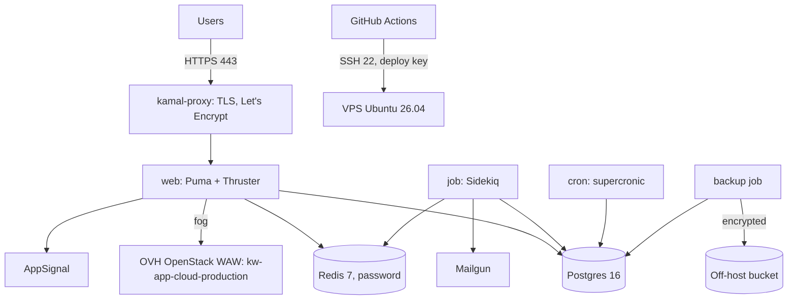

# New Production Implementation Plan

Status: **PLAN ONLY, nothing below has been applied to the new VPS.** Written 2026-11-17 on branch `develop`.

Goal: move kw-app from the old native server (`51.68.141.247`) to the new OVH VPS (`51.255.38.227`) running Kamal + Docker, with a hardened host, working background jobs and cron, tested backups and a rehearsed, reversible cutover.

Related: `.rules` section 14 (hosts), `.agents/skills/prod-db-restore` (1:1 DB restore + verify), `.agents/skills/scp-transfer` (fetching the prod dump), `.agents/skills/bws-secrets` (secrets, rotation backlog), `.agents/skills/kamal-deployment`.

Legend: **[V]** verified on a real host or in the repo on 2026-11-17, **[R]** recommendation, **[?]** open question that needs a decision or investigation, **[ASK]** needs explicit user approval first (`.rules` section 8).

---

## 1. Current state

### 1.1 Old production `51.68.141.247` [V] (read-only)

| Item | Value |
|------|-------|
| OS / size | Ubuntu 20.04.6 (EOL standard support), 1 vCPU, 2 GB RAM, 20 GB disk at 84% |
| Shared host | Also runs PHP-FPM, MariaDB, ~9 other nginx sites, PostgreSQL 10 **and** 12 |
| App runtime | Ruby 2.6.6 (rbenv), nginx + Passenger, Capistrano-style `releases/` |
| Public host | `panel.kw.krakow.pl` (nginx `server_name`, Let's Encrypt via Certbot) |
| Background jobs | systemd `sidekiq.service`, queues `default` + `mailers`, native Redis with password |
| Cron | 10 jobs from `config/schedule.rb` (whenever), run from the user crontab |
| Backups | 03:15 `kw-db-backup` runner, 7-day local retention, **off-host copy is in ERROR** |
| Local files | `shared/public/uploads` 1.7 GB = **only CarrierWave's stale `tmp/` cache, not needed** (section 3.1). Real files are in OpenStack |

### 1.2 New production `51.255.38.227` [V]

| Item | Value |
|------|-------|
| Provider | OVH VPS, created 2026-11-17, hostname `vps-fb065f1c` |
| OS | **Ubuntu 26.04 LTS (codename `resolute`)**, kernel 7.0, brand new release |
| Size | 2 vCPU, 3.8 GB RAM, 38 GB disk, no swap, IPv4 + IPv6 |
| Access | `ubuntu` with our key only (`SHA256:cVosxEG...`, verified, exactly 1 key in `authorized_keys`), passwordless sudo |
| Docker | **Not installed** |
| Firewall | UFW installed but **inactive**; listening only on `:22` |
| SSH | Password login **still enabled** (`50-cloud-init.conf` sets `PasswordAuthentication yes` and wins over `60-cloudimg-settings.conf`) |
| fail2ban | Not installed; unattended-upgrades active; chrony/NTP synced; AppArmor loaded (178 profiles) |
| Docker packages | Official repo `download.docker.com/.../resolute` returns 200; Ubuntu archive also has `docker.io` 29.1.3 |

### 1.3 Staging `pi5main.local` [V]
Kamal `web` role + `kw-app-staging-postgres` + `kw-app-staging-redis`. **No Sidekiq and no cron are deployed there.** Also hosts unrelated apps. Note: containers `kw-app-postgres` / `kw-app-redis` (no `staging`) also exist on the Pi. Check what they are before using the `new-prod` restore profile anywhere near the Pi.

---

## 2. Gaps found in the repo (must be closed before cutover)

| # | Finding | Evidence | Impact | Fix (phase) |
|---|---------|----------|--------|-------------|
| G1 | **No Sidekiq role** in Kamal. Old prod runs `sidekiq.service`; 32 files enqueue jobs (`deliver_later`, `perform_async`) | `config/deploy*.yml` have only `servers.web`; `Procfile` is unused by Kamal | Mail, reminders, payments follow-ups would pile up in Redis and never run | P4 |
| G2 | **No cron** for the 10 whenever jobs | `config/schedule.rb`; nothing in Kamal | Prepaid e-mails, reminders, sign-up cleanup, yearly fee never run | P4 |
| G3 | **Hostname mismatch**: live host is `panel.kw.krakow.pl`, Kamal/Rails use `nowypanel.kw.krakow.pl` | nginx on old prod vs `deploy.production.yml`, `production.rb` (`default_url_options`, route host) | Links in e-mails, Dotpay/Strava/Mailgun callbacks and inbound `reply+...@panel.kw.krakow.pl` depend on the host | Decision D1 |
| G4 | `proxy.ssl: true` makes kamal-proxy **stop forwarding `X-Forwarded-*`**, and `force_ssl` is **commented out** | Kamal proxy docs; `production.rb` line 55 | App does not know it is on HTTPS (cookies, redirects, URL helpers); enabling `force_ssl` without `forward_headers: true` causes a redirect loop | P4 |
| G5 | `app_port: 3000` bypasses **Thruster** (it listens on 80 and proxies to 3000) | `Dockerfile.production` CMD `thrust ...`, `deploy.yml` `app_port: 3000` | Thruster compression/asset caching unused. Harmless but misleading | P4 |
| G6 | `config/init.sql` runs `CREATE DATABASE kw_app_production` while `POSTGRES_DB` already creates it | `deploy.production.yml` accessory | Postgres init script runs with `ON_ERROR_STOP`, so first boot of the accessory **will likely fail**. Verify on a scratch container, then drop the file | P4 |
| G7 | Custom Docker network `kw-app-network` is referenced by app and accessories but **Kamal does not create it** | `options.network` in all deploy files | `kamal setup` fails on a clean host | P2 (create it) |
| G8 | Redis URLs: Sidekiq initializer needs `REDIS_URL_SIDEKIQ` (or `credentials.redis.url`); Action Cable needs `REDIS_URL` | `config/initializers/sidekiq.rb`, `config/cable.yml` | Falls back to `localhost` inside the container, jobs and cable silently break | P4 (set in `env.clear`, verify without printing credentials) |
| G9 | Upload **cache** is written under `public/uploads/tmp` (default), publicly servable, 1.7 GB of stale files on old prod, and 8 `.php` probe files; uploaders have no extension allow-list | section 3.1, `app/uploaders/*` | Public exposure of cached uploads, disk growth, accepted dangerous extensions | P4 (cache dir under `tmp/`, allow-lists) |
| G10 | `log_level :debug` in production, no Docker log rotation | `production.rb` line 59 | Disk fills, noisy logs with PII | P4 / P2 |
| G11 | Production workflow: secret written with `echo "${{ secrets... }}"` (script injection pattern), `cat` of `known_hosts` and `ssh/config`, `ssh-keyscan` at deploy time (trust on first use), 5 of 7 bws values not `::add-mask::`ed, `gem install kamal` unpinned (lockfile has 2.10.1), actions not pinned, no environment protection | `.github/workflows/deploy-production.yml` | Secret leakage / MITM / supply-chain risk | P3 |
| G12 | Ruby **3.2.2** (EOL 2026-03-31, latest 3.2.11), Rails **7.0.10** (EOL 2025-04-01), base image `ruby:3.2.2-slim` unpatched | `.ruby-version`, `Gemfile.lock`, `Dockerfile.production`; endoflife.date | Unpatched CVEs on an internet-facing app | P0 (patch bump) + separate upgrade track |
| G13 | No CI security gates besides tests (`brakeman` is in the Gemfile, no `bundler-audit`, no `rack-attack`) | `Gemfile`, `.github/workflows/test.yml` | No automated dependency/CVE checks, no app-level rate limiting on login | P3 / P4 |
| G14 | Sidekiq Web is mounted at `/sidekiq` behind `authenticate :user, admin?` | `config/routes.rb` | OK, keep. Do not expose any other admin surface | none |
| G15 | Registry creds are one account for push and pull; the server stores the pull token in `~/.docker/config.json` | Kamal registry login | Compromised host leaks push rights | P3 (scoped Docker Hub token) |
| G16 | **FIXED on `develop` 2026-11-17 (specs `sign_up_operations_spec`, `dry_monads_includes_spec`). `Charity::CreateDonation` was wrongly listed: it `require`s the deprecated `lib/` Result and works, so 7 classes were fixed.** `develop` regression: 5 cron/Sidekiq-path operations call `Success(...)`/`Failure(...)` with no `Dry::Monads` include** (`FillEmptyPlaces`, `DestroySignUp`, `OpenConversation`, `AddToConversation`, `SendEmailWithPayment`; also `Training::Questionare::SnwProfileService`, `Events::Competitions::SignUps::Destroy`, `Charity::CreateDonation`). Commit `8e4151f7` renamed `Left/Right` to `Failure/Success` and dropped `include Dry::Monads::Either::Mixin`. `master` still has the include | verified in the app container: `respond_to?(:Success, true)` is `false` for all five; none of them has a spec | Every course waitlist fill, conversation open and sign-up destroy (cron **and** admin UI) raises `NoMethodError`. `DestroySignUp` raises **after** `sign_up.destroy` and the mail enqueue | Appendix A.4, fix on `develop` with specs before staging soak |
| G17 | **FIXED on `develop` 2026-11-17 for the 3 `expired_sign_ups` repositories (two chained `where.not`, specs added); the ~25 activities statistics queries are still to audit in Phase U.** Rails 6.1 changed `where.not(a: nil, b: nil)`** from `a IS NOT NULL AND b IS NOT NULL` to `NOT (a IS NULL AND b IS NULL)`. `expired_sign_ups` uses it in 3 repositories (training, business, events) | `SignUpRecord.where.not(sent_at: nil, expired_at: nil).to_sql` on Rails 7.0.10; old prod runs Rails 5.2.3 | On old prod `destroy_expired_sign_ups` never touches rows with `sent_at IS NULL`. On Rails 7 it selects **424 unpaid training sign-ups (219 distinct e-mails, created 2019-2025, all for past courses)**, deletes their payments, destroys them and sends each person a "sign-up deleted" mail. Also 4 business sign-ups. The same shape (`mountain_routes: { id: nil, length: nil }`, ~25 places in the activities repositories) changes the meaning of statistics queries | Appendix A.4: rewrite as two chained `where.not` calls + specs **before** any cron runs on new prod; audit the activities queries during Phase U |
| G18 | 14 hardcoded `hc-ping.com` / `hchk.io` URLs in `lib/tasks/periodic.rake` (+2 in `Management::Voting::Reminder`); pings are sent on **enqueue**, not on job success; `Net::HTTP.get` has no explicit timeout | `lib/tasks/periodic.rake` | Running any task on staging/dev pings the **production** monitor; anyone with the URL can fake a heartbeat; monitor says "OK" even when the Sidekiq job later fails | Appendix A.5 |
| G19 | **FIXED on `develop` 2026-11-17** (`value: ...to_s`; the same bug was also in `reactivation.html.slim`; request spec). **`develop` regression: the public application form `/zgloszenie` returns 500** (`undefined method 'strftime' for "":String`, `app/views/profiles/_form.html.slim:44`, `date_field` on a blank-string `birth_date`; Rails 7.0 stopped tolerating `""`) | Reproduced on staging (smoke check B-PRO-2) | New members cannot apply through the legacy form, which is the URL the club links to (`get 'zgloszenie' => 'profiles#new'`). The v2 form `/v2/profiles/new` works | Fix on `develop` with a request spec (default `birth_date` to `nil` / use `value:`), before the rehearsal |
| G20 | **FIXED on `develop` 2026-11-17** (`gutter: 0`; mailer spec). **Prawn 2.2.2 -> 2.5.0: `define_grid(columns:, rows:)` without a gutter raises** `TypeError: can't convert nil into Float` (2.2.2 did `nil.to_f`, 2.5.0 uses `Float(nil)`) | `ProfileMailer#apply` (`profile_mailer.rb:44`) and `app/views/profiles/show.pdf.prawn:2`; reproduced on staging (B-PRO-6) | Admin button "send application e-mail with payment link" (`Admin::ProfilesController#send_email`) fails; profile PDF download fails | Add `gutter: 0` (identical to 2.2.2 behaviour), spec that renders the PDF |
| G21 | **FIXED on `develop` 2026-11-17**: the `visiting_card` route was removed. On old prod the main `profiles` routes win (verified with `curl`: `/profiles/reactivation` 200, `/profiles/new` 200, `/profiles/1` 404), so the visiting-card page was never reachable there either; `VisitingCard::ProfilesController` is now unused (routing spec). **`/profiles/reactivation` is unreachable on `develop`**: `custom_endpoints.rb` draws `scope module: 'visiting_card' { resources :profiles, only: :show }` first, so `/profiles/reactivation` routes to `visiting_card/profiles#show` with `id=reactivation` (RecordNotFound -> redirect to `/`). The legacy `ProfilesController#show` (PDF) is shadowed the same way | `Rails.application.routes.recognize_path('/profiles/reactivation')` on staging (B-PRO-3). `master` has no `visiting_card` | Lapsed members cannot reactivate | Constrain the visiting-card route (`id: /\d+/`) or draw it after the profile collection routes; decide whether the PDF `show` is still wanted |
| G22 | **FIXED on `develop` 2026-11-17** (un-nested the `to_prepare`; initializer spec). **`develop` regression: the Mailboxer extensions never load.** `config/initializers/mailboxer.rb` wraps everything in `Rails.application.config.to_prepare { ... }` (commit `1855626c rails70`) and has a **second, nested** `to_prepare` inside it. A `to_prepare` registered while the prepare callbacks are already running is never executed when classes are not reloaded (staging/production). So `Mailboxer::Conversation#sign_ups`, `#courses`, `#conversation_items`, `set_code` and `Mailboxer::Message#create_notification` are **not defined** | Staging: `reflect_on_association(:sign_ups)` and `(:courses)` are `nil`; the new-message e-mail template raises `undefined method 'sign_ups'`; inbound reply `POST /email_processor` raises `undefined method 'courses'` (B-MAIL-5, B-MSG-3). `master` has the unwrapped file | Every e-mail notification of a new message/reply, every reply-by-e-mail and the course/business conversation features fail | Remove the nested `to_prepare` (keep one), add a spec that asserts the associations exist, re-run B-MAIL-5 |
| G23 | **Dotpay status callback is unauthenticated** (`POST /api/payments/status`): no `signature`/PIN check, no IP allow-list; it trusts `control` + `operation_status` from the request. Reproduced: an anonymous request with a bogus `signature` marked a payment `prepaid` (B-PAY-4). An unknown `control` raises `NoMethodError: undefined method 'paid?' for nil` (500, B-PAY-3). The app also holds no Dotpay PIN secret, and `PaymentRequest` disables TLS verification (`VERIFY_NONE`) | `app/services/payments/dotpay/{notification,status,payment_request}.rb`, staging smoke test | Anyone who learns a payment's `dotpay_id` (sent to Dotpay as `control` in every payment link, so very likely visible to the payer; to be confirmed) can mark it paid (fees, trainings, donations). Same on old prod, so it is not a migration regression, but the migration must not make it worse | Fix after cutover unless trivial: nil-safe lookup now; signature verification (needs the Dotpay PIN from the Dotpay panel, then a new bws secret) + `VERIFY_PEER`. Confirm the signature algorithm in Dotpay's current documentation before implementing |
| G24 | Authorization gaps found by **reading code, not executed** (a call would reach Dotpay or Strava): `PaymentsController#refund` has no authorization or login check (any visitor with a CSRF token can request a refund of any payment id); `Api::StravaActivitiesController#index/#create` are open (`index` reads Strava activities of any `user_id`, `create` enqueues a sync job); `EmailCenter::Api::EmailsController#delivered` is unsigned (anyone can mark e-mails delivered) | `app/controllers/payments_controller.rb`, `app/components/training/activities/api/strava_activities_controller.rb`, `app/components/email_center/api/emails_controller.rb` | Money and personal-data exposure. Identical on old prod | Backlog after cutover (`authorize!`/`authenticate_user!` + Mailgun webhook signature); verify with a harness scenario using a stubbed HTTP layer |

---

## 3. Decisions (answered 2026-11-17)

| ID | Decision | Answer | Consequence for the plan |
|----|----------|--------|--------------------------|
| D1 | Final public hostname | **`panel.kw.krakow.pl`**, but it stays on **old prod until the flip**. | New prod is rehearsed on a temporary name (`nowypanel.kw.krakow.pl`). At cutover `panel` DNS moves. Deploy config switches to `panel` only in the cutover change. |
| D2 | Upgrade first or migrate first | **Upgrade first: do as much as possible before the migration so we test once.** | New Phase **U** (Ruby/Rails upgrade) runs in parallel with the infra phases and must finish before the single rehearsal phase P7. Reverses my earlier recommendation, see 5.U for the trade-off. |
| D3 | Local `public/uploads` | **Investigated: stale, not needed** (see 3.1). | No volume, no rsync, nothing to migrate. Fix the cache location and add upload allow-lists instead (P4). |
| D4 | Off-host backup target | Not decided, asked for the simplest. | **OVH Object Storage (S3) + restic**, see 3.2. |
| D5 | SSH exposure | Asked what is better. | **Key-only SSH on 22 + fail2ban now**; optional step to close 22 behind Tailscale later, see 3.3. |
| D6 | Cutover window / old prod | **Agreed**: weekend early morning (avoid 04:15-04:45 cron slot), keep old prod intact but stopped for 14 days, then wipe. | As written in P8/P9. |

### 3.1 Uploads investigation (D3) [V, read-only on old prod]
- `shared/public/uploads` contains **only `tmp/`**: 2001 files, 1.7 GB, i.e. CarrierWave's default **cache directory**. No `csv/` or any store directory exists.
- Every mounted uploader inherits `ApplicationUploader` with `storage :fog` (OpenStack), so rendering reads files from `kw-app-cloud-<env>`, never from local disk. The only `storage :file` uploader is `CsvUploader`, used directly by `Admin::ImportingController` (not mounted on a model, nothing persisted).
- Age: 1992 of 2001 files are older than 30 days, 1512 older than a year (oldest 2024-02-05). Content is leftover originals/thumbnails/PDF invoices from uploads whose permanent copy lives in OpenStack.
- **Conclusion: stale cache, not needed for rendering. Do not migrate.** `shared/public/system` is empty, `assets` (34 MB) is rebuilt by the image.
- **Security finding:** 8 files with a `.php` extension sit in that cache (`test.php` x4 from 2024, `hello.php` 2025-03, `template.php` x2 and `doc.php` 2025). Names/sizes only were read, never the content. They look like upload-form probes or web-shell attempts. They are served as static text by nginx (the `panel` vhost has no PHP handler), so likely harmless today, but it proves an upload endpoint accepts arbitrary extensions. Action items for P4:
  1. add an extension/content-type **allow-list** to `ApplicationUploader` (and a per-uploader list where images only are expected);
  2. move CarrierWave `cache_dir` **out of `public/`** (e.g. `Rails.root.join('tmp/uploads')`) so cached uploads are never publicly served;
  3. find which authenticated/unauthenticated form accepted them (nginx access logs on old prod for `/uploads/tmp/*.php`, read-only) and tell the user, since it may be a membership/PII incident to assess.

### 3.2 Backup target (D4): my recommendation and why it is simplest
**OVH Object Storage (S3 API) with `restic`.**
- You already use OVH Public Cloud (OpenStack, region WAW) for uploads, so no new vendor/account/billing. Create one bucket + one S3 user limited to that bucket.
- `restic` = one static binary: client-side encryption, dedup, retention (`forget --keep-daily 7 --keep-weekly 4 --keep-monthly 6`), integrity `check`. The DB is ~90 MB raw so cost is cents per month.
- Credentials and the restic password live in bws (`kw-app-production-restic-password`, `...-backup-s3-*`), not on disk beyond a root-only env file.
- Put the bucket in a **different OVH region/project from the VPS** than the live data where possible, and **store the restic password also outside the VPS** (bws is that copy).
- Optional second copy: have the Pi at home **pull** the encrypted dumps over SSH with a restricted key. Adds nothing to the cloud bill, but the Pi is a single home device, so treat it as a bonus, not the primary.
- Rejected as more work: Backblaze B2 (new vendor), a second VPS (patching + cost), plain rsync without encryption (PII in the dump).

### 3.3 SSH exposure (D5): which is better
| Option | Security | Effort | Catch |
|--------|----------|--------|-------|
| A. Port 22 open, **key-only**, fail2ban, `AllowUsers`, limited tries | Good: no passwords to guess, ed25519 key, noise only | Low | Constant scan noise in logs; relies on key hygiene |
| B. SSH reachable **only over a private network** (Tailscale/WireGuard), 22 closed on the public IP | Best: nothing to scan or brute force | Medium: the GitHub runner must join the tailnet (ephemeral auth key via `tailscale/github-action`), your laptop too | Dependency; if the VPN or the OAuth app breaks, deploys stop (OVH KVM/console remains the break-glass) |
| C. Allow-list source IPs in UFW | Good | Low for laptop, **not workable** with GitHub-hosted runners (dynamic IPs) | Only if deploys move to your laptop or a self-hosted runner |

**Recommendation: A now** (it is what the rest of the plan assumes and is adequate for a key-only sshd), then **B as a follow-up hardening step** after the first successful production deploy, if you want zero public SSH. Decide B at the end of P3 and we adjust P1.

## 4. Target architecture



Principles: only 22/80/443 reachable from outside; Postgres and Redis only on the Docker network (no published ports); secrets only from bws at deploy time; every state-changing step has a rollback.

---

## 5. Phases

Order: P0 -> (P1, P2, P3, P4, P5, P6 and **U** in parallel where independent) -> P7 -> P8 -> P9. U is described before P4 because P4's Kamal/Rails changes are made on the upgraded code.

Each phase has an exit gate. Do not start the next one until the gate is green. Items marked [ASK] need your approval at that moment.

### P0. Prerequisites in the repo (develop only, no server changes)
1. [R] Bump Ruby **3.2.2 -> 3.2.11** first (patch only, low risk) as the baseline commit of Phase U: `.ruby-version`, `Dockerfile.production`, `Dockerfile`, workflows; run the suite in Docker; deploy to staging. [ASK] (pushing to `develop` auto-deploys staging).
2. [R] Add `bundler-audit` and a `brakeman` step to `.github/workflows/test.yml` (new gem = [ASK]).
3. Fix the code gaps that do not need the server: Sidekiq/cron roles drafted in a branch (P4), `force_ssl`, `config.hosts`, log level, `init.sql` check on a scratch Postgres 16 container.
4. [V] Uploads classified (section 3.1): stale CarrierWave cache, nothing to migrate. Still open: trace the 8 `.php` probe uploads in old prod's nginx access logs (read-only) and report.
5. [?] Inventory external callbacks bound to the host: Mailgun routes/webhooks (inbound `reply+...@panel.kw.krakow.pl`), Dotpay URLC/return URLs, Strava webhook subscription, any OAuth redirect URIs. List them with where each is configured.
6. Rehearse the whole restore path on staging first (`prod-db-restore` skill, `staging` profile). Already rehearsed on a scratch DB; do the real one before touching new prod.

Gate: suite green, staging deployed on the patched Ruby, callback inventory written down, `.php` upload source identified.

### P1. Host hardening (Ubuntu 26.04) [ASK before each batch]
Order matters: **never close the current SSH session until a second, new session proves access.**

1. **Updates**: `apt update && apt full-upgrade`, reboot if `/var/run/reboot-required`. Add a 2 GB swapfile (box has none).
2. **Users**: keep `ubuntu` as the admin (sudo). Create `deploy` (no sudo, member of `docker` after P2, own key). `docker` group is root-equivalent, so only the deploy key and CI use it. Lock root password; keep `PermitRootLogin no`.
3. **SSH** via a drop-in that sorts first (`/etc/ssh/sshd_config.d/00-hardening.conf`), because the first value wins and `50-cloud-init.conf` currently enables passwords:
   ```
   PasswordAuthentication no
   KbdInteractiveAuthentication no
   PermitRootLogin no
   PubkeyAuthentication yes
   AllowUsers ubuntu deploy
   MaxAuthTries 3
   LoginGraceTime 20
   X11Forwarding no
   AllowAgentForwarding no
   ```
   Validate with `sshd -t`, then `sshd -T | grep -E 'passwordauthentication|permitrootlogin'`, reload (not restart), open a **new** session, only then close the old one.
4. **Firewall (UFW)**, IPv6 included (`IPV6=yes`): default deny incoming, allow `22/tcp` (use `ufw limit`), `80/tcp`, `443/tcp`. **Docker bypasses UFW for published ports**, so: publish nothing but kamal-proxy (80/443), do not publish Postgres/Redis at all, and add the `DOCKER-USER` chain rule set (ufw-docker pattern) as defence in depth. Verify from outside with `nmap -Pn` (laptop and one more network).
5. **fail2ban**: `sshd` jail with `backend = systemd` (Ubuntu 26.04 uses journald; the old Ansible playbook used `/var/log/auth.log`, which may not exist), `maxretry 4`, `bantime 1h` increasing, `ignoreip` = our fixed IPs.
6. **Automatic security updates**: `unattended-upgrades` (security pocket only), `Automatic-Reboot` at a quiet hour (e.g. 05:00 Sun) or use Ubuntu Pro Livepatch (free for personal use, up to 5 machines) and reboot manually. `needrestart` in automatic mode.
7. **Kernel/network sysctl** (`/etc/sysctl.d/90-hardening.conf`): `rp_filter`, `accept_redirects=0`, `send_redirects=0`, `tcp_syncookies=1`, `kernel.dmesg_restrict=1`, `kernel.kptr_restrict=2`, `fs.protected_hardlinks/symlinks=1`. Do **not** disable IPv4 forwarding (Docker needs it).
8. **Logging**: persistent journald with size cap (`SystemMaxUse=500M`), `auditd` with a small ruleset (sshd, sudo, docker socket, `/etc/ssh`), optional.
9. **OVH side**: enable the VPS **automated backup / snapshot** option, record the KVM/console access path (this is your recovery if SSH breaks), verify reverse DNS/IPv6, enable OVH 2FA on the account.
10. **Acceptance**: run `lynis audit system` (or Ubuntu Security Guide, Ubuntu Pro) and keep the report; target hardening index >= 80 and zero "warning" on SSH/firewall.

Gate: password SSH rejected from outside, only 22/80/443 open on both IPv4 and IPv6, `fail2ban-client status sshd` active, second session test passed, snapshot taken.

### P2. Docker engine and Kamal prerequisites [ASK]
1. Install Docker from the **official apt repo** (`docker-ce`, `containerd.io`, `docker-buildx-plugin`; confirm the codename with `lsb_release -cs` = `resolute`). Fallback: Ubuntu `docker.io` 29.1.x. Do not pipe-install; Kamal's `server bootstrap` can be skipped because Docker is already present.
2. `/etc/docker/daemon.json`: `{"log-driver":"local","log-opts":{"max-size":"20m","max-file":"5"},"live-restore":true,"no-new-privileges":true}` then restart Docker. (`log-driver local` plus rotation fixes G10 on the host side.)
3. Add `deploy` to the `docker` group. Verify `docker run --rm hello-world` as `deploy`.
4. **Create the network Kamal expects (G7)**: `docker network create kw-app-network`.
5. Data dirs for accessories (Kamal creates them under the deploy user's home; confirm ownership and that they sit on the 38 GB disk with room for growth; DB is 86 MB raw, uploads volume per D4).
6. Weekly `docker system prune` for dangling images only (never volumes). Kamal keeps `retain_containers: 3`.

Gate: `docker info` clean, `deploy` can run docker without sudo, network exists, nothing but SSH listening publicly.

### P3. Secrets and CI/CD for production [ASK, touches deploy config and workflows]
1. **New dedicated deploy key**: `ssh-keygen -t ed25519` for CI only, installed for `deploy` (not `ubuntu`). Store the private key in the GitHub `production` **Environment** secret, not repo-wide.
2. **Pin the host key**: store the VPS host key fingerprint/known_hosts line as an Environment variable and write it in the workflow. Remove `ssh-keyscan`. Remove all `cat ~/.ssh/...` echoes.
3. Write the key via `printf '%s' "$KEY"` from an `env:` variable, never `${{ secrets.X }}` inside the script body.
4. `::add-mask::` every bws value before it goes to `$GITHUB_ENV` (5 are currently unmasked).
5. Pin: `gem install kamal -v 2.10.1` (match `Gemfile.lock`), actions by commit SHA, bws CLI version/checksum.
6. `permissions: contents: read`, GitHub Environment `production` with **required reviewer** and branch restriction to `main`; keep the `concurrency` group.
7. Make production deploy depend on a green test run (`workflow_run` or `needs`).
8. **Registry**: Docker Hub **access tokens**: one read/write for CI, one read-only for the server if Kamal config allows a separate pull credential; otherwise at minimum a scoped token instead of the account password. Confirm the `regedarek/kw-app` repository is **private**.
9. **bws**: create a production-only machine account with read access limited to the production secrets (web UI only), keep the shared `panel` token out of the production environment. Keep the rotation backlog in `.agents/skills/bws-secrets/SKILL.md` for **after** the migration (decision recorded: rotate after cutover).
10. Production secrets needed in bws (names): master key, Postgres password, Redis password, AppSignal key, Strava token, registry creds, **new**: backup encryption key, off-host bucket credentials, deploy SSH key (as backup copy). Never created by echoing values.

Gate: a dry deploy run (`kamal config`/`kamal lock status` on the runner) succeeds with no secret printed in the log, and a log review confirms masking.

### 5.U. Ruby/Rails upgrade (D2): do it before the one rehearsal
Runs on `develop`/staging only, in parallel with P1-P6. `main` is untouched until the cutover change. Infrastructure work does not depend on the app version.

Target stack (all dates from endoflife.date, checked 2026-11-17):
| Component | Now | Target | Why |
|-----------|-----|--------|-----|
| Ruby | 3.2.2 (EOL 2026-03-31) | **3.4.x** (EOL 2028-03-31) | 3.3 ends 2027-03; 3.4 is the safe middle. Ruby 4.0 is too new for this gem set |
| Rails | 7.0.10 (EOL 2025-04-01) | **8.1.x** (security to 2027-10-10) | 7.1 EOL 2025-10, 7.2 EOL 2026-08, 8.0 EOL 2026-11-07, so only 8.1 is supported |
| Postgres | 10 (old prod) / 16.0 (staging) | **16.latest** | already the plan |

Procedure (one hop at a time, each hop merged to `develop` and soaked on staging before the next):
1. U0 Ruby 3.2.11 (patch) -> U1 Ruby 3.4 (gem compatibility: native gems `libsodium`, `fog-openstack`, `mimemagic`, `devise`, etc.; fix deprecations) -> U2 Rails 7.1 -> U3 Rails 7.2 -> U4 Rails 8.0 -> U5 Rails 8.1.
2. Per Rails hop: `bin/rails app:update` and review the diff, keep `config.load_defaults` of the **previous** version until the hop is stable, then bump it and the `new_framework_defaults_*` initializers (there are 5 of them today), run the full RSpec suite in Docker, fix deprecation warnings, deploy to staging **with the restored prod DB** (`prod-db-restore` skill) and click through the critical flows (login, sign-ups, payments sandbox, mail, Sidekiq, GPS/strava, PDFs).
3. Gates in CI per hop: `bundler-audit`, `brakeman`, suite green, no new deprecations.
4. Kamal/Thruster/Sidekiq stay on current versions during U unless a hop requires a bump.
5. Time-box: set a date together (suggested 3-4 weeks). **Fallback if U slips:** cut over on Ruby 3.2.11 / Rails 7.0.10 (infra identical) and run U afterwards on the new host. The cost is a second regression test round, which is exactly what D2 wanted to avoid, so use it only if U is clearly late.

### P4. Kamal and Rails production configuration [ASK]
All in `config/deploy.production.yml`, `config/deploy.yml`, `Dockerfile.production`, `config/environments/production.rb`. Production `env.secret` **replaces** the base list, so every secret name goes in both files (existing pitfall).

1. **Host/user**: `servers.web.hosts` and the accessory `host:` -> `51.255.38.227`; `ssh.user` -> `deploy`; repoint `bin/migrate-database-to-new-prod`, `bin/verify-migration`, `profiles/new-prod.env` (they still target the obsolete `146.59.44.70`).
2. **Hostnames**: `proxy.hosts: [panel.kw.krakow.pl, nowypanel.kw.krakow.pl]` for the rehearsal, final per D1. Update `default_url_options`, `routes.default_url_options`, `ASSET_HOST`.
3. **TLS/proxy**: keep `ssl: true`, add `forward_headers: true` (G4), keep `/up` healthcheck, set `response_timeout` and `buffering.max_request_body` to what uploads need. Decide Thruster vs direct (G5), keep one.
4. **Rails**: `config.force_ssl = true` with `ssl_options: { redirect: { exclude: ->(r) { r.path == '/up' } } }`, `config.hosts` allow-list (exclude `/up`), `log_level = :info`, `config.log_tags = [:request_id]`, make sure `filter_parameter_logging` covers tokens/IBAN/PESEL-like fields. Secure/HttpOnly/SameSite=Lax session cookie (`session_store.rb` currently has only the key).
5. **Sidekiq role (G1)**:
   ```yaml
   servers:
     job:
       hosts: [51.255.38.227]
       cmd: bundle exec sidekiq -e production -C config/sidekiq.yml
       proxy: false
       options: { network: "kw-app-network" }
   ```
   Decide the queue list: old prod runs `default` + `mailers` only, `config/sidekiq.yml` also lists `critical` and `low`. Run all four so nothing is orphaned. Concurrency 5 is fine for 2 vCPU; each Sidekiq/Puma process is ~200 MB, budget the 3.8 GB RAM (Postgres ~1 GB, Redis ~100 MB, web ~400 MB, job ~400 MB, cron ~200 MB).
6. **Cron role (G2)**: add a `cron` role running **supercronic** (static binary, no `cron` package, logs to stdout), crontab committed to the repo, `TZ=Europe/Warsaw` in that container (old prod crontab runs in `Europe/Paris`; the new VPS is UTC, so `*/30 8-23` would otherwise shift by 1-2 h; do **not** change `config.time_zone`). Use the **reviewed job list and consolidation from Appendix A** (7 live jobs, 3 dead tasks removed). Runs on exactly one host, never on staging, started only at cutover (P8). Old prod's crontab is disabled in the same step, never both.
7. **Redis/DB env (G8)**: `REDIS_URL`, `REDIS_URL_SIDEKIQ` in `env.clear` pointing to `kw-app-redis` (without the password; password via `REDIS_PASSWORD` secret), verified from a `kamal app exec` smoke command that prints only `PONG`/ok.
8. **Postgres accessory**: pin `postgres:16.x` (latest 16 minor, not `16.0`), remove published `port:` (reach it with `kamal accessory exec`/`docker exec`), drop `init.sql` (G6), tune for 3.8 GB: `-c shared_buffers=768MB -c effective_cache_size=2GB -c work_mem=8MB -c maintenance_work_mem=128MB -c max_connections=60 -c log_min_duration_statement=500`, `scram-sha-256` (default in 16). Healthcheck (`pg_isready`).
9. **Redis accessory**: password, `appendonly yes`, `maxmemory 256mb`, **`maxmemory-policy noeviction`** (Sidekiq requires it), no published port.
10. `retain_containers: 3` stays; add `--memory`/`--cpus` limits on `job` and `cron` so a runaway job cannot starve Postgres; `restart: unless-stopped` (Kamal default).
11. `Dockerfile.production`: base `ruby:3.2.11-slim`, install `supercronic` with a pinned checksum, keep non-root user (already `USER 1000`), consider `.dockerignore` covering `.git`, `config/master.key`, `.kamal/`, `node_modules`.
12. **Uploads (G9)**: in `config/initializers/carrierwave.rb` set `config.cache_dir = Rails.root.join('tmp/uploads')` (outside `public/`), add `extension_allowlist`/`content_type_denylist` to `ApplicationUploader` and narrower lists on image-only uploaders, add specs. No persistent volume is needed (D3).
13. Validate with the Kamal config loader in the app container (`docker-compose exec -T app bundle exec kamal config -d production` with dummy env). **Do not run `kamal secrets print`.**

Gate: `kamal config -d production` OK, both deploy files list the same secret names, specs green, a staging deploy of the same code (with the new roles) healthy.

### P5. Data and files strategy
1. **Database**: use `prod-db-restore` with the `new-prod` profile (fill in container `kw-app-postgres`, user `production_user`, DB `kw_app_production`, web filter; verify values over SSH first). Old Postgres is **10.23**, new is 16, so it is a logical restore (no pg_upgrade), which the skill already does; `verify` compares rows + content digest + sequences + structure.
2. **Migrations** run on the restored data (`migrate`, then `verify --after-migrate`). Production `database.yml` has no env override for the DB name, so rehearse on the new host in the real DB name before cutover, then restore again at cutover.
3. **Uploads (D3)**: nothing to migrate. `public/uploads` on old prod is only stale CarrierWave cache (section 3.1). Real files live in OpenStack and new prod reads the same `kw-app-cloud-production` container through the credentials in `production.yml.enc` (confirm the container name for `Rails.env == production`). Both servers must **not** both write during the overlap; the cutover freeze covers it.
4. **Redis/Sidekiq state**: do **not** copy Redis. Old prod runs Sidekiq/Ruby 2.6 payloads; new is Sidekiq 7.3. Instead drain: stop enqueuing, wait for queues to reach 0, list the `scheduled` and `retry` sets (export, then re-enqueue on new prod if any). Sessions are cookie-based so no user logs out because of Redis.
5. **Backups on new prod (replace the broken off-host copy)**:
   - nightly `pg_dump -Fc` in the Postgres container to `/var/backups/kw-app`, 7 daily + 4 weekly + 6 monthly, with a manifest (sha256, row-count digest via `table_digest.py`) like the current runner;
   - `restic` (or equivalent) client-side encrypted copy to the OVH Object Storage bucket (D4, section 3.2), credentials from bws, **alert on failure** (Gatus/healthchecks ping, not silent like today);
   - weekly automated **restore test** into a scratch DB with `verify`;
   - OVH VPS snapshot as the third layer (not a substitute: snapshots are crash-consistent only);
   - targets: RPO 24 h (nightly) or lower with WAL archiving if you want it, RTO under 2 h.

### P6. Observability and alerting
1. AppSignal: confirm the new host reports (env key `APPSIGNAL_PUSH_API_KEY`, `APPSIGNAL_ENVIRONMENT` / hostname label distinguishes new vs old during overlap).
2. Uptime: external check of `https://<host>/up` (Gatus runs on the Pi at home, so add a check from outside your own network, e.g. a hosted monitor), plus TLS-expiry alert at 14 days.
3. Host metrics: the Pi already runs `beszel`/`beszel-agent`, so add a `beszel-agent` container on the VPS (disk, RAM, swap, Docker). Alert at 80% disk, 90% RAM, swap in use.
4. Logs: Docker `local` driver with rotation; `kamal app logs`; AppSignal for errors. Decide retention (e.g. 14 days) given PII.
5. Security alerts: fail2ban ban digest and unattended-upgrades result by e-mail (use Mailgun SMTP or a script) so you see them.

### P7. Rehearsal on the new VPS (no real traffic)
1. `kamal setup -d production` with a **temporary hostname** (`nowypanel.kw.krakow.pl` pointed at the VPS; lower TTL first). This boots kamal-proxy, Postgres, Redis, web, job, cron.
2. Restore the latest prod dump with the skill (`preflight`, `restore`, `verify`, `migrate`, `verify --after-migrate`), then run **Appendix B (see B.0)** against the rehearsal host (automated scenario plus the manual rows) and smoke-test through the real UI as admin and as a normal member: login, sign-up for an event, a payment sandbox flow, file upload/download, PDF generation, an e-mail send **to a safe address**, Sidekiq UI, one cron task run by hand, Strava webhook verification (token from bws).
3. **Mail safety**: new prod has real Mailgun credentials and real member e-mails after a 1:1 restore. During rehearsal run with delivery redirected (`MAILGUN` interceptor to a test inbox or `config.action_mailer.perform_deliveries = false` via env), and keep the cron role **stopped** until cutover.
4. Performance baseline: 20 concurrent users on the heaviest pages (e.g. `ab`/`k6`) against the 2 vCPU box; compare with old prod AppSignal p95. Check memory with `docker stats` under load.
5. Failure drills: reboot the VPS (everything must come back by itself), kill the web container, fill Redis, run a deploy with a failing migration (zero-downtime preserved?), restore a backup into a scratch DB.
6. Repeat the full restore at least twice; the second must be a stopwatch rehearsal of the cutover steps.

Gate: Phase U complete (or fallback consciously chosen), two clean rehearsals on the final stack, timings recorded, backup + restore test green, hardening report attached, callback inventory (P0.5) fully mapped to the new host.

### P8. Cutover runbook (target: < 30 min downtime)
**T-7 days**: lower DNS TTL of `panel.kw.krakow.pl` to 60 s; announce the window; freeze deploys to `main`; confirm snapshots and backups are fresh; pre-sync `uploads`.
**T-1 h**: final rehearsal checks (VPS healthy, disk, Docker, disk space), confirm rollback owner and chat channel.

1. Put old prod in **maintenance** (nginx maintenance page for the panel vhost only; other sites on that box keep running).
2. On old prod: stop `sidekiq.service` after queues reach 0; record `scheduled`/`retry` set sizes; comment out the 10 cron entries.
3. Take the final dump (`pg_dump` read-only; fetch with the `scp-transfer` skill) and the final `uploads` delta (rsync).
4. On new prod: `restore`, `verify` (must be 100%), `migrate`, `verify --after-migrate`.
5. Start `web`, then `job`, then `cron` (in that order). `kamal app details`, `/up` 200, AppSignal receiving.
6. **Update external callbacks** (Mailgun inbound routes/webhooks, Dotpay, Strava, anything from P0.5).
7. Flip DNS `panel.kw.krakow.pl` A (and AAAA if IPv6) to `51.255.38.227`. Wait for kamal-proxy's Let's Encrypt issuance on first HTTPS request (may take 5-30 s, watch `kamal proxy logs`). **Pre-check with `curl --resolve`** before the flip so you know the app responds with the right Host.
8. Smoke test: follow the **Appendix B.3 order** (first 30 minutes), using the B.2 rows; watch AppSignal and Sidekiq for 30 min; send one real test e-mail; confirm a cron task runs at its next slot.
9. Remove the maintenance page only on the **old** server and route nothing there.

**Rollback (any time up to T+14 days):** point DNS back to `51.68.141.247`, re-enable Sidekiq and cron there, remove maintenance. Data written on new prod after the flip is lost unless reverse-dumped, so the rule is: **decide go/no-go within the first 30 min**; after that, roll forward, not back. Keep old prod's DB and app intact and stopped (D7).

### P9. After the migration
1. Rotation backlog (`bws-secrets` skill, **master key last**, together with re-encrypting `production.yml.enc`).
2. Remove `config/master.key` and the `secrets.yml` exposure from `main`; rewrite history only if you decide it is worth it (ask first).
3. Update `.rules` section 14, `scp-transfer`, `prod-db-restore`, `kamal-deployment` (still describes Ansible/Passenger-era flow), `AGENTS.md`; delete deprecated `ansible/` and the obsolete `146.59.44.70` references.
4. Decommission old prod after D6: final dump archived off-host encrypted, drop `kw_app_production` data, remove SSH keys, cancel/resize the VPS.
5. The Ruby/Rails upgrade is **not** here any more: per D2 it is Phase U and finishes before the rehearsal. After cutover only keep it current (patch/minor bumps, `bundler-audit` + Brakeman gates).
6. Quarterly: restore test report, Lynis rerun, package and image updates (Postgres/Redis minor tags), SSH key review, bws rotation review.

---

## 6. Risks and mitigations

| Risk | Likelihood | Mitigation |
|------|-----------|------------|
| Locked out of the VPS while hardening SSH | Medium | Second session before closing the first, OVH console/KVM as break-glass, snapshot before P1 |
| Docker published ports bypass UFW | High if ignored | No published DB/Redis ports, `DOCKER-USER` rules, external `nmap` check |
| Sidekiq/cron missing on new prod | **Certain today** (G1, G2) | P4 roles + rehearsal task checks |
| Duplicate cron/mail (old + new both running) | Medium | Explicit checklist step to disable old cron/Sidekiq, cron role stopped until cutover |
| Real e-mails sent from rehearsal data | Medium | Delivery interception during P7, cron stopped |
| PG10 -> 16 behavioural differences | Low-Medium | Logical restore + `verify` + migrations + full UI smoke; watch collations/ordering in sorted lists |
| Callbacks (Dotpay/Mailgun/Strava) still on old host | Medium | P0.5 inventory, P8 step 6, test payment in sandbox |
| Let's Encrypt issuance fails at cutover (rate limits/DNS) | Low | Rehearse issuance on `nowypanel`; keep DNS TTL low; fallback custom certificate via `proxy.ssl.certificate_pem` from bws |
| Memory pressure on 3.8 GB | Medium | Swap, container memory limits, Postgres tuning, load test (P7) |
| Ubuntu 26.04 is a very new release (fewer field reports, kernel 7.0) | Low-Medium | Stay on `docker-ce` supported packages, test reboot, snapshot; fallback is reinstalling 24.04 LTS in OVH before any data lands |
| Secret exposure during deploys | Medium | P3 workflow fixes, environment protection, masking |
| EOL Ruby/Rails | Certain | Phase U before the rehearsal (D2), fallback cutover on Ruby 3.2.11 / Rails 7.0.10 if U slips, rate limiting (`rack-attack` [ASK]) |
| Upgrade drags on and blocks the migration | Medium | Infra phases P1-P6 are independent of the app version and run in parallel; time-box U, see fallback in 5.U |

---

## 7. Execution order (summary checklist)

- [x] D1-D6 answered (section 3)
- [ ] P0 repo prerequisites, staging real restore, callback inventory, `.php` upload trace
- [ ] P1 hardening + snapshot
- [ ] P2 Docker, network
- [ ] P3 deploy key, workflow fixes, production bws machine account
- [ ] U Ruby/Rails upgrade on develop/staging with restored prod data (parallel with P1-P6)
- [ ] P4 Kamal/Rails config (staging-tested)
- [ ] P5 backup pipeline live and restore-tested
- [ ] P6 monitoring and alerts
- [ ] Appendix B green on staging (G16, G17, G19-G22 fixed first), then on both rehearsals, then post-flip (B.3)
- [ ] P7 two rehearsals green, **on the final Ruby/Rails stack**
- [ ] P8 cutover (announce, maintenance, restore, flip, verify)
- [ ] 14-day watch, then P9 decommission, rotation, docs

## Appendix A. Cron / whenever review (2026-11-17)

Evidence: `config/schedule.rb`, `lib/tasks/periodic.rake`, old prod `crontab -l` (identical to `schedule.rb`, 10 jobs, server TZ `Europe/Paris`), old prod `cron_log.log` (564 lines, 7 aborted runs), read-only counts from `kw_app_production`. Old prod runs commit `8f4afa3e` (master, Rails 5.2.3, Sidekiq 6.1, dry-monads 0.3.1); `develop` is 302 commits ahead (Rails 7.0.10, Sidekiq 7.3, dry-monads 1.6).

### A.1 Verdict per job
| # | Schedule | Task | What it does | Live data (prod DB) | Verdict |
|---|----------|------|--------------|---------------------|---------|
| 1 | `*/30 8-23` | `send_prepaid_emails` | enqueues "payment received" mail for prepaid supplementary-course sign-ups | 102 such mails in the last year | **Keep.** 3 of the 7 aborts in the log (Fog/OpenStack auth 503/504 while loading courses) |
| 2 | `*/30 8-23` | `destroy_expired_sign_ups` | destroys unpaid expired sign-ups (training + business) and enqueues equipment-list mail for prepaid business sign-ups | 234 payment mails sent in the last year; currently 0 rows legitimately due | **Keep, but fix G17 first** (would hit 424 old rows on Rails 7) |
| 3 | `*/30 8-23` | `fill_empty_places` | for each upcoming published course, mails payment link to waitlisted sign-ups that now fit the limit | 5 published future courses; 506 courses total | **Keep, fix G16 first.** 4 of the 7 aborts (same Fog auth timeouts) |
| 4 | `30 4 * * *` | `send_reminders` | mails reservation reminder (`Db::Reservation.expire_tomorrow`, which actually matches `end_date = yesterday`) | 68 reservations created last year | **Keep.** Ask the club whether "reminder for yesterday's end date" is the intended wording |
| 5 | `30 4 * * *` | `open_conversations` | opens/updates the course chat for each upcoming course, staggered by index minutes | 5 upcoming courses | **Keep, fix G16 first.** The `.set(wait: ...)` stagger is ignored by Sidekiq (ActiveJob option), harmless |
| 6 | `30 6 * * *` | `destroy_unpaid_reservations` | destroys non-prepaid, non-cash reservations older than 2 days | 1375 reservation payments overall | **Keep** |
| 7 | `30 7 * * *` | `set_regular_members` | candidates with application date >= 1 year become `regular` | 0 currently due; runs daily | **Keep, reduce to weekly** (cost is one Rails boot per day for ~0 work). Cosmetic bug: `position.push('regular').uniq` discards the result |
| 8 | `30 8 * * *` | `destroy_outdated_profiles` | **destroys** unaccepted, unpaid profiles older than 3 months (irreversible, PII) | 0 currently due (9 unaccepted older than 3 months, none with an unpaid fee) | **Keep, add logging** of what was destroyed (ids only) |
| 9 | `0 0 1 3 *` | `send_yearly_fee_reminder` | mails members with unpaid fee this year (excl. honorary/senior) | 11982 membership fee payments | **Keep** (runs once a year, 1 March 00:00 in the cron TZ) |
| 10 | `0 0 1 9 *` | `recalculate_cost` | recomputes cost for unaccepted unpaid profiles (worker exists) | 35 unaccepted profiles | **Keep** (once a year, 1 September) |

### A.2 Dead / obsolete (not scheduled on old prod, or broken)
| Item | Evidence | Recommendation |
|------|----------|----------------|
| `store_shmu`, `store_topr`, `store_weather` (+ empty `every 6.hours do #rake :store_topr end` block) | Not scheduled; newest rows: `topr_records` 2021-09-27, `shmu_diagrams` 2021-01-05, `weather_records` / `meteoblue_records` 2020-08. Page `/warunki` and `/api/meteoblue`, `/api/pogodynka` still exist | **Remove the tasks and the empty block.** Separate decision for the `Scrappers` component, `/warunki` page, 4 tables and the `kw-app-cloud` files they use (ask the club) |
| `destroy_expired_events_sign_ups` | Not scheduled. **Broken**: references `Events::Competitions::Worker::DestroyExpiredSignUpWorker` but the class is `Events::Competitions::Workers::DestroyExpiredEventSignUpWorker` (`NameError`). 947 of 1269 event sign-ups have `expired_at` set, 0 are expired-and-unsent | Ask the club whether event sign-ups should auto-expire. Today they never do. Delete the task, or fix + schedule with a spec |
| `Management::Voting::Reminder.send_reminders` / `.close_outdated` | No caller anywhere (not in cron, not in a worker) | Ask the club (voting reminders). Delete or schedule |
| `reset_passwords` (manual) | Mails a reset link to **every** user, no guard | Keep out of the image or add `CONFIRM=yes` guard |
| `desc "... Heroku scheduler add-on"` | Stale | Delete |

### A.3 Operational findings that affect the new host
1. **Timezone**: old crontab runs in `Europe/Paris`, new VPS/containers are UTC. Set `TZ=Europe/Warsaw` for the cron container only.
2. **One Rails boot per rake task**: slot `:00/:30` launches 3 separate Rails processes (~200 MB each), `04:30` launches 2. On a 3.8 GB box that also hosts Postgres, web and Sidekiq this is wasteful. Consolidate to one wrapper per slot (`periodic:half_hourly`, `periodic:daily_morning`, ...) that runs the steps sequentially, **rescues and logs each step separately**, and pings once.
3. **Fog/OpenStack auth timeouts** (7 aborts, `Excon 503/504` in `fog-openstack` `token.rb`) happen while loading courses: the course record mounts an uploader and the OpenStack token is requested during `Course.from_record`. Wrap the call with a small retry and explicit Excon timeouts, and avoid building uploader URLs inside cron paths.
4. **Overlap protection**: two runs of the same slot must not overlap (supercronic does not queue by default). The wrapper takes a Postgres advisory lock (`pg_try_advisory_lock`).
5. **Monitoring**: every task pings a healthchecks URL **on enqueue**. Keep a heartbeat per slot but ping after the wrapper completes without errors, and alert on silence.
6. **Sidekiq-native alternative** (later, [ASK] new gem `sidekiq-cron`/`sidekiq-scheduler`): schedule jobs inside Sidekiq so no extra Rails boot, retries and a UI. Not needed for the migration; keep supercronic for 1:1 behaviour.

### A.4 Must-fix before cron is enabled on new prod [ASK, develop only, TDD]
1. G16: restore the monads include in the 8 files (`include Dry::Monads[:result]`), add specs for `FillEmptyPlaces`, `DestroySignUp`, `OpenConversation`, `AddToConversation`, `SendEmailWithPayment`.
2. G17: rewrite the three `expired_sign_ups` queries as `where.not(sent_at: nil).where.not(expired_at: nil)` (the Rails 5.2 meaning that production relies on), with a spec that fails on the buggy form. **Gate before enabling cron:** on the restored prod DB, `Training::Supplementary::Repository.new.expired_sign_ups.count` must equal the old-prod value (0 rows due today), not 424.
3. Audit the ~25 `where.not(mountain_routes: { id: nil, length: nil })` queries in `activities/*_repository.rb` and `training/activities/repository.rb`: compare results on the restored DB between the old and new semantics, then decide per query.
4. Remove dead tasks (A.2) after the club answers.
5. Move healthcheck URLs to ENV (`HC_PING_<JOB>`), no default value, so staging/dev never ping production.
6. Safety net on the first run: start `cron` on new prod **stopped**; run each wrapper by hand once with `DRY_RUN=1` (counts only) and compare with old prod counts from A.1.

### A.5 Target crontab for new prod (supercronic, `TZ=Europe/Warsaw`)
```
*/30 8-23 * * *   bin/rails periodic:half_hourly      # send_prepaid_emails, destroy_expired_sign_ups, fill_empty_places
30 4 * * *        bin/rails periodic:early_morning     # send_reminders, open_conversations
30 6 * * *        bin/rails destroy_unpaid_reservations
30 7 * * 1        bin/rails set_regular_members        # weekly instead of daily (A.1 #7)
30 8 * * *        bin/rails destroy_outdated_profiles
0 0 1 3 *         bin/rails send_yearly_fee_reminder
0 0 1 9 *         bin/rails recalculate_cost
```
Seven entries and three processes per heavy slot become one. Schedule stays equivalent to the 10 existing jobs; only #7 gets less frequent.

---

## Appendix B. Post-migration verification checklist (2026-11-17)

### B.0 How to use it

| When | What to run |
|------|-------------|
| Staging, after every deploy of the Phase U stack and after the real prod restore | `post_migration_smoke.rb` scenario (below) + the **Probe** rows |
| P7 rehearsal on `nowypanel`, after each restore | Everything. The **Manual** rows use a safe account/address (team mailbox, throwaway member), never a real member |
| P8 step 8 (right after the DNS flip) | Rows marked **[flip]** first (login, `/up`, TLS, one real Dotpay payment, one real e-mail), then the rest within the first hours |
| T+1 day, T+7 days, T+14 days | Rows marked **[watch]** (webhooks, cron, backups, queue sizes) |

Row types: **Auto** = `.agents/skills/staging-controller-testing/scenarios/post_migration_smoke.rb` (one rolled-back transaction, throwaway `@example.invalid` users, mail forced to the `:test` adapter, jobs to the `:test` adapter, no Dotpay/Mailgun/Redis traffic; the only outbound call is a read-only OpenStack token request and one HEAD request). **Probe** = a read-only command. **Manual** = a human clicks through it.

Run the Auto part on staging:

```bash
cd .agents/skills/staging-controller-testing
cat harness.rb scenarios/post_migration_smoke.rb \
  | ssh pi5main.local 'docker exec -e APPSIGNAL_ACTIVE=false -i $(docker ps -q --filter label=service=kw-app-staging --filter label=role=web --filter status=running | head -n1) bin/rails runner -'
```

Pass = `== N/N checks passed` and exit code 0. Every `FAIL` line names the check; `INFO` lines are facts to read (hosts, counts), never secrets. The harness refuses to run unless `Rails.env` is `staging`, so it **cannot** run on the new-prod VPS (`RAILS_ENV=production`) as it is. For P7 either use the Manual/Probe rows or allow an explicit, rehearsal-only override (`HARNESS_ALLOW_ENV=production`, to be added, [ASK]); never on live traffic.

### B.1 Staging run, 2026-11-17 (develop image deployed on `pi5main.local`)

**78 of 97 automated checks passed; 19 failed; 7 things are not testable on staging.** All 19 failures are real findings, mapped to gaps in section 2:

| Failing check(s) | Gap |
|------------------|-----|
| `/zgloszenie` 500 | G19 |
| `ProfileMailer.apply` PDF `TypeError` | G20 |
| `/profiles/reactivation` routed to `show` | G21 |
| Mailboxer associations missing, new-message e-mail template raises, inbound reply 500 (4 checks) | G22 |
| Unsigned Dotpay callback marks a payment paid; unknown `control` 500 (2 checks) | G23 |
| 8 Dry::Monads includes missing (cron/Sidekiq/admin paths) | G16 |
| `expired_sign_ups` is `NOT (a AND b)` | G17 |
| Mailgun API key empty in the staging config | staging config (below) |

**Limits of this staging run** (so nobody over-trusts it):
- The staging database is small and stale (about 24 users, 1 notification type, no uploaded files). Rerun after the real restore; with prod data expect 11/11 notification types and real files.
- Staging runs **no Sidekiq and no cron**; its web container has no `REDIS_URL*`, so Sidekiq points at `localhost:6379` (refused) and `deliver_later` runs on the `:async` adapter inside the web process.
- Staging's Mailgun API key is **empty** and the domain is a Mailgun **sandbox** domain (it only delivers to pre-authorised recipients). So real e-mail delivery, the delivery webhook against real Mailgun and the inbound route cannot be proven on staging. This corrects the earlier assumption (section 1.3 era) that staging has working Mailgun credentials; nothing could have been sent from it.
- Staging is plain HTTP behind kamal-proxy: no TLS, no HSTS, no `Secure` cookie flag, `force_ssl` false, `config.hosts` empty.

### B.2 Checklist

Status legend for the **Staging 2026-11-17** column: PASS, FAIL (see gap), N/T = not testable on staging (reason), static = verified by reading code.

**Infrastructure**

| ID | What | How to verify | Pass when | Type | Staging 2026-11-17 |
|----|------|---------------|-----------|------|--------------------|
| B-INF-1 [flip] | App answers through the proxy | `curl -s -o /dev/null -w '%{http_code} %{time_total}\n' https://HOST/up` and `https://HOST/zaloguj` | `200`, under 1 s | Probe, Auto | PASS (`/up` 200 in 10 ms via proxy with Host header) |
| B-INF-2 [flip] | TLS + redirect + HSTS | `curl -sI http://HOST/` (expect 301 to https); `curl -sI https://HOST/zaloguj`; `echo \| openssl s_client -connect HOST:443 -servername HOST 2>/dev/null \| openssl x509 -noout -issuer -dates` | 301 to https, valid Let's Encrypt cert > 30 days, `Strict-Transport-Security` present, no redirect loop (G4) | Probe | N/T (HTTP only; `force_ssl` false) |
| B-INF-3 | Cookie and header hardening | `curl -sI https://HOST/zaloguj` | `_kw_app_session` has `HttpOnly; Secure; SameSite=Lax`; `X-Frame-Options`, `X-Content-Type-Options: nosniff`, `Referrer-Policy` present | Probe | PARTIAL: HttpOnly, SameSite=Lax, XFO, nosniff, referrer policy present; `Secure` and HSTS absent (HTTP), no CSP |
| B-INF-4 | Hostname consistency | Auto `INFO` lines: mailer host, routes host, Dotpay `urlc` host | All three are the final host (`panel.kw.krakow.pl`), same scheme `https` | Auto | PASS with note: all `panel.taterniczek.pl`, but mailer uses `https`, routes `http` (staging only) |
| B-INF-5 | Survives a reboot | `sudo reboot`; after 2 min: `docker ps`, `kamal app details -d production`, B-INF-1 | web, job, cron, postgres, redis all `Up` without manual action | Manual | static: restart policy `unless-stopped`; reboot not run (shared Pi) |
| B-INF-6 | Only expected ports open | from your laptop: `nmap -Pn -p- 51.255.38.227` | only 22, 80, 443; no 5432, 6379 | Probe | N/T |
| B-INF-7 | SSH hardened | `ssh -o PubkeyAuthentication=no -o PreferredAuthentications=password ubuntu@HOST` is refused; `sudo fail2ban-client status sshd`; `sudo sshd -T \| grep -E 'passwordauthentication\|permitrootlogin'` | password auth `no`, root login `no`, fail2ban jail active | Probe | N/T |
| B-INF-8 | Logs and disk under control | `docker info \| grep -i 'logging driver'`, `df -h /`, `docker system df` | log rotation set (G10), disk < 70 % | Probe | N/T |

**Data (needs the real restore)**

| ID | What | How to verify | Pass when | Type | Staging |
|----|------|---------------|-----------|------|---------|
| B-DAT-1 | Restore is 1:1 | `prod-db-restore` skill: `verify` (before `migrate`) and `verify --after-migrate` | exit 0: row counts, content digest, sequences, structure all equal | Probe | N/T: real restore not done yet (P0.6) |
| B-DAT-2 | Business counts equal old prod at dump time | read-only `psql` on both (counts only). Baseline 2026-11-17 on old prod: users 1542 (87 signed in within 30 days), profiles 2296, payments 22869 (prepaid 18529, unpaid 4340), `emails` 9052, notifications 150010, conversations 2201, mailboxer messages 4097 | equal on both sides for the same dump | Probe | N/T |
| B-DAT-3 | Data is the newest | `select max(created_at) from payments, notifications, versions` | within minutes of the final dump (P8 step 3) | Probe [flip] | N/T |
| B-DAT-4 | PG 10 to 16 ordering | open an admin list with Polish names (profiles, users) on both servers | same order | Manual | N/T |

**Login and sessions**

| ID | What | How to verify | Pass when | Type | Staging |
|----|------|---------------|-----------|------|---------|
| B-LOG-1 [flip] | Sign in, session, sign out | Auto: wrong password rejected, right password redirects, `/notifications` readable, `sign_in_count` incremented, `GET /users/sign_out` (Devise uses GET) ends the session. Manual on the real host: log in as a real admin, reload, log out | all steps as described | Auto + Manual | PASS (Auto) |
| B-LOG-2 [flip] | Password reset end-to-end with a real inbox | Manual: on `/users/password/new` request a reset for a **team-owned member account**; open the mail; the link host must be the final host; set a new password; log in | mail in the inbox in < 1 min, link works, new password works | Manual | N/T (Mailgun key empty on staging) |
| B-LOG-3 | Reset mail renders with token and right host | Auto: reset mail contains `reset_password_token=` and the configured host | match | Auto | PASS |
| B-LOG-4 | Self-registration | Auto: `/zarejestruj` renders; `POST /users` creates a user. Observation: registration is open and accepts a user-chosen `kw_id` and phone; the account has no member rights until a membership fee is paid | no 500 | Auto | PASS (observation recorded) |
| B-LOG-5 | Role/permission matrix | `scenarios/settlement_admin_contracts.rb` (existing) + Auto `/sidekiq` rows | per scenario | Auto | PASS (anonymous and member get no `/sidekiq`); admin UI N/T (Redis) |
| B-LOG-6 | Rate limiting on login (only if `rack-attack` is adopted, G13) | 10 wrong passwords from one IP | 429 after the limit | Manual | N/A yet |

**Profile creation (membership applications)**

| ID | What | How to verify | Pass when | Type | Staging |
|----|------|---------------|-----------|------|---------|
| B-PRO-1 | v2 application form | Auto: `GET /v2/profiles/new` 200; invalid e-mail re-renders; valid post redirects and creates exactly one `Db::Profile` | as described | Auto | PASS |
| B-PRO-2 [flip] | Legacy form `/zgloszenie` and `/application` | Auto: `GET /zgloszenie` 200. Manual: fill it as a test person with photo + certificate, submit | 200, redirect with success flash, row in admin list | Auto + Manual | **FAIL (G19: 500)** |
| B-PRO-3 | Reactivation form | Auto: route resolves to `profiles#reactivation`; Manual: open `/profiles/reactivation` | form renders | Auto | **FAIL (G21: shadowed by visiting_card)** |
| B-PRO-4 | Admin accepts an application | Auto: `PUT /admin/profiles/:id/accept` creates the user and enqueues two mails (password reset + `accepted`) | user exists, 2 mails rendered | Auto | PASS |
| B-PRO-5 | Admin list + XLSX export | Auto: `GET /admin/profiles` 200; `.xlsx` 200 with spreadsheet content type | as described | Auto | PASS |
| B-PRO-6 | Application e-mail with PDF (`send_email`) | Auto: `ProfileMailer.apply` builds a PDF attachment starting with `%PDF` | true | Auto | **FAIL (G20)** |
| B-PRO-7 | Photo and certificate upload, thumbnails | Manual: submit B-PRO-2 with a small image + PDF, open the admin profile, open both files, then delete the test profile and the two files in OpenStack | files open (HTTP 200) from the final host | Manual | N/T (writes to OpenStack, not rolled back) |

**E-mail**

| ID | What | How to verify | Pass when | Type | Staging |
|----|------|---------------|-----------|------|---------|
| B-MAIL-1 [flip] | Mailgun configured | Auto: API key length > 0, domain present (names/length only). Dashboard: domain verified, SPF/DKIM green; `dig TXT <domain>` | all present; the domain is the production domain, not `sandbox...` | Auto + Probe | **FAIL on staging**: API key empty, domain is a sandbox |
| B-MAIL-2 | Every mailer has its templates | Auto: each `ApplicationMailer` action has a template; the three Messaging templates exist | no missing template | Auto | PASS |
| B-MAIL-3 [flip] | A real mail leaves the new host | Manual: B-LOG-2 and one mail from an admin action (e.g. profile `accepted` to a team-owned test profile). Mailgun Logs show `accepted` then `delivered`; check the received mail's headers (DKIM pass) | delivered, not in spam | Manual | N/T |
| B-MAIL-4 [watch] | Delivery webhook marks mails delivered | Auto: `POST /api/emails/delivered` with a known message-id sets `delivered_at`, unknown id gives 404. After cutover Probe: `select count(*) from emails where created_at > '<cutover>' and delivered_at is null` | Auto PASS. Probe: near 0 after 24 h (old prod: 9050 of 9052 delivered, 17 of 17 in the last 30 days) | Auto + Probe | PASS (Auto) |
| B-MAIL-5 [flip] | Inbound reply-by-e-mail | Auto: `POST /email_processor` in SendGrid format with `reply+<code>@panel.kw.krakow.pl` adds a message to the conversation. Manual: reply to a real notification mail from a member address | the reply appears in `/wiadomosci` within 1 min | Auto + Manual | **FAIL (G22: 500)**. Also **open question**: the Griddler adapter is `:sendgrid`, outbound is Mailgun. Find out which provider actually posts to `/email_processor` (P0.5) before cutover |
| B-MAIL-6 | New-message mail renders | Auto: `MessageMailer.new_message_email` renders | true | Auto | **FAIL (G22)** |

**Notifications and messaging**

| ID | What | How to verify | Pass when | Type | Staging |
|----|------|---------------|-----------|------|---------|
| B-NOT-1 | Every stored notification type renders | Auto: for each distinct `(notifiable_type, action)` in the DB render the newest record through `NotificationCenter::Notification.from_record`. Old prod has 11 pairs: `hearted_route`, `updated_contract`, `created_contract`, `commented_contract`, `assigned_to_route`, `prepayment_contract`, `commented_route`, `accepted_contract`, `created_voting`, `created_message`, `commented_project`; all 11 partials exist | no render error | Auto | PASS (1 pair in the staging DB; rerun after restore, expect 11/11) |
| B-NOT-2 | Bell list and mark-as-read | Auto: `GET /notifications` is 200 JSON with the new record; `POST /notifications/mark_as_read` leaves 0 unread; anonymous is redirected to sign-in | as described | Auto | PASS |
| B-NOT-3 [flip] | A real notification is created by a user action | Manual: user A "hearts" a route of user B (the busiest source: 71775 of 150010 rows); user B's bell shows it | B sees it after reload | Manual | N/T |
| B-NOT-4 | Notification e-mails | Manual: comment on a contract; colleagues get `Mailers::CommentsMailer` mail (needs Sidekiq) | mail arrives | Manual | N/T |
| B-MSG-1 | Messages page | Auto: `/wiadomosci` 200 for a member, redirect for anonymous | as described | Auto | PASS |
| B-MSG-2 | Message round trip | Manual: A writes to B; B gets the mail with a `reply+<code>@...` sender; B replies by mail (B-MAIL-5) | reply visible in the thread | Manual | N/T (G22) |

**Dotpay (payments)**

| ID | What | How to verify | Pass when | Type | Staging |
|----|------|---------------|-----------|------|---------|
| B-PAY-1 | All Dotpay settings present | Auto: `dotpay_base_url/login/password/back_url` and the six account ids (`fees`, `reservations`, `trainings`, `donations`, `donations_other`, `club_trips`) are non-empty. Names and lengths only. Base host must be `ssl.dotpay.pl` | all present | Auto | PASS (presence only; cannot tell production from test merchants) |
| B-PAY-2 [flip] | Callback happy path and replay | Auto: `POST /api/payments/status` with `operation_status=completed` returns `OK` and sets `prepaid`; a replay is idempotent; `rejected` leaves `unpaid`; `thank_you` with `status=OK` redirects to `/payments` | as described | Auto | PASS |
| B-PAY-3 | Unknown payment id | Auto: unknown `control` must not 500 | 200 or 404 | Auto | **FAIL (G23: 500)** |
| B-PAY-4 | Callback authenticity | Auto: an unsigned callback must not mark a payment paid | stays `unpaid` | Auto | **FAIL (G23)**. Known, unchanged from old prod; decide before or after cutover |
| B-PAY-5 | Cash payment permission | Auto: anonymous `PUT /payments/:id/mark_as_paid` changes nothing; role `events` sets `cash` + `prepaid` | as described | Auto | PASS |
| B-PAY-6 [flip] | Payment link creation | Manual, rehearsal and after the flip: as a test member open `GET /payments/:id/charge` for a small unpaid item (e.g. a donation of the minimum amount) | redirected to `ssl.dotpay.pl`, `payments.payment_url` stored. Creates one payment link on the live Dotpay merchant account (harmless if not paid); do not do it for a real member's item | Manual | N/T (external call with live merchant credentials) |
| B-PAY-7 [flip] | One real payment end to end | Manual, T+0 after the flip: pay the smallest amount with a real card; Dotpay panel shows the notification delivered with answer `OK`; `payments.state='prepaid'` for that row; the thank-you page redirects to `/payments`; membership/sign-up state changes. Refund it in the **Dotpay panel** (not via `POST /payments/:id/refund`, see G24) | all true within 2 min | Manual | N/T |
| B-PAY-8 [flip] | Callback URLs in the Dotpay panel point to the final host | Dotpay panel: URLC and return URLs (also the `dotpay_urlc`/`back_url` secrets) | host `panel.kw.krakow.pl`, https | Manual | N/T |
| B-PAY-9 [watch] | Real payments keep arriving | `select count(*) from payments where state='prepaid' and cash=false and updated_at > '<cutover>'`; old prod had 31 non-cash payments in the previous 60 days (about 0.5 per day) | at least 1 within 3 days; else check the Dotpay panel for failed URLC deliveries | Probe | N/T |

**Strava**

| ID | What | How to verify | Pass when | Type | Staging |
|----|------|---------------|-----------|------|---------|
| B-STR-1 | Webhook verification | Auto: valid `hub.verify_token` returns 200 and echoes `hub.challenge`; a wrong token is not accepted; token present | as described | Auto | PASS |
| B-STR-2 [watch] | Real activity sync | Manual: a connected member logs a Strava activity; `Training::Activities::Workers::SyncStravaActivityWorker` runs in Sidekiq; it appears in `/przejscia`. The callback URL registered with Strava is hardcoded as `https://panel.kw.krakow.pl/activities/api/strava_activities/callback` (`RegistrationsController`), correct as long as the final host stays | activity appears | Manual | N/T (no Sidekiq) |

**Files, PDF, XLSX**

| ID | What | How to verify | Pass when | Type | Staging |
|----|------|---------------|-----------|------|---------|
| B-FIL-1 | OpenStack auth and container | Auto: Fog token request and `directories.get(container)`. The container is `kw-app-cloud-<RAILS_ENV>`, so new prod uses `kw-app-cloud-production`; confirm it is **the same container** old prod uses (list it read-only, compare object counts) | found | Auto + Probe | PASS (`kw-app-cloud-staging`) |
| B-FIL-2 [flip] | Existing prod files still open | Auto (after restore): HEAD on the URL of one stored photo/certificate. Manual: open 5 random profile photos, 5 contract attachments, 2 course banners in the browser. **Why this is a risk:** old prod (master) uses `fog_public = false` and an `openstack_asset_host` secret; `develop` uses `fog_public = true` and no asset host, so URLs for files uploaded earlier may differ or be denied | HTTP 200 and the image shows | Auto + Manual | N/T (no files in the staging DB). **Must be tested on the rehearsal with restored data** |
| B-FIL-3 | New upload and delete | Manual: upload to a draft course/contract, open it, delete it | file served, deleted | Manual | N/T |
| B-FIL-4 | XLSX / PDF generation | Auto: profile list XLSX (see B-PRO-5); contract list XLSX in `settlement_admin_contracts.rb`; PDF in B-PRO-6. Manual: download one of each in the browser and open it | opens, not empty | Auto + Manual | XLSX PASS, PDF **FAIL (G20)** |

**Background jobs and cron**

| ID | What | How to verify | Pass when | Type | Staging |
|----|------|---------------|-----------|------|---------|
| B-JOB-1 [flip] | Redis reachable from web and job | `docker exec <job container> bin/rails runner 'puts Sidekiq.redis { \|c\| c.ping }'`; check the env **names** only (`env \| cut -d= -f1 \| grep -i redis`), never values (G8) | `PONG` from both containers | Probe | N/T (staging web has no `REDIS_URL*`; Sidekiq points at `localhost:6379`, refused) |
| B-JOB-2 [flip] | A job runs end to end | B-LOG-2 on the real host: the reset mail is a `deliver_later` job. Sidekiq UI: processed counter +1, queue `mailers` back to 0, mail arrives | all true | Manual | N/T |
| B-JOB-3 | Sidekiq UI is admin-only | Auto: anonymous and member get no `/sidekiq`. Manual: admin opens it and sees the `critical`, `default`, `mailers`, `low` queues | as described | Auto + Manual | PASS for anonymous/member; admin UI N/T (500: Redis unreachable on staging) |
| B-JOB-4 [watch] | Queues stay healthy | Sidekiq UI after 30 min and 24 h: enqueued 0, retries 0, dead 0 (or explained) | as described | Manual | N/T |
| B-CRN-1 [flip] | Cron container has the crontab and the right time zone | `docker exec <cron> date` shows Europe/Warsaw; `supercronic -test <crontab>` | parses, TZ correct (A.5) | Probe | N/T |
| B-CRN-2 | Cron code paths are not broken | Auto: the 8 monads classes include `Dry::Monads` (G16); `expired_sign_ups` is not `NOT (a AND b)` (G17); the 6 live rake tasks are defined | all true | Auto | **FAIL: G16 (8 classes), G17**; tasks PASS |
| B-CRN-3 | `expired_sign_ups` equals old prod | `Training::Supplementary::Repository.new.expired_sign_ups.count` on the restored DB | equals old prod's value (0) | Probe | N/T until G17 is fixed and the DB restored |
| B-CRN-4 [watch] | First scheduled slots | at the next `*/30` slot (08:00-23:30) `send_prepaid_emails` runs: job processed, healthcheck ping received, no error in AppSignal. After 24 h each of the 7 live jobs has run | all ran | Manual | N/T |
| B-CRN-5 | Rehearsal does not touch production monitors | cron role stays **stopped** on `nowypanel` (G18: tasks ping the real healthcheck URLs) | no pings from the rehearsal | Manual | static |

**Observability, backups, security, performance**

| ID | What | How to verify | Pass when | Type | Staging |
|----|------|---------------|-----------|------|---------|
| B-OBS-1 [flip] | AppSignal sees the new host | AppSignal: new host reporting, request samples arriving, deploy marker; raise a harmless test error (`Appsignal.send_error(StandardError.new('post-migration check'))` from a runner started **without** `APPSIGNAL_ACTIVE=false` only on the rehearsal host) | error visible within 2 min | Manual | N/T (staging harness disables AppSignal on purpose) |
| B-OBS-2 | No secrets or PII in logs | `kamal app logs -d production --since 30m \| grep -c -E 'password\|token\|reset_password'` and read the `Parameters:` lines of one login | filtered values only | Probe | N/T |
| B-BAK-1 [watch] | Backup pipeline | next morning: dump present, restic snapshot present, `restic check` clean | all true | Probe | N/T |
| B-BAK-2 | Restore test | restore the newest backup into a scratch DB and compare counts (B-DAT-2) | equal | Probe | N/T |
| B-PERF-1 | Performance baseline | P7.4 (20 concurrent users on the heaviest pages), `docker stats` under load | p95 not worse than old prod's AppSignal p95, memory < 80 % | Probe | N/T |
| B-SEC-1 | Static security gates | `brakeman`, `bundler-audit` in CI | no high findings | Probe | N/T |
| B-SEC-2 | Open authorization gaps recorded | G23 and G24 are written down with an owner and a date | yes | Manual | static (done above) |

### B.3 Order of the first 30 minutes after the DNS flip (P8 step 8)

1. B-INF-1, B-INF-2, B-INF-3 (the site answers over valid TLS).
2. B-LOG-1 as a real admin, then B-LOG-2 (the first real mail and the first real job).
3. B-PAY-8, then B-PAY-6/7 (one small real payment, refunded in the Dotpay panel).
4. B-NOT-3, B-MSG-2 / B-MAIL-5 (notification and reply path).
5. B-FIL-2, B-PRO-2 (old files open, the application form works).
6. B-JOB-1, B-JOB-3, B-CRN-1, B-OBS-1.
7. Then the **[watch]** rows at T+1 h, T+1 day, T+7 days, T+14 days.

Any failure in steps 1-4 is a go/no-go input for the rollback decision window (30 min, P8).

---

## 8. Approvals needed per `.rules`
Deploy-config edits (`config/deploy*.yml`, workflows) = ask; gems (`bundler-audit`, `rack-attack`) = ask; any write on old prod = ask (dump with `pg_dump`, maintenance page, stopping Sidekiq); migrations = ask; push to `develop` (auto-deploys staging) and to `main` (deploys production) = ask. Nothing in this plan will be executed without the matching approval.
