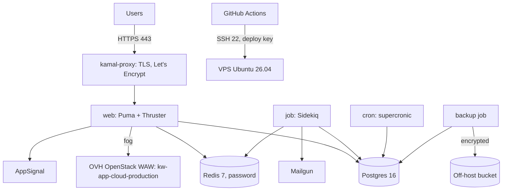

# New Production Implementation Plan

Status: **PLAN ONLY, nothing below has been applied to the new VPS.** Written 2026-11-17 on branch `develop`.

Goal: move kw-app from the old native server (`51.68.141.247`) to the new OVH VPS (`51.255.38.227`) running Kamal + Docker, with a hardened host, working background jobs and cron, tested backups and a rehearsed, reversible cutover.

Related: `.rules` section 14 (hosts), `.agents/skills/prod-db-restore` (1:1 DB restore + verify), `.agents/skills/scp-transfer` (fetching the prod dump), `.agents/skills/bws-secrets` (secrets, rotation backlog), `.agents/skills/kamal-deployment`.

Legend: **[V]** verified on a real host or in the repo on 2026-11-17, **[R]** recommendation, **[?]** open question that needs a decision or investigation, **[ASK]** needs explicit user approval first (`.rules` section 8).

---

## 1. Current state

### 1.1 Old production `51.68.141.247` [V] (read-only)

| Item | Value |
|------|-------|
| OS / size | Ubuntu 20.04.6 (EOL standard support), 1 vCPU, 2 GB RAM, 20 GB disk at 84% |
| Shared host | Also runs PHP-FPM, MariaDB, ~9 other nginx sites, PostgreSQL 10 **and** 12 |
| App runtime | Ruby 2.6.6 (rbenv), nginx + Passenger, Capistrano-style `releases/` |
| Public host | `panel.kw.krakow.pl` (nginx `server_name`, Let's Encrypt via Certbot) |
| Background jobs | systemd `sidekiq.service`, queues `default` + `mailers`, native Redis with password |
| Cron | 10 jobs from `config/schedule.rb` (whenever), run from the user crontab |
| Backups | 03:15 `kw-db-backup` runner, 7-day local retention, **off-host copy is in ERROR** |
| Local files | `shared/public/uploads` 1.7 GB (2001 files, 9 changed in the last 30 days) [?] |

### 1.2 New production `51.255.38.227` [V]

| Item | Value |
|------|-------|
| Provider | OVH VPS, created 2026-11-17, hostname `vps-fb065f1c` |
| OS | **Ubuntu 26.04 LTS (codename `resolute`)**, kernel 7.0, brand new release |
| Size | 2 vCPU, 3.8 GB RAM, 38 GB disk, no swap, IPv4 + IPv6 |
| Access | `ubuntu` with our key only (`SHA256:cVosxEG...`, verified, exactly 1 key in `authorized_keys`), passwordless sudo |
| Docker | **Not installed** |
| Firewall | UFW installed but **inactive**; listening only on `:22` |
| SSH | Password login **still enabled** (`50-cloud-init.conf` sets `PasswordAuthentication yes` and wins over `60-cloudimg-settings.conf`) |
| fail2ban | Not installed; unattended-upgrades active; chrony/NTP synced; AppArmor loaded (178 profiles) |
| Docker packages | Official repo `download.docker.com/.../resolute` returns 200; Ubuntu archive also has `docker.io` 29.1.3 |

### 1.3 Staging `pi5main.local` [V]
Kamal `web` role + `kw-app-staging-postgres` + `kw-app-staging-redis`. **No Sidekiq and no cron are deployed there.** Also hosts unrelated apps. Note: containers `kw-app-postgres` / `kw-app-redis` (no `staging`) also exist on the Pi. Check what they are before using the `new-prod` restore profile anywhere near the Pi.

---

## 2. Gaps found in the repo (must be closed before cutover)

| # | Finding | Evidence | Impact | Fix (phase) |
|---|---------|----------|--------|-------------|
| G1 | **No Sidekiq role** in Kamal. Old prod runs `sidekiq.service`; 32 files enqueue jobs (`deliver_later`, `perform_async`) | `config/deploy*.yml` have only `servers.web`; `Procfile` is unused by Kamal | Mail, reminders, payments follow-ups would pile up in Redis and never run | P4 |
| G2 | **No cron** for the 10 whenever jobs | `config/schedule.rb`; nothing in Kamal | Prepaid e-mails, reminders, sign-up cleanup, yearly fee never run | P4 |
| G3 | **Hostname mismatch**: live host is `panel.kw.krakow.pl`, Kamal/Rails use `nowypanel.kw.krakow.pl` | nginx on old prod vs `deploy.production.yml`, `production.rb` (`default_url_options`, route host) | Links in e-mails, Dotpay/Strava/Mailgun callbacks and inbound `reply+...@panel.kw.krakow.pl` depend on the host | Decision D1 |
| G4 | `proxy.ssl: true` makes kamal-proxy **stop forwarding `X-Forwarded-*`**, and `force_ssl` is **commented out** | Kamal proxy docs; `production.rb` line 55 | App does not know it is on HTTPS (cookies, redirects, URL helpers); enabling `force_ssl` without `forward_headers: true` causes a redirect loop | P4 |
| G5 | `app_port: 3000` bypasses **Thruster** (it listens on 80 and proxies to 3000) | `Dockerfile.production` CMD `thrust ...`, `deploy.yml` `app_port: 3000` | Thruster compression/asset caching unused. Harmless but misleading | P4 |
| G6 | `config/init.sql` runs `CREATE DATABASE kw_app_production` while `POSTGRES_DB` already creates it | `deploy.production.yml` accessory | Postgres init script runs with `ON_ERROR_STOP`, so first boot of the accessory **will likely fail**. Verify on a scratch container, then drop the file | P4 |
| G7 | Custom Docker network `kw-app-network` is referenced by app and accessories but **Kamal does not create it** | `options.network` in all deploy files | `kamal setup` fails on a clean host | P2 (create it) |
| G8 | Redis URLs: Sidekiq initializer needs `REDIS_URL_SIDEKIQ` (or `credentials.redis.url`); Action Cable needs `REDIS_URL` | `config/initializers/sidekiq.rb`, `config/cable.yml` | Falls back to `localhost` inside the container, jobs and cable silently break | P4 (set in `env.clear`, verify without printing credentials) |
| G9 | Local uploads (`public/uploads`, 1.7 GB) are not on a volume. `CsvUploader` uses `storage :file`; everything else is `:fog` (OpenStack) | `app/uploaders/*`, old prod `shared/public` | Container has no persistent volume, files written locally are lost on every deploy | D4, P5 |
| G10 | `log_level :debug` in production, no Docker log rotation | `production.rb` line 59 | Disk fills, noisy logs with PII | P4 / P2 |
| G11 | Production workflow: secret written with `echo "${{ secrets... }}"` (script injection pattern), `cat` of `known_hosts` and `ssh/config`, `ssh-keyscan` at deploy time (trust on first use), 5 of 7 bws values not `::add-mask::`ed, `gem install kamal` unpinned (lockfile has 2.10.1), actions not pinned, no environment protection | `.github/workflows/deploy-production.yml` | Secret leakage / MITM / supply-chain risk | P3 |
| G12 | Ruby **3.2.2** (EOL 2026-03-31, latest 3.2.11), Rails **7.0.10** (EOL 2025-04-01), base image `ruby:3.2.2-slim` unpatched | `.ruby-version`, `Gemfile.lock`, `Dockerfile.production`; endoflife.date | Unpatched CVEs on an internet-facing app | P0 (patch bump) + separate upgrade track |
| G13 | No CI security gates besides tests (`brakeman` is in the Gemfile, no `bundler-audit`, no `rack-attack`) | `Gemfile`, `.github/workflows/test.yml` | No automated dependency/CVE checks, no app-level rate limiting on login | P3 / P4 |
| G14 | Sidekiq Web is mounted at `/sidekiq` behind `authenticate :user, admin?` | `config/routes.rb` | OK, keep. Do not expose any other admin surface | none |
| G15 | Registry creds are one account for push and pull; the server stores the pull token in `~/.docker/config.json` | Kamal registry login | Compromised host leaks push rights | P3 (scoped Docker Hub token) |

---

## 3. Decisions needed from you

| ID | Decision | Options | My recommendation |
|----|----------|---------|-------------------|
| D1 | **Final public hostname** | (a) keep `panel.kw.krakow.pl` and flip its DNS; (b) switch everyone to `nowypanel.kw.krakow.pl` | (a). External integrations (Mailgun inbound routes, Dotpay, Strava webhook, saved links, e-mail reply addresses) are tied to `panel`. Use `nowypanel` only for rehearsal. Then change `production.rb`/deploy config to `panel` |
| D2 | **Cutover window** | Weeknight late vs. weekend morning | Weekend early morning, announce 1 h read-only/maintenance. Cron jobs are 04:30-08:30 daily and `*/30 8-23`, so avoid 04:15-04:45 |
| D3 | **Upgrade first or migrate first?** | Ruby/Rails upgrade before vs after infra move | **Migrate first on the current stack** (Ruby 3.2.11 patch bump only), then upgrade Ruby/Rails as its own project. Combining them makes failures impossible to attribute |
| D4 | Local `uploads` | Move to a Docker volume + rsync / migrate to OpenStack / drop if legacy | Investigate first (P0.4). Likely: rsync once to a named volume mounted at `public/uploads`, then fix `CsvUploader` to `:fog` later |
| D5 | Off-host backup target | OVH Object Storage (S3, same provider), Backblaze B2, a second VPS | OVH or B2 bucket, client-side encrypted (restic), credentials in bws |
| D6 | SSH exposure | Open 22 to the world + fail2ban, restrict to known IPs, or WireGuard/Tailscale | World-open 22 with key-only + fail2ban is acceptable (GitHub-hosted runners have dynamic IPs). Stronger option: self-hosted runner/laptop deploys + SSH limited to a VPN. Your call |
| D7 | Keep or retire old prod | Keep stopped for N days | Keep intact (stopped app, DB running) for 14 days after cutover, then wipe |

---

## 4. Target architecture



Principles: only 22/80/443 reachable from outside; Postgres and Redis only on the Docker network (no published ports); secrets only from bws at deploy time; every state-changing step has a rollback.

---

## 5. Phases

Each phase has an exit gate. Do not start the next one until the gate is green. Items marked [ASK] need your approval at that moment.

### P0. Prerequisites in the repo (develop only, no server changes)
1. [R] Bump Ruby **3.2.2 -> 3.2.11** in `.ruby-version`, `Dockerfile.production`, `Dockerfile`, workflows; run the suite in Docker; deploy to staging. [ASK] (pushing to `develop` auto-deploys staging).
2. [R] Add `bundler-audit` and a `brakeman` step to `.github/workflows/test.yml` (new gem = [ASK]).
3. Fix the code gaps that do not need the server: Sidekiq/cron roles drafted in a branch (P4), `force_ssl`, `config.hosts`, log level, `init.sql` check on a scratch Postgres 16 container.
4. [?] Classify `public/uploads` on old prod: which model/uploader owns each file group, which are still referenced by DB rows, what writes the recent 9 files (likely CSV exports). Read-only.
5. [?] Inventory external callbacks bound to the host: Mailgun routes/webhooks (inbound `reply+...@panel.kw.krakow.pl`), Dotpay URLC/return URLs, Strava webhook subscription, any OAuth redirect URIs. List them with where each is configured.
6. Rehearse the whole restore path on staging first (`prod-db-restore` skill, `staging` profile). Already rehearsed on a scratch DB; do the real one before touching new prod.

Gate: suite green, staging deployed on the patched Ruby, callback inventory and uploads classification written down.

### P1. Host hardening (Ubuntu 26.04) [ASK before each batch]
Order matters: **never close the current SSH session until a second, new session proves access.**

1. **Updates**: `apt update && apt full-upgrade`, reboot if `/var/run/reboot-required`. Add a 2 GB swapfile (box has none).
2. **Users**: keep `ubuntu` as the admin (sudo). Create `deploy` (no sudo, member of `docker` after P2, own key). `docker` group is root-equivalent, so only the deploy key and CI use it. Lock root password; keep `PermitRootLogin no`.
3. **SSH** via a drop-in that sorts first (`/etc/ssh/sshd_config.d/00-hardening.conf`), because the first value wins and `50-cloud-init.conf` currently enables passwords:
   ```
   PasswordAuthentication no
   KbdInteractiveAuthentication no
   PermitRootLogin no
   PubkeyAuthentication yes
   AllowUsers ubuntu deploy
   MaxAuthTries 3
   LoginGraceTime 20
   X11Forwarding no
   AllowAgentForwarding no
   ```
   Validate with `sshd -t`, then `sshd -T | grep -E 'passwordauthentication|permitrootlogin'`, reload (not restart), open a **new** session, only then close the old one.
4. **Firewall (UFW)**, IPv6 included (`IPV6=yes`): default deny incoming, allow `22/tcp` (use `ufw limit`), `80/tcp`, `443/tcp`. **Docker bypasses UFW for published ports**, so: publish nothing but kamal-proxy (80/443), do not publish Postgres/Redis at all, and add the `DOCKER-USER` chain rule set (ufw-docker pattern) as defence in depth. Verify from outside with `nmap -Pn` (laptop and one more network).
5. **fail2ban**: `sshd` jail with `backend = systemd` (Ubuntu 26.04 uses journald; the old Ansible playbook used `/var/log/auth.log`, which may not exist), `maxretry 4`, `bantime 1h` increasing, `ignoreip` = our fixed IPs.
6. **Automatic security updates**: `unattended-upgrades` (security pocket only), `Automatic-Reboot` at a quiet hour (e.g. 05:00 Sun) or use Ubuntu Pro Livepatch (free for personal use, up to 5 machines) and reboot manually. `needrestart` in automatic mode.
7. **Kernel/network sysctl** (`/etc/sysctl.d/90-hardening.conf`): `rp_filter`, `accept_redirects=0`, `send_redirects=0`, `tcp_syncookies=1`, `kernel.dmesg_restrict=1`, `kernel.kptr_restrict=2`, `fs.protected_hardlinks/symlinks=1`. Do **not** disable IPv4 forwarding (Docker needs it).
8. **Logging**: persistent journald with size cap (`SystemMaxUse=500M`), `auditd` with a small ruleset (sshd, sudo, docker socket, `/etc/ssh`), optional.
9. **OVH side**: enable the VPS **automated backup / snapshot** option, record the KVM/console access path (this is your recovery if SSH breaks), verify reverse DNS/IPv6, enable OVH 2FA on the account.
10. **Acceptance**: run `lynis audit system` (or Ubuntu Security Guide, Ubuntu Pro) and keep the report; target hardening index >= 80 and zero "warning" on SSH/firewall.

Gate: password SSH rejected from outside, only 22/80/443 open on both IPv4 and IPv6, `fail2ban-client status sshd` active, second session test passed, snapshot taken.

### P2. Docker engine and Kamal prerequisites [ASK]
1. Install Docker from the **official apt repo** (`docker-ce`, `containerd.io`, `docker-buildx-plugin`; confirm the codename with `lsb_release -cs` = `resolute`). Fallback: Ubuntu `docker.io` 29.1.x. Do not pipe-install; Kamal's `server bootstrap` can be skipped because Docker is already present.
2. `/etc/docker/daemon.json`: `{"log-driver":"local","log-opts":{"max-size":"20m","max-file":"5"},"live-restore":true,"no-new-privileges":true}` then restart Docker. (`log-driver local` plus rotation fixes G10 on the host side.)
3. Add `deploy` to the `docker` group. Verify `docker run --rm hello-world` as `deploy`.
4. **Create the network Kamal expects (G7)**: `docker network create kw-app-network`.
5. Data dirs for accessories (Kamal creates them under the deploy user's home; confirm ownership and that they sit on the 38 GB disk with room for growth; DB is 86 MB raw, uploads volume per D4).
6. Weekly `docker system prune` for dangling images only (never volumes). Kamal keeps `retain_containers: 3`.

Gate: `docker info` clean, `deploy` can run docker without sudo, network exists, nothing but SSH listening publicly.

### P3. Secrets and CI/CD for production [ASK, touches deploy config and workflows]
1. **New dedicated deploy key**: `ssh-keygen -t ed25519` for CI only, installed for `deploy` (not `ubuntu`). Store the private key in the GitHub `production` **Environment** secret, not repo-wide.
2. **Pin the host key**: store the VPS host key fingerprint/known_hosts line as an Environment variable and write it in the workflow. Remove `ssh-keyscan`. Remove all `cat ~/.ssh/...` echoes.
3. Write the key via `printf '%s' "$KEY"` from an `env:` variable, never `${{ secrets.X }}` inside the script body.
4. `::add-mask::` every bws value before it goes to `$GITHUB_ENV` (5 are currently unmasked).
5. Pin: `gem install kamal -v 2.10.1` (match `Gemfile.lock`), actions by commit SHA, bws CLI version/checksum.
6. `permissions: contents: read`, GitHub Environment `production` with **required reviewer** and branch restriction to `main`; keep the `concurrency` group.
7. Make production deploy depend on a green test run (`workflow_run` or `needs`).
8. **Registry**: Docker Hub **access tokens**: one read/write for CI, one read-only for the server if Kamal config allows a separate pull credential; otherwise at minimum a scoped token instead of the account password. Confirm the `regedarek/kw-app` repository is **private**.
9. **bws**: create a production-only machine account with read access limited to the production secrets (web UI only), keep the shared `panel` token out of the production environment. Keep the rotation backlog in `.agents/skills/bws-secrets/SKILL.md` for **after** the migration (decision recorded: rotate after cutover).
10. Production secrets needed in bws (names): master key, Postgres password, Redis password, AppSignal key, Strava token, registry creds, **new**: backup encryption key, off-host bucket credentials, deploy SSH key (as backup copy). Never created by echoing values.

Gate: a dry deploy run (`kamal config`/`kamal lock status` on the runner) succeeds with no secret printed in the log, and a log review confirms masking.

### P4. Kamal and Rails production configuration [ASK]
All in `config/deploy.production.yml`, `config/deploy.yml`, `Dockerfile.production`, `config/environments/production.rb`. Production `env.secret` **replaces** the base list, so every secret name goes in both files (existing pitfall).

1. **Host/user**: `servers.web.hosts` and the accessory `host:` -> `51.255.38.227`; `ssh.user` -> `deploy`; repoint `bin/migrate-database-to-new-prod`, `bin/verify-migration`, `profiles/new-prod.env` (they still target the obsolete `146.59.44.70`).
2. **Hostnames**: `proxy.hosts: [panel.kw.krakow.pl, nowypanel.kw.krakow.pl]` for the rehearsal, final per D1. Update `default_url_options`, `routes.default_url_options`, `ASSET_HOST`.
3. **TLS/proxy**: keep `ssl: true`, add `forward_headers: true` (G4), keep `/up` healthcheck, set `response_timeout` and `buffering.max_request_body` to what uploads need. Decide Thruster vs direct (G5), keep one.
4. **Rails**: `config.force_ssl = true` with `ssl_options: { redirect: { exclude: ->(r) { r.path == '/up' } } }`, `config.hosts` allow-list (exclude `/up`), `log_level = :info`, `config.log_tags = [:request_id]`, make sure `filter_parameter_logging` covers tokens/IBAN/PESEL-like fields. Secure/HttpOnly/SameSite=Lax session cookie (`session_store.rb` currently has only the key).
5. **Sidekiq role (G1)**:
   ```yaml
   servers:
     job:
       hosts: [51.255.38.227]
       cmd: bundle exec sidekiq -e production -C config/sidekiq.yml
       proxy: false
       options: { network: "kw-app-network" }
   ```
   Decide the queue list: old prod runs `default` + `mailers` only, `config/sidekiq.yml` also lists `critical` and `low`. Run all four so nothing is orphaned. Concurrency 5 is fine for 2 vCPU; each Sidekiq/Puma process is ~200 MB, budget the 3.8 GB RAM (Postgres ~1 GB, Redis ~100 MB, web ~400 MB, job ~400 MB, cron ~200 MB).
6. **Cron role (G2)**: add a `cron` role running **supercronic** (single static binary, container-friendly, logs to stdout, no `cron` package or root needed), crontab file committed and generated from `config/schedule.rb` (`whenever --update-crontab` output, reviewed). Must run on **exactly one** host and **never on staging**. Disable the old prod crontab at cutover, never both.
7. **Redis/DB env (G8)**: `REDIS_URL`, `REDIS_URL_SIDEKIQ` in `env.clear` pointing to `kw-app-redis` (without the password; password via `REDIS_PASSWORD` secret), verified from a `kamal app exec` smoke command that prints only `PONG`/ok.
8. **Postgres accessory**: pin `postgres:16.x` (latest 16 minor, not `16.0`), remove published `port:` (reach it with `kamal accessory exec`/`docker exec`), drop `init.sql` (G6), tune for 3.8 GB: `-c shared_buffers=768MB -c effective_cache_size=2GB -c work_mem=8MB -c maintenance_work_mem=128MB -c max_connections=60 -c log_min_duration_statement=500`, `scram-sha-256` (default in 16). Healthcheck (`pg_isready`).
9. **Redis accessory**: password, `appendonly yes`, `maxmemory 256mb`, **`maxmemory-policy noeviction`** (Sidekiq requires it), no published port.
10. `retain_containers: 3` stays; add `--memory`/`--cpus` limits on `job` and `cron` so a runaway job cannot starve Postgres; `restart: unless-stopped` (Kamal default).
11. `Dockerfile.production`: base `ruby:3.2.11-slim`, install `supercronic` with a pinned checksum, keep non-root user (already `USER 1000`), consider `.dockerignore` covering `.git`, `config/master.key`, `.kamal/`, `node_modules`.
12. Validate with the Kamal config loader in the app container (`docker-compose exec -T app bundle exec kamal config -d production` with dummy env). **Do not run `kamal secrets print`.**

Gate: `kamal config -d production` OK, both deploy files list the same secret names, specs green, a staging deploy of the same code (with the new roles) healthy.

### P5. Data and files strategy
1. **Database**: use `prod-db-restore` with the `new-prod` profile (fill in container `kw-app-postgres`, user `production_user`, DB `kw_app_production`, web filter; verify values over SSH first). Old Postgres is **10.23**, new is 16, so it is a logical restore (no pg_upgrade), which the skill already does; `verify` compares rows + content digest + sequences + structure.
2. **Migrations** run on the restored data (`migrate`, then `verify --after-migrate`). Production `database.yml` has no env override for the DB name, so rehearse on the new host in the real DB name before cutover, then restore again at cutover.
3. **Uploads (D4)**: rsync `shared/public/uploads` to a Docker volume on the VPS, mounted at `/rails/public/uploads` (`servers.web.volumes` and the job role), then re-rsync the delta at cutover. OpenStack files need no migration if new prod uses the same container `kw-app-cloud-production` (credentials come from `production.yml.enc`); confirm which container name is used per `Rails.env`.
4. **Redis/Sidekiq state**: do **not** copy Redis. Old prod runs Sidekiq/Ruby 2.6 payloads; new is Sidekiq 7.3. Instead drain: stop enqueuing, wait for queues to reach 0, list the `scheduled` and `retry` sets (export, then re-enqueue on new prod if any). Sessions are cookie-based so no user logs out because of Redis.
5. **Backups on new prod (replace the broken off-host copy)**:
   - nightly `pg_dump -Fc` in the Postgres container to `/var/backups/kw-app`, 7 daily + 4 weekly + 6 monthly, with a manifest (sha256, row-count digest via `table_digest.py`) like the current runner;
   - `restic` (or equivalent) client-side encrypted copy to the off-host bucket (D5), credentials from bws, **alert on failure** (Gatus/healthchecks ping, not silent like today);
   - weekly automated **restore test** into a scratch DB with `verify`;
   - OVH VPS snapshot as the third layer (not a substitute: snapshots are crash-consistent only);
   - targets: RPO 24 h (nightly) or lower with WAL archiving if you want it, RTO under 2 h.

### P6. Observability and alerting
1. AppSignal: confirm the new host reports (env key `APPSIGNAL_PUSH_API_KEY`, `APPSIGNAL_ENVIRONMENT` / hostname label distinguishes new vs old during overlap).
2. Uptime: external check of `https://<host>/up` (Gatus runs on the Pi at home, so add a check from outside your own network, e.g. a hosted monitor), plus TLS-expiry alert at 14 days.
3. Host metrics: the Pi already runs `beszel`/`beszel-agent`, so add a `beszel-agent` container on the VPS (disk, RAM, swap, Docker). Alert at 80% disk, 90% RAM, swap in use.
4. Logs: Docker `local` driver with rotation; `kamal app logs`; AppSignal for errors. Decide retention (e.g. 14 days) given PII.
5. Security alerts: fail2ban ban digest and unattended-upgrades result by e-mail (use Mailgun SMTP or a script) so you see them.

### P7. Rehearsal on the new VPS (no real traffic)
1. `kamal setup -d production` with a **temporary hostname** (`nowypanel.kw.krakow.pl` pointed at the VPS; lower TTL first). This boots kamal-proxy, Postgres, Redis, web, job, cron.
2. Restore the latest prod dump with the skill (`preflight`, `restore`, `verify`, `migrate`, `verify --after-migrate`), then smoke-test through the real UI as admin and as a normal member: login, sign-up for an event, a payment sandbox flow, file upload/download, PDF generation, an e-mail send **to a safe address**, Sidekiq UI, one cron task run by hand, Strava webhook verification (token from bws).
3. **Mail safety**: new prod has real Mailgun credentials and real member e-mails after a 1:1 restore. During rehearsal run with delivery redirected (`MAILGUN` interceptor to a test inbox or `config.action_mailer.perform_deliveries = false` via env), and keep the cron role **stopped** until cutover.
4. Performance baseline: 20 concurrent users on the heaviest pages (e.g. `ab`/`k6`) against the 2 vCPU box; compare with old prod AppSignal p95. Check memory with `docker stats` under load.
5. Failure drills: reboot the VPS (everything must come back by itself), kill the web container, fill Redis, run a deploy with a failing migration (zero-downtime preserved?), restore a backup into a scratch DB.
6. Repeat the full restore at least twice; the second must be a stopwatch rehearsal of the cutover steps.

Gate: two clean rehearsals, timings recorded, backup + restore test green, hardening report attached, callback inventory (P0.5) fully mapped to the new host.

### P8. Cutover runbook (target: < 30 min downtime)
**T-7 days**: lower DNS TTL of `panel.kw.krakow.pl` to 60 s; announce the window; freeze deploys to `main`; confirm snapshots and backups are fresh; pre-sync `uploads`.
**T-1 h**: final rehearsal checks (VPS healthy, disk, Docker, disk space), confirm rollback owner and chat channel.

1. Put old prod in **maintenance** (nginx maintenance page for the panel vhost only; other sites on that box keep running).
2. On old prod: stop `sidekiq.service` after queues reach 0; record `scheduled`/`retry` set sizes; comment out the 10 cron entries.
3. Take the final dump (`pg_dump` read-only; fetch with the `scp-transfer` skill) and the final `uploads` delta (rsync).
4. On new prod: `restore`, `verify` (must be 100%), `migrate`, `verify --after-migrate`.
5. Start `web`, then `job`, then `cron` (in that order). `kamal app details`, `/up` 200, AppSignal receiving.
6. **Update external callbacks** (Mailgun inbound routes/webhooks, Dotpay, Strava, anything from P0.5).
7. Flip DNS `panel.kw.krakow.pl` A (and AAAA if IPv6) to `51.255.38.227`. Wait for kamal-proxy's Let's Encrypt issuance on first HTTPS request (may take 5-30 s, watch `kamal proxy logs`). **Pre-check with `curl --resolve`** before the flip so you know the app responds with the right Host.
8. Smoke test (checklist from P7), watch AppSignal and Sidekiq for 30 min; send one real test e-mail; confirm a cron task runs at its next slot.
9. Remove the maintenance page only on the **old** server and route nothing there.

**Rollback (any time up to T+14 days):** point DNS back to `51.68.141.247`, re-enable Sidekiq and cron there, remove maintenance. Data written on new prod after the flip is lost unless reverse-dumped, so the rule is: **decide go/no-go within the first 30 min**; after that, roll forward, not back. Keep old prod's DB and app intact and stopped (D7).

### P9. After the migration
1. Rotation backlog (`bws-secrets` skill, **master key last**, together with re-encrypting `production.yml.enc`).
2. Remove `config/master.key` and the `secrets.yml` exposure from `main`; rewrite history only if you decide it is worth it (ask first).
3. Update `.rules` section 14, `scp-transfer`, `prod-db-restore`, `kamal-deployment` (still describes Ansible/Passenger-era flow), `AGENTS.md`; delete deprecated `ansible/` and the obsolete `146.59.44.70` references.
4. Decommission old prod after D7: final dump archived off-host encrypted, drop `kw_app_production` data, remove SSH keys, cancel/resize the VPS.
5. Start the **Ruby/Rails upgrade track** (D3): Ruby 3.3 -> 3.4, Rails 7.0 -> 7.1 -> 7.2 -> 8.1 (8.0 reached EOL 2026-11-07; 7.2 EOL 2026-08-09), one minor at a time on `develop`/staging, test-first, with `bundler-audit` and Brakeman as gates.
6. Quarterly: restore test report, Lynis rerun, package and image updates (Postgres/Redis minor tags), SSH key review, bws rotation review.

---

## 6. Risks and mitigations

| Risk | Likelihood | Mitigation |
|------|-----------|------------|
| Locked out of the VPS while hardening SSH | Medium | Second session before closing the first, OVH console/KVM as break-glass, snapshot before P1 |
| Docker published ports bypass UFW | High if ignored | No published DB/Redis ports, `DOCKER-USER` rules, external `nmap` check |
| Sidekiq/cron missing on new prod | **Certain today** (G1, G2) | P4 roles + rehearsal task checks |
| Duplicate cron/mail (old + new both running) | Medium | Explicit checklist step to disable old cron/Sidekiq, cron role stopped until cutover |
| Real e-mails sent from rehearsal data | Medium | Delivery interception during P7, cron stopped |
| PG10 -> 16 behavioural differences | Low-Medium | Logical restore + `verify` + migrations + full UI smoke; watch collations/ordering in sorted lists |
| Callbacks (Dotpay/Mailgun/Strava) still on old host | Medium | P0.5 inventory, P8 step 6, test payment in sandbox |
| Let's Encrypt issuance fails at cutover (rate limits/DNS) | Low | Rehearse issuance on `nowypanel`; keep DNS TTL low; fallback custom certificate via `proxy.ssl.certificate_pem` from bws |
| Memory pressure on 3.8 GB | Medium | Swap, container memory limits, Postgres tuning, load test (P7) |
| Ubuntu 26.04 is a very new release (fewer field reports, kernel 7.0) | Low-Medium | Stay on `docker-ce` supported packages, test reboot, snapshot; fallback is reinstalling 24.04 LTS in OVH before any data lands |
| Secret exposure during deploys | Medium | P3 workflow fixes, environment protection, masking |
| EOL Ruby/Rails | Certain | Patch bump now (P0), upgrade track after cutover (D3), WAF-like limits (`rack-attack` [ASK]) |

---

## 7. Execution order (summary checklist)

- [ ] D1-D7 answered
- [ ] P0 repo prerequisites, staging real restore, callback + uploads inventory
- [ ] P1 hardening + snapshot
- [ ] P2 Docker, network
- [ ] P3 deploy key, workflow fixes, production bws machine account
- [ ] P4 Kamal/Rails config (staging-tested)
- [ ] P5 backup pipeline live and restore-tested
- [ ] P6 monitoring and alerts
- [ ] P7 two rehearsals green
- [ ] P8 cutover (announce, maintenance, restore, flip, verify)
- [ ] 14-day watch, then P9 decommission, rotation, docs, upgrade track

## 8. Approvals needed per `.rules`
Deploy-config edits (`config/deploy*.yml`, workflows) = ask; gems (`bundler-audit`, `rack-attack`) = ask; any write on old prod = ask (dump with `pg_dump`, maintenance page, stopping Sidekiq); migrations = ask; push to `develop` (auto-deploys staging) and to `main` (deploys production) = ask. Nothing in this plan will be executed without the matching approval.
